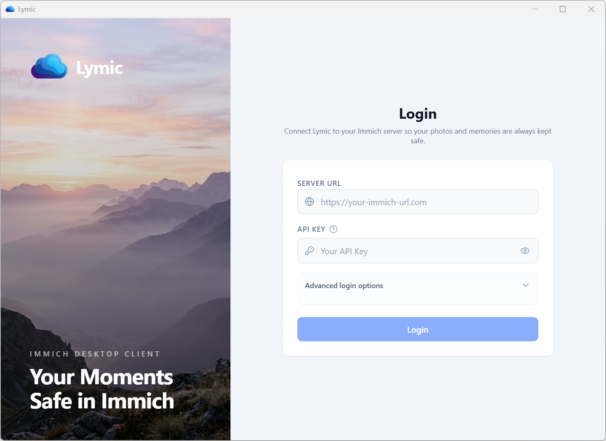
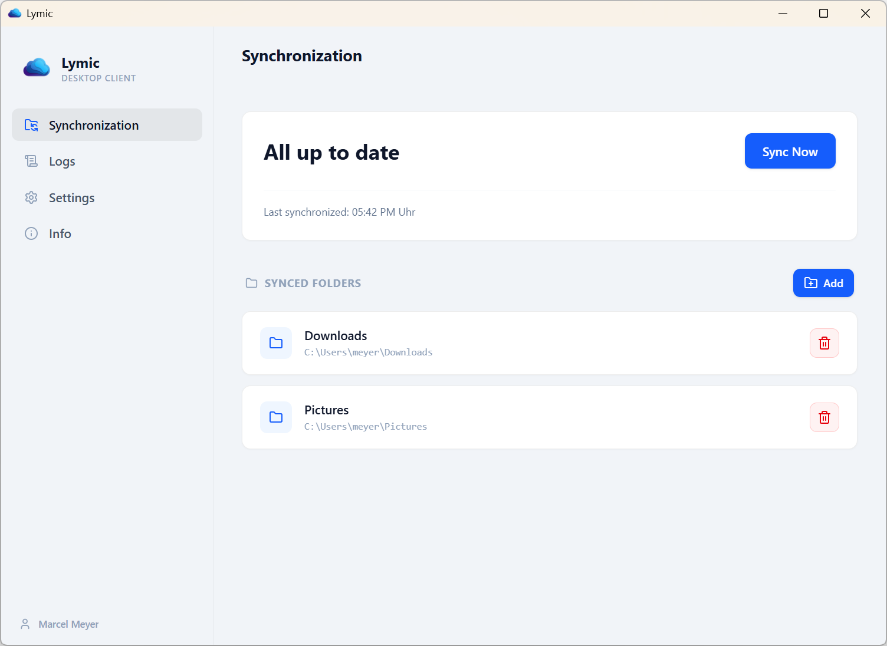
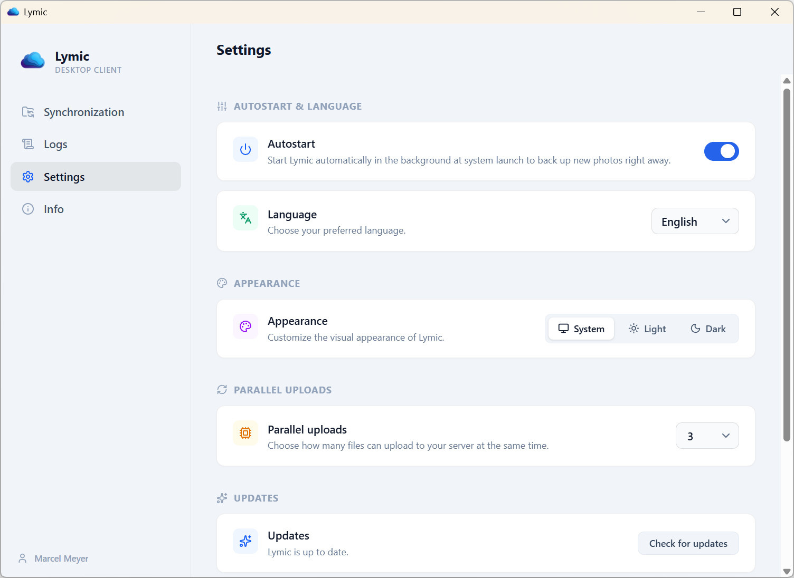

<p align="center">
  
</p>

# Lymic — Desktop upload client for Immich

[](LICENSE)
[](https://apps.microsoft.com/store/detail/9NLQWHTHR1FZ?cid=DevShareMCLPCS)
[](https://snapcraft.io/lymic)
[](https://tauri.app/)
[](https://kit.svelte.dev/)

**Lymic** is an unofficial, cross-platform desktop client for uploading and synchronizing local media with [Immich](https://immich.app/). It watches selected local folders, detects supported media, avoids uploading assets that already exist on Immich, and streams missing files from disk.

> Lymic is an upload-oriented client, not a two-way filesystem mirror. It does not download remote assets, mirror remote deletions, rename local files, or manage albums as part of its normal synchronization workflow.

<p align="center">
  
</p>

<p align="center">
  
  
</p>

---

## Features

- **Efficient synchronization** — Unchanged files reuse their cached SHA-1/Base64 after a current size-and-mtime check; only changed or uncached files are streamed for hashing, while Immich bulk checks prevent unnecessary transfers.
- **Folder watching** — Recursively monitors watched folders, handles changes with a debounce, and rescans after watcher overflow.
- **Large-file support** — Streams multipart uploads directly from disk without retaining full files in memory.
- **Durable queue** — Persists synchronization work, pause state, progress, and failures locally; failed items can be retried.
- **Secure credentials** — Stores API keys in the platform-native keyring (Keychain, Credential Manager, or Secret Service).
- **Desktop experience** — Provides real-time status, progress, system-tray controls, notifications, optional autostart, light/dark themes, and English/German UI.
- **Media-aware uploads** — Supports broad, extension-based media detection, recognized live-photo/motion pairs, and optional XMP sidecars.
- **Media timeline** — Responsive photo and video timeline with masonry layout, date scrubber, thumbnail caching, and full lightbox preview.
- **People discovery** — Browse recognized persons with cached avatars and filter the timeline by person.
- **Explore** — An overview after Photos with recognized people, places (cities) and memories; open a place or memory as a timeline. Read-only, and it needs the `asset.read`, `person.read` and `memory.read` API key permissions (see [Required Permissions](#required-permissions-scopes)).
- **Archive** — A read-only view of your archived photos and videos, directly after Favorites in the navigation, shown in the same timeline as Photos. Lymic never archives or unarchives anything; do that in Immich. It needs the `asset.read` API key permission (see [Required Permissions](#required-permissions-scopes)). Lymic requests only assets with archive visibility. Keeping Immich-trashed assets out relies on Immich's archive visibility filter, which was confirmed against Immich v3.4.1; keeping locked-folder assets out has not been verified. Archived items are not shown in the Photos and Favorites views, as in Immich's web app; they appear only in Archive.
- **Trash** — A view of the photos and videos in your Immich trash, directly after Archive in the navigation, shown in the same timeline as Photos. You can look at them, download them, and **Restore** them one at a time from the preview or several at once with multi-selection; restored items return to your Immich library without a confirmation. Lymic never moves anything to the trash and never deletes anything permanently or empties the trash; do that in Immich, which removes trashed items permanently after the retention period set on the server. Browsing needs the `asset.read` API key permission; Restore needs `asset.delete` (see [Required Permissions](#required-permissions-scopes)). The filter Lymic uses to list trashed items and the Restore call were checked against Immich v3.4.1 only; no minimum Immich version is claimed. If one selected item can no longer be restored (for instance because Immich already deleted it permanently), Lymic restores the others one by one and keeps the failed one selected. A local file whose copy is in the Immich trash counts as synced: Lymic never uploads it again and never restores it, still adds it to its folder's Target Album where Immich allows it, and shows a warning in the activity log that the file is in the Immich trash, so you can restore it here.
- **Tags** — A Tags entry after People shows your Immich Tags as a tree that follows their hierarchy (top level expanded, deeper levels collapsed, a colour dot where Immich has a colour). Select a Tag to open its **Tag Timeline**, in the same timeline as Photos with its full path as the title; Lymic shows whatever Immich returns for that Tag, so whether a parent Tag includes its child Tags' photos is not verified. The Lightbox shows a photo's Tags as chips in the Info panel, and selecting a chip opens that Tag's timeline; Back returns to where you came from. Read-only: Lymic never creates, changes, assigns or removes Tags. The tree needs the `tag.read` API key permission and a Tag Timeline needs `asset.read` (see [Required Permissions](#required-permissions-scopes)); a missing `tag.read` only disables the Tags view and the Tag filter of Search (Search itself keeps working). No minimum Immich version is claimed: the Immich release that added the Tag filter on timelines and the Tags of asset details has not been identified, and Tags were not tested against a live server.
- **Album browsing** — Browse accessible Immich albums with cover thumbnails and asset counts, and explore album media in a dedicated timeline view.
- **Search** — A search bar at the top of every view searches your whole Immich Library, read-only. Choose how the text is read: **Context** (what a photo shows, the default; needs Smart Search switched on in Immich), **Filename**, **Description**, **Folder Path** or **OCR** (text recognized in photos; needs OCR switched on in Immich). Narrow the Search with filters in the panel: Recognized People, Tags (chosen from the Tag hierarchy; several mean all of them, and only the chosen Tags count, not their child Tags), a date range, Location (country, state or region, city), media type, camera make, model and lens, Rating, Favorites, Archived Assets and Unfiled Assets (in no Album); all filters apply together and you can search with filters alone. Results without a Context text open chronologically in the same timeline as Photos (at most the 5,000 newest, with a notice when a Search was cut); Context results are shown in order of relevance as a flat grid (up to the best 1,000, loaded as you scroll). Back returns to where you searched from, and the text and filters stay for the session only. Search never changes anything in Immich and never shows trashed items. It needs **Immich 3.2 or later** (an older server shows a message naming the required version and every other view keeps working) and the `asset.read` API key permission, plus `person.read` for the Recognized People filter, `tag.read` for the Tag filter and `asset.view` for thumbnails and photos (see [Required Permissions](#required-permissions-scopes)). Search was checked against Immich 3.4.1; the 3.2 cut-off itself was not tested on a 3.2 server.

---

## Technology

| Layer | Technology |
|---|---|
| **Backend** | [Rust](https://www.rust-lang.org/) + [Tauri v2](https://tauri.app/) |
| **Frontend** | [SvelteKit](https://kit.svelte.dev/) + [TypeScript](https://www.typescriptlang.org/) |
| **Styling** | [Tailwind CSS v4](https://tailwindcss.com/) |
| **Icons** | [Lucide](https://lucide.dev/) |
| **Database** | [SQLite](https://sqlite.org/) via [SQLx](https://github.com/launchbadge/sqlx) |
| **Networking** | [Reqwest](https://github.com/seanmonstar/reqwest) (HTTP / multipart streaming) |

---

## Getting started

### Download

Download the latest installer for your operating system from the [Lymic releases](https://github.com/xXRoxXeRXx/lymic/releases) page.

#### Windows (Microsoft Store)

Windows users can install and update Lymic directly from the Microsoft Store:

[](https://apps.microsoft.com/store/detail/9NLQWHTHR1FZ?cid=DevShareMCLPCS)

```powershell
winget install 9NLQWHTHR1FZ
```

#### Linux (Snap)

Ubuntu and Linux users can install and update Lymic directly from the Snap Store:

[](https://snapcraft.io/lymic)

```bash
sudo snap install lymic
```

#### Arch Linux (AUR)

Arch Linux users can install Lymic from the AUR:

```bash
paru -S lymic-bin
# or
yay -S lymic-bin
```

#### macOS (Homebrew)

```bash
brew tap xXRoxXeRXx/tap
brew install --cask lymic
```

See the [Homebrew Cask guide](docs/homebrew-cask.md) for release automation and local installation verification.

> [!IMPORTANT]
> **macOS Users:** Since this is an open-source project without a paid Apple Developer certificate, macOS will block the app as "unidentified" or "damaged".
>
> **Option 1 (Recommended):**
> 1. Drag the app into your **Applications** folder.
> 2. **Right-click** (or Control-click) the app icon and select **Open**.
> 3. Click **Open** in the confirmation dialog.
>
> **Option 2 (If Option 1 fails):**
> If you still see the "App is damaged" message, run the following command in your terminal:
> ```bash
> xattr -cr /Applications/Lymic.app
> ```

### Building from Source

#### Prerequisites

- [Rust](https://www.rust-lang.org/tools/install) (latest stable)
- [Node.js](https://nodejs.org/) (v18+)
- OS-specific dependencies (see [Tauri prerequisites](https://tauri.app/start/prerequisites/))

#### Steps

1. **Clone the repository**
   ```bash
   git clone https://github.com/xXRoxXeRXx/lymic.git
   cd lymic
   ```

2. **Install dependencies**
   ```bash
   npm install
   ```

3. **Run in development mode**
   ```bash
   npm run tauri dev
   ```

4. **Build for production**
   ```bash
   npm run tauri build
   ```

---

## Connect to Immich

Generate an API key in the Immich web interface under **Account Settings → API Keys**, then enter the server URL and key in Lymic.

The server URL must use **HTTPS** by default and must not include embedded credentials, a query string, or a fragment. Redirects are intentionally disabled, so configure your reverse proxy to expose the final HTTPS endpoint directly.

### Local HTTP (Optional)

For a local development or self-hosted instance only, **Advanced login options** includes **Allow HTTP for local server**. This is off by default and permits HTTP only for `localhost`, IPv4 loopback addresses in `127.0.0.0/8`, and IPv6 loopback `[::1]`. LAN addresses, `.local` names, and public hosts remain HTTPS-only. HTTP exposes the API key to local network observers, so use it only when that tradeoff is intentional. The per-server choice is stored with the API key in the native keyring and redirects remain disabled.

### Cloudflare Access (Optional)

If Immich is protected by Cloudflare Access, open **Advanced login options** and enter a Cloudflare Access service-token client ID and client secret. Lymic sends them as `CF-Access-Client-Id` and `CF-Access-Client-Secret` only to the configured Immich endpoint, which is HTTPS by default or an explicitly opted-in loopback HTTP endpoint. Both values are stored with the API key in the native keyring and are omitted from logs. See [Cloudflare's service-token documentation](https://developers.cloudflare.com/cloudflare-one/identity/service-tokens/).

### Required Permissions (Scopes)

| Scope | Purpose |
|---|---|
| `asset.upload` | Transmit new media files to the server |
| `asset.read` | Verify whether a file already exists before uploading; Archive: browse archived photos and videos; Trash: browse trashed photos and videos; Search: every search, its suggestions and its city list (Immich 3.2 or later) |
| `album.read` | List available target albums |
| `album.create` | Create a target album from the app |
| `albumAsset.create` | Add synchronized media to a target album |
| `user.read` | Retrieve the signed-in user during login |
| `person.read` | Explore: show recognized people; Search: the Recognized People filter |
| `memory.read` | Explore: show memories |
| `tag.read` | Tags: show the Tags tree; Search: the Tag filter |
| `asset.delete` | Trash: Restore trashed photos and videos (confirmed on Immich v3.4.1) |

Explore also uses `asset.read` (listed above) for places and place timelines. Each Explore section depends on its own permission: a key that lacks `person.read` or `memory.read` disables only the People or Memories section, and a key that lacks `asset.read` disables only Places, while the rest of Explore keeps working. The section explains the missing permission where it can. Memories additionally need a recent Immich server release; Lymic documents no minimum version. The Archive view needs only `asset.read`. Browsing the Trash view needs `asset.read`; Restore needs `asset.delete` in addition (confirmed on Immich v3.4.1). Without it you can still browse and download, and Restore shows a message naming the permission. Viewing thumbnails and photos in the timelines also needs `asset.view`.

The Tags view needs `tag.read` to list your Tags; opening a Tag Timeline needs `asset.read`, and its thumbnails and photos need `asset.view`. One missing permission only disables the Tags view and the Tag filter of Search: a key that lacks `tag.read` disables just those two, each of which names the missing permission and offers Retry; Photos, Explore, Search and every other view keep working. The Tags shown as chips in the Lightbox come with the photo's details and need no `tag.read`. Tags need a recent Immich server release; Lymic documents no minimum version.

Search needs `asset.read` and Immich 3.2 or later. A key without `person.read` disables only the Recognized People filter, and a key without `tag.read` disables only the Tag filter; each names its missing permission and everything else in Search keeps working. Results are shown with thumbnails and photos, which need `asset.view`. That the Tag filter's "all of them" holds on a live server has not been verified.

Lymic does not require `asset.delete` or `album.update` for synchronization, and it never deletes anything; `asset.delete` is needed only to Restore items from the Immich trash.

---

## How synchronization works

1. **Discover** — Lymic recursively scans watched folders at startup and when a folder is added. Filesystem events trigger later incremental work.
2. **Classify and hash** — It detects supported media, live-photo/motion pairs, and optional XMP sidecars. Files whose current size and mtime match their synchronized cache entry reuse its SHA-1/Base64; changed or uncached files are streamed to calculate it. Hashes are cached in SQLite alongside file metadata.
3. **Check** — SHA-1/Base64 values are sent to Immich's bulk check in batches; existing assets are skipped.
4. **Queue and upload** — Missing assets are written to the durable queue and streamed to Immich with configurable parallelism, using SHA-1/Base64 in the `x-immich-checksum` header.
5. **Record** — Completion and failure details are persisted and shown in the UI. Paused work can resume safely after a restart.

Duplicate and overlapping watched folders are rejected. Temporarily unavailable folders remain configured and are retried. Closing the main window hides Lymic to the system tray; use the tray menu to quit.

For complete synchronization behavior, supported pairing rules, security details, local-data retention, architecture, development checks, release workflow, and troubleshooting, see the **[full project documentation](docs/README.md)**.

---

## Contributing

Contributions are welcome! Please read [CONTRIBUTING.md](CONTRIBUTING.md) before opening a pull request.

---

## Disclaimer

**Lymic is an unofficial community project and is not affiliated with, maintained, or endorsed by the official Immich team.** Use it at your own risk. Always keep backups of your precious media.

---

## License

This project is licensed under the [MIT License](LICENSE).

---

<p align="center">
  Made with ❤️ for the Immich Community
</p>
