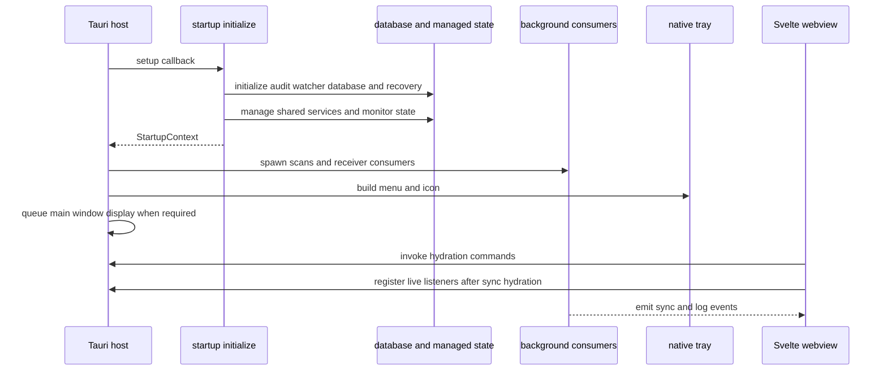
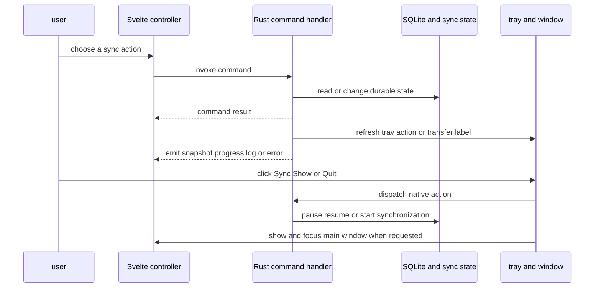

# Desktop Runtime Architecture

Lymic is a Tauri desktop application. The Svelte 5 webview owns presentation and interaction state; the Rust host owns operating-system integration, credentials, persistence, filesystem watching, synchronization, and Immich communication. The boundary is named Tauri commands for request/response operations and serialized events for asynchronous changes, not shared in-process state.

## Composition root and startup order

`src-tauri/src/main.rs` enters `lib::run`, which delegates to `app::run`. The Tauri builder installs opener, notification, autostart, dialog, process, and updater plugins. Its `setup` callback is the composition root: it decides whether an autostart launch remains hidden, initializes host state, spawns background consumers, creates the tray, and, when needed, queues showing the main window on the native main thread. The invoke handler is the authoritative command registry for authentication, albums, folders and removable-media acceptance, synchronization, settings, webview startup probes, and the database-recovery notice.

The ordering is an invariant: `startup::initialize` completes and manages shared state before `background::spawn` starts tasks that retrieve that state from `AppHandle`. Tray setup follows background spawning. Initialization and tray-build errors propagate from `setup`; the runtime does not reach a healthy event loop. Audited startup phases record readiness and failure milestones, tray setup, main-window display, and event-loop readiness.

This sequence shows the startup and background handoff: the host state exists before workers use it, while the webview hydrates durable state before following later event updates.

### Required startup and recovery

`startup::initialize` performs the following work:

1. It creates and manages the `AuditLogger`, then records subsequent startup phases through it.
2. It creates the bounded watcher-event channel with capacity 4,096, an overflow flag and notification, then creates the filesystem watcher.
3. It initializes SQLite and recovers the persisted synchronization snapshot. Audit, watcher, database, sync-recovery, and watched-folder-load failures abort setup. `db::init` may repair database corruption instead.
4. After a repair, it constructs a one-time `DatabaseRecoveryNotice` with the reason, backup path, and salvaged folder count, sends a localized native notification, and records an audit event. `get_database_recovery_notice` exposes the managed notice to the webview.
5. It registers persisted folders with the watcher. Unavailable paths are deferred, and individual watch-registration errors are logged and audited rather than making the whole startup fail.
6. It manages the pool, watcher mutex, `SyncState`, `SyncCoordinator`, locale, recovery notice, and active removable-volume state. The coordinator begins paused when the recovered status is `PAUSED`.
7. It starts the platform removable-volume monitor. Failure to start that monitor is logged to the UI but is deliberately nonfatal, so the application continues without monitor events.

For persistence and repair semantics, see [Local Persistence and Recovery](../data/local-state.md).

### Visibility and lifetime

The autostart plugin supplies `--autostart`. The main window stays hidden only when that argument is present **and** credentials can be read and are stored. A manual launch, absent credentials, or a credential-read error queues showing and focusing the `main` window on the native main thread. Scheduling avoids blocking the Windows event loop during setup.

A close request hides the window and prevents it from closing, leaving background tasks and tray controls available. The tray Show action—and a non-macOS left-click—shows and focuses the window; Quit calls `app.exit(0)`. When Tauri emits `RunEvent::Exit`, the host appends `app.shutdown` to the audit log and attempts to flush it.

## Managed state and background consumers

Tauri-managed state is the host-side sharing boundary for commands, tray actions, and asynchronous tasks:

- `Arc<AuditLogger>` records startup, recovery, watcher, and shutdown operations.
- `SqlitePool` accesses durable state, while `Mutex<WatcherState>` serializes watcher registration and reconciliation.
- `SyncState` and `SyncCoordinator` serialize activity and retain the recovered pause decision.
- `LocaleState` and `DatabaseRecoveryNotice` serve backend localization and one-time recovery reporting.
- `ActiveRemovableVolumes` tracks removable-media handling. Tray setup additionally manages the menu, cached sync status, and transfer statistics.

`background::spawn` starts four independent tasks after that state is available: a startup scan delayed by two seconds, a debounced watcher-event consumer, deferred-watch reconciliation every 30 seconds, and a removable-volume event consumer. Deferred reconciliation checks persisted paths, reconciles registrations under the watcher mutex, and scans paths that have just become registered. A removable-event handling error is reported to the UI and does not terminate the event loop.

All scan producers call `sync_scan_result_if_authenticated`. It converts scan output into upload units and failures, persists them to the SQLite queue, updates the tray and emits a snapshot **before** it considers starting work. A restored pause returns after enqueueing. Otherwise the durable lifecycle gate admits at most one runner; it is aborted when credentials or an authenticated client are unavailable. Thus scanning can continue to make durable progress while a run is active, paused, or cannot yet authenticate. See [Synchronization Workflow](../workflows/synchronization.md).

The watcher channel is bounded by design. On overflow, the watcher requests a rescan; after the debounce interval, the consumer discards incremental buffers, scans every watched folder, then queues the reconciled result. This prefers reconciliation to silently losing filesystem changes. See [Watched Folders](../workflows/watched-folders.md).

## Webview bootstrapping and IPC

The root route creates feedback, target-album, removable-volume, synchronization, authentication, preferences, and update controllers once. On mount it starts the sync, updater, and preference lifecycles, begins removable-volume subscriptions, then independently hydrates authentication, synchronization, and preferences. Synchronization event subscriptions are installed only after `sync.hydrate()` resolves; authentication hydration refreshes failed uploads only for an authenticated user. Updater startup also records webview update and version phase probes through a command.

The route renders login when unauthenticated and dashboard or settings when authenticated. It passes controller state and callbacks to views, keeping direct Rust invocation out of leaf presentation components. On teardown it destroys sync, updater, preferences, and removable-volume lifecycles. Sync destruction clears its timer, marks itself unmounted, and invokes the event disposer; the subscription helper also unregisters a listener that resolves after disposal or after the lifecycle becomes inactive.

### Hydrate with commands, then follow events

The frontend is not the durable-state authority. Sync hydration requests folders and sync status, maps host `RUNNING` and `PAUSED` snapshots to UI state, and only then subscribes to changes. User actions invoke commands such as `start_sync`, `pause_sync`, `resume_sync`, folder management, retry, and settings updates; controllers send actionable failures to feedback.

This shell and event flow distinguishes commands used to hydrate or request work from best-effort host events used to update an already-hydrated webview.

Events include `sync-progress`, `sync-progress-percent`, `sync-started`, `sync-transfer-stats`, `sync-progress-snapshot`, `sync-paused`, `sync-resumed`, `sync-error`, `sync-idle`, and `log-message`. The frontend subscription also retains a `trigger-sync` listener, but the current Rust tray implementation starts synchronization directly rather than emitting that event. Event emission and native-notification failures are deliberately ignored by the helpers, so command hydration is the recovery path after reload or a missed update. Event names and payload shapes are a compatibility boundary: change the Rust producer, TypeScript subscription and controller, payload types, and tests together. See [Frontend State and Tauri IPC](../frontend/ui-and-ipc.md).

## Native tray control surface

Tray setup creates a disabled transfer-status item plus Sync, Show, and Quit. Sync is initially enabled only if startup found folders. The Sync handler reads the persisted snapshot: `RUNNING` pauses through the internal sync service, `PAUSED` resumes through it, and every other status directly creates `Synchronization` and calls `start`. It does not depend on the webview being present. If that action fails, the host emits a UI log and `sync-error`, then refreshes its cached action from the database.

The tray keeps managed sync-status and transfer-statistics copies. Status selects localized Sync, Pause Sync, or Resume Sync text. While a transfer is `RUNNING` or `PAUSED`, its disabled label shows percentage and, if available, ETA; other statuses use localized idle text. Locale updates can therefore refresh native labels while the main window is hidden.

## Safe change guidance

- Initialize and manage every resource shared by commands or tasks before spawning a task that retrieves it from `AppHandle` state.
- Preserve the fatal/nonfatal boundary: audit, watcher, database, recovery, and folder-load failures abort startup, whereas removable-monitor startup failure degrades only that feature.
- Add a host command to the invoke registry and expose it through a controller instead of calling `invoke` from a leaf component. Retain command hydration for event-loss recovery.
- When changing an event, update its Rust producer, `sync-event-subscription.ts`, controller cleanup, payload types, and tests together.
- Preserve queue-before-runner ordering and the restored-pause gate for automatic scan results.
- Keep tray behavior coherent with persisted sync state. It is a direct native control surface when the main window is hidden, not a proxy that requires a live webview.

Focused Rust tests cover Tauri command registration and autostart visibility in `app/mod.rs`, synchronization lifecycle behavior in `sync/service.rs`, and tray actions and labels in `app/tray.rs`. TypeScript controller tests cover IPC and lifecycle behavior. Run the checks described in [Development and Testing](../operations/development-and-testing.md) after cross-runtime changes.

## Related pages

- [Frontend State and Tauri IPC](../frontend/ui-and-ipc.md)
- [Local Persistence and Recovery](../data/local-state.md)
- [Audit Logging](../operations/audit-logging.md)
- [Synchronization Workflow](../workflows/synchronization.md)
- [Watched Folders](../workflows/watched-folders.md)
- [Development and Testing](../operations/development-and-testing.md)
