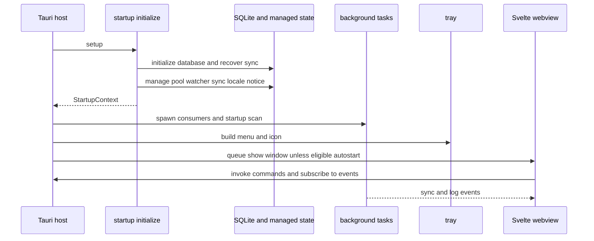

# Desktop Runtime and Lifecycle

Lymic is a Tauri desktop application: the Svelte 5 webview owns presentation and short-lived interaction state, while Rust owns operating-system integration, credentials, local persistence, filesystem observation, synchronization, and Immich communication. The two sides communicate through named Tauri commands and serialized application events; they do not share an in-process state model.

## Composition root

`src-tauri/src/lib.rs` exposes `run`, which delegates to `app::run`. The Tauri builder installs notification, autostart, dialog, process, and updater plugins, then its `setup` callback establishes runtime state before entering the event loop. The same builder is the authoritative command boundary: it registers authentication, album, watched-folder, synchronization, locale, upload-parallelism, and database-recovery commands.

The application deliberately separates startup preparation from long-running work. `startup::initialize` completes the required initialization and returns a `StartupContext`; `background::spawn` consumes its receivers and coordination handles only after that state has been managed by Tauri. A failure to initialize the audit logger, watcher, database, or recovered sync snapshot aborts setup rather than launching a partially initialized runtime.

This is the startup and runtime handoff: managed state is installed before background tasks start, while the webview obtains durable state with commands and follows later changes through events.

### Startup sequence and recovery

Initialization proceeds in this order:

1. Initialize and manage the `AuditLogger`, then record startup phases as audit events.
2. Create the bounded watcher event channel (capacity 4,096), watcher instance, and rescan flag/notification.
3. Initialize SQLite, recover the persisted sync job, and load watched folders. If database repair occurred, retain a one-time `DatabaseRecoveryNotice` for the UI command and issue a native notification plus audit record.
4. Register available stored folders with the watcher. An unavailable folder is not fatal: it is logged as deferred; a registration error is logged and startup continues.
5. Manage the database pool, watcher mutex, sync-running flag, `SyncCoordinator` (initialized paused when recovery says `PAUSED`), locale, and recovery notice. Start the removable-volume monitor; failure to start it is reported to the UI but does not abort startup.
6. Spawn background consumers, initialize the tray, and—unless this is an authenticated autostart launch—queue showing and focusing the main window on the native main thread.

Database initialization can repair corruption, but complete initialization failure prevents the application from completing setup. The repair path preserves a backup location and number of salvaged folders for the UI; other stored data may not survive the rebuild. See [Local Persistence and Recovery](../data/local-state.md) for the persisted model.

### Visibility, autostart, and exit

The autostart plugin launches Lymic with `--autostart`. The main window remains hidden only when that argument is present **and** credentials can be read successfully from the keyring. A manual launch, missing credentials, or keyring-read error shows the window. This makes an unauthenticated autostart recoverable rather than leaving an invisible application.

Closing the main window hides it and prevents the close, keeping background services and tray controls alive. The tray can show and focus the `main` window, and on non-macOS a left-click does the same. The explicit **Quit** action exits the app. On `RunEvent::Exit`, the runtime appends an `app.shutdown` audit event and attempts to flush the logger.

## Managed Rust state and background services

Tauri-managed state is the ownership boundary for services shared by commands, tray actions, and tasks:

- `Arc<AuditLogger>` records startup, recovery, watcher, and shutdown operations.
- `SqlitePool` is the durable-state handle used by commands and workers.
- `Mutex<WatcherState>` serializes registration and reconciliation of filesystem watches.
- `SyncState` and `SyncCoordinator` serialize synchronization activity and preserve the restored pause decision.
- `LocaleState`, `DatabaseRecoveryNotice`, and tray menu/status state support localized UI and native-tray behavior.

`background::spawn` starts four independent asynchronous loops:

- a startup scan after a two-second delay;
- a watcher-event consumer that debounces activity for two seconds;
- a 30-second deferred-watch reconciliation loop for folders unavailable at startup; and
- a removable-volume event consumer.

All scan sources pass their results into `sync_scan_result_if_authenticated`. It first persists upload units and scan failures to the SQLite queue, updates the tray and emits a `sync-progress-snapshot`, and only then considers starting a runner. Thus watcher ingestion remains durable even if a runner is active. A restored `PAUSED` coordinator returns after enqueueing; otherwise, a runner is spawned only if stored credentials exist and can construct an Immich client. Invalid server configuration is logged to the UI rather than starting the runner.

The watcher event channel is deliberately bounded. If the watcher signals overflow, the consumer clears its buffered incremental changes and rescans every configured folder before queueing the resulting work. This favors reconciliation over silently missing filesystem changes. Folder availability is also reconciled periodically, so a removable or offline path can become watched and scanned without restarting the app. See [Watched Folders](../workflows/watched-folders.md) and [Synchronization Workflow](../workflows/synchronization.md).

## Frontend lifecycle and safe IPC handoff

The root route constructs six long-lived controllers: feedback, synchronization, removable volumes, authentication, preferences, and updates. On mount it marks sync active, starts updater and preference lifecycles, subscribes to removable-volume events, then hydrates authentication, sync state, and preferences. Sync event subscriptions are installed only after sync hydration; after authentication hydration, failed uploads are refreshed only for an authenticated user. The route selects login, dashboard, or settings from controller state and passes callbacks and state into views rather than letting components invoke Rust directly.

On route teardown, the sync controller marks itself unmounted, clears its pending progress timer, and unregisters event listeners; updater, preferences, and removable-volume controllers also stop their lifecycles. Event listeners are asynchronously established and immediately unregistered if disposal or inactivity wins the race. This prevents a late backend event from mutating a torn-down route.

The frontend is not a durable-state authority. For example, sync hydration reads `get_folders` and `get_sync_status`; a snapshot maps backend `RUNNING` and `PAUSED` status to UI state. It then combines that initial read with live events. UI actions invoke `start_sync`, `pause_sync`, `resume_sync`, folder, retry, and settings commands; command errors are presented through the feedback path. Details of this contract are in [Frontend State and Tauri IPC](../frontend/ui-and-ipc.md).

### Commands for requests, events for change

Commands provide request/response operations such as login, reading status, changing settings, and explicit sync actions. Events carry asynchronous state that could change independently of a button click:

- synchronization emits progress path and percentage, started, transfer statistics, snapshots, paused/resumed state, errors, and idle;
- `log-message` carries a normalized level, message, timestamp, optional translation key, and optional string parameters;
- the tray emits `trigger-sync` to request the same frontend start action used by the dashboard.

The Rust event helper normalizes unknown log levels to `INFO` and intentionally ignores emission and native-notification errors. Consumers must therefore treat events as best-effort live updates and retain command-based hydration as the recovery mechanism after reload or missed events. Event names and payload shapes are a compatibility boundary: changing one requires coordinated Rust emitter, TypeScript subscription/controller, and tests.

## Tray as a native control surface

Tray setup creates a disabled transfer-status item, a sync action, Show, and Quit. The sync action is enabled only when startup found at least one folder. Its label and operation derive from the persisted snapshot: `RUNNING` pauses, `PAUSED` resumes, and every other status starts a sync by emitting `trigger-sync`. Pause and resume run directly through the same internal command logic used elsewhere; a tray failure produces both a UI log and `sync-error`.

The tray maintains managed copies of the most recent sync status and transfer statistics. Sync snapshots update the action label; active (`RUNNING` or `PAUSED`) transfer statistics update a localized percentage and optional ETA, while other states show the localized idle text. Locale changes can refresh these native labels without requiring the webview to be visible.

## Change and test guidance

A safe runtime change follows the ownership boundary:

- Add a durable or OS-facing capability in Rust, initialize/manage any shared resource before spawning consumers, and make degradation explicit through logs, events, or a command response.
- Add a command to the Tauri registry and a controller method rather than invoking commands from a leaf component. Keep a command's response useful for hydration and error recovery.
- When adding or changing an event, update its Rust emitter, `sync-event-subscription.ts`, controller lifecycle cleanup, payload types, and tests together.
- Treat the persisted queue as the handoff from scans to upload execution. Do not schedule a runner before work has been enqueued, and do not bypass the restored pause gate.
- Preserve tray semantics when status values or sync actions change: the menu is usable while the main window is hidden.

Focused tests cover autostart visibility decisions and keyring errors in `app/mod.rs`, tray status/action selection and localized transfer labels in `app/tray.rs`, sync queue and client configuration behavior in `sync/service.rs`, and controller lifecycle/IPC behavior in `src/lib/controllers/*.test.ts`. Run the project checks described in [Development and Testing](../operations/development-and-testing.md) after changes that cross this boundary.

## Related pages

- [Frontend State and Tauri IPC](../frontend/ui-and-ipc.md)
- [Local Persistence and Recovery](../data/local-state.md)
- [Synchronization Workflow](../workflows/synchronization.md)
- [Watched Folders](../workflows/watched-folders.md)
- [Development and Testing](../operations/development-and-testing.md)
