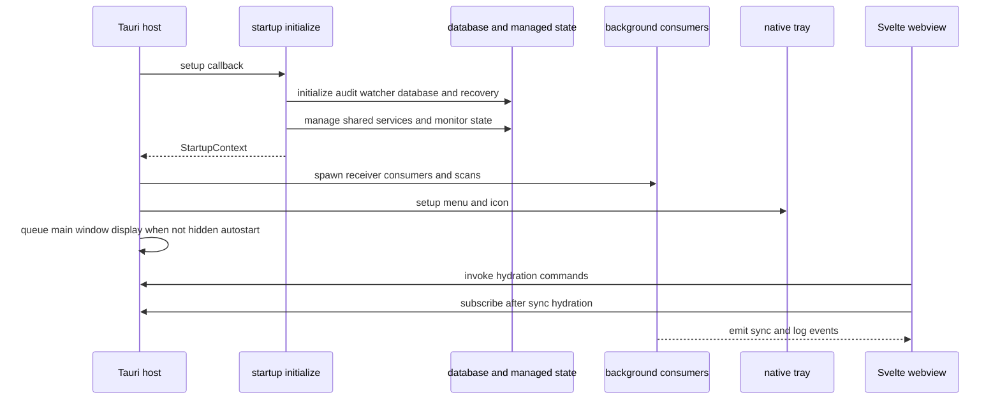

# Desktop Runtime and Lifecycle

Lymic is a Tauri desktop application. The Svelte 5 webview owns presentation and interaction state; the Rust host owns operating-system integration, credentials, persistence, filesystem watching, synchronization, and Immich communication. They communicate through named Tauri commands and serialized events rather than a shared in-process state model.

## Composition root and ordering

`src-tauri/src/lib.rs` exposes `run`, which delegates to `app::run`. The Tauri builder installs notification, autostart, dialog, process, and updater plugins. Its `setup` callback is the composition root: it computes whether an autostart launch may remain hidden, initializes host state, starts consumers, builds the tray, and queues main-window display when appropriate. The invoke handler is the authoritative command registry for authentication, albums, folders and removable-media acceptance, sync control and status, settings, and the database-recovery notice.

The ordering is intentional. `startup::initialize` performs all required setup and manages shared state before `background::spawn` is given its receivers. Only then does the app initialize the tray. Initialization or tray construction errors propagate out of `setup`; the builder consequently does not enter a healthy event-loop runtime. Startup phase audit events mark the individual readiness, failure, tray, queued/displayed-window, and event-loop-ready milestones.

The diagram shows the host-to-webview handoff: managed state exists before consumers use it, while the webview first hydrates durable state by command and then follows later changes by event.

### Required startup and recovery

`startup::initialize` proceeds as follows:

1. Create and manage the `AuditLogger`; subsequent startup phase records use it.
2. Create the bounded watcher event channel (capacity 4,096), overflow-rescan flag and notification, then create the filesystem watcher.
3. Initialize SQLite and recover the persisted sync snapshot. Failure of audit, watcher, database, sync recovery, or loading configured folders aborts setup. Database corruption can instead be repaired by `db::init`.
4. When repair occurred, create a one-time `DatabaseRecoveryNotice` containing the reason, backup path, and salvaged folder count; emit a native notification and audit event. The notice is available to the webview through `get_database_recovery_notice`.
5. Register stored folders with the watcher. An unavailable folder is deferred, and an individual registration failure is logged and audited rather than being fatal.
6. Manage the pool, watcher mutex, sync-running flag, `SyncCoordinator`, locale, recovery notice, and active-removable-volume state. The coordinator begins paused when the recovered snapshot is `PAUSED`.
7. Start the platform removable-volume monitor with a channel. Its startup failure is logged to the UI but does **not** abort application startup; the app continues without those monitor events.

For persistence and repair semantics, see [Local Persistence and Recovery](../data/local-state.md).

### Visibility and process lifetime

The autostart plugin launches Lymic with `--autostart`. The main window remains hidden only if that argument is present **and** reading credentials succeeds with stored credentials. A manual launch, absent credentials, or keyring-read failure queues showing and focusing the `main` window on the native main thread. Scheduling this call avoids blocking the Windows event loop during setup.

A close request hides the window and prevents closure, preserving background services and tray controls. The tray Show action—and a left-click on non-macOS—shows and focuses that window; explicit Quit calls `app.exit(0)`. On `RunEvent::Exit`, the runtime appends the `app.shutdown` audit event and attempts an audit-log flush.

## Managed host state and consumers

Tauri-managed state is the host-side sharing boundary for commands, tray actions, and asynchronous tasks:

- `Arc<AuditLogger>` records startup, recovery, watcher, and shutdown operations.
- `SqlitePool` accesses durable state.
- `Mutex<WatcherState>` serializes filesystem-watch registration and reconciliation.
- `SyncState` and `SyncCoordinator` serialize activity and retain the recovered pause decision.
- `LocaleState` and `DatabaseRecoveryNotice` serve localization and one-time recovery reporting.
- `ActiveRemovableVolumes` tracks removable-volume handling; tray setup additionally manages the menu plus cached sync and transfer state.

`background::spawn` creates four independent loops after managed state is available:

- a startup scan after two seconds;
- a watcher-event consumer which debounces changes for two seconds;
- deferred-watch reconciliation every 30 seconds for paths unavailable at startup; and
- a removable-volume event consumer.

The deferred-watch loop checks configured paths, reconciles registrations while holding the watcher mutex, then scans newly registered paths. The removable consumer builds a `RemovableVolumeCoordinator` from the managed database and active-volume state. Errors in either consumer are reported to the UI; they do not take down the event loop.

All scan sources pass results to `sync_scan_result_if_authenticated`. It persists upload units and failures to the SQLite queue and publishes an updated snapshot before considering a runner. A recovered pause returns after enqueueing; otherwise a runner starts only when stored credentials and valid client configuration are available. This preserves the durable queue as the scan-to-upload handoff even when a runner is already active. See [Synchronization Workflow](../workflows/synchronization.md).

The watcher channel is bounded by design. On overflow, the watcher sets a rescan request; after debounce, the consumer clears its incremental buffers and scans all configured folders before queueing work. This favors reconciliation over silently missing changes. See [Watched Folders](../workflows/watched-folders.md).

## Webview lifecycle and IPC boundary

The root route creates feedback, removable-volume, sync, authentication, preferences, and update controllers once. On mount it marks the sync controller mounted, starts updater and preference lifecycles, starts removable-volume subscriptions, and independently hydrates authentication, sync state, and preferences. It installs sync event listeners only after `sync.hydrate()` completes; after authentication hydration it refreshes failed uploads only for an authenticated user. Updater startup also records webview update/version phase probes through a command.

The root route renders login when unauthenticated and dashboard or settings when authenticated. It passes controller state and callbacks to views, keeping direct Rust invocation out of leaf presentation components. On teardown, it destroys sync, updater, preferences, and removable-volume lifecycles. Sync destruction clears its timer, marks it unmounted, and calls the subscription disposer. Because event listeners are registered asynchronously, the subscription helper immediately unregisters a listener if disposal or inactivity wins the race.

### Hydrate with commands, follow with events

The frontend is not the durable-state authority. For example, sync hydration reads `get_folders` and `get_sync_status`, mapping host `RUNNING` and `PAUSED` snapshots to UI state. It then combines that initial result with live events. Actions invoke `start_sync`, `pause_sync`, `resume_sync`, folder management, retry, and settings commands; controllers route actionable errors through feedback.

Commands are request/response operations such as login, status reads, setting changes, and explicit sync actions. Events carry asynchronous changes that may occur without a webview button click:

- `sync-progress`, `sync-progress-percent`, `sync-started`, `sync-transfer-stats`, `sync-progress-snapshot`, `sync-paused`, `sync-resumed`, `sync-error`, and `sync-idle` update synchronization presentation;
- `trigger-sync` lets the native tray request the same frontend start path;
- `log-message` carries a normalized `UiLogMessage` for the in-webview log.

Events are best-effort live updates: host helpers deliberately ignore event-emission and native-notification errors. Command hydration is therefore the recovery mechanism after reload or missed notifications. Event names and payload shapes are a compatibility boundary; changing one requires coordinated Rust emitter, TypeScript subscription/controller, and test changes. See [Frontend State and Tauri IPC](../frontend/ui-and-ipc.md).

## Native tray control surface

Tray setup creates a disabled transfer-status item, Sync, Show, and Quit. Sync is initially enabled only when startup found folders. The action derives from the persisted snapshot: `RUNNING` pauses directly through the internal sync logic, `PAUSED` resumes through that logic, and every other state emits `trigger-sync` for the webview. Failures produce both a UI log and `sync-error`; the tray then refreshes its cached action from the database.

The tray keeps managed copies of sync status and the latest transfer statistics. Snapshots choose the localized Sync action; active `RUNNING` or `PAUSED` transfers show percentage and optional ETA, while other states show localized idle text. Locale changes can refresh these native labels even while the webview remains hidden.

## Safe change guidance

- Initialize and manage every resource shared by commands or tasks before spawning a consumer that retrieves it from `AppHandle` state.
- Preserve the distinction between fatal initialization and explicit degradation. In particular, removable-monitor startup is nonfatal, while audit, watcher, database, and recovery failures are not.
- Add a host command to the invoke registry and expose it through a controller rather than calling `invoke` from a leaf component. Retain command hydration paths for event-loss recovery.
- When changing an event, update its Rust producer, `sync-event-subscription.ts`, controller cleanup, payload types, and tests together.
- Do not schedule upload work before scan output is queued, and do not bypass the restored pause gate.
- Keep tray behavior coherent with sync status changes: it remains the usable native control surface when the main window is hidden.

Focused Rust tests cover autostart visibility in `app/mod.rs` and tray action/label behavior in `app/tray.rs`; TypeScript controller tests cover IPC and lifecycle behavior. Run the checks described in [Development and Testing](../operations/development-and-testing.md) after cross-runtime changes.

## Related pages

- [Frontend State and Tauri IPC](../frontend/ui-and-ipc.md)
- [Local Persistence and Recovery](../data/local-state.md)
- [Synchronization Workflow](../workflows/synchronization.md)
- [Watched Folders](../workflows/watched-folders.md)
- [Development and Testing](../operations/development-and-testing.md)
