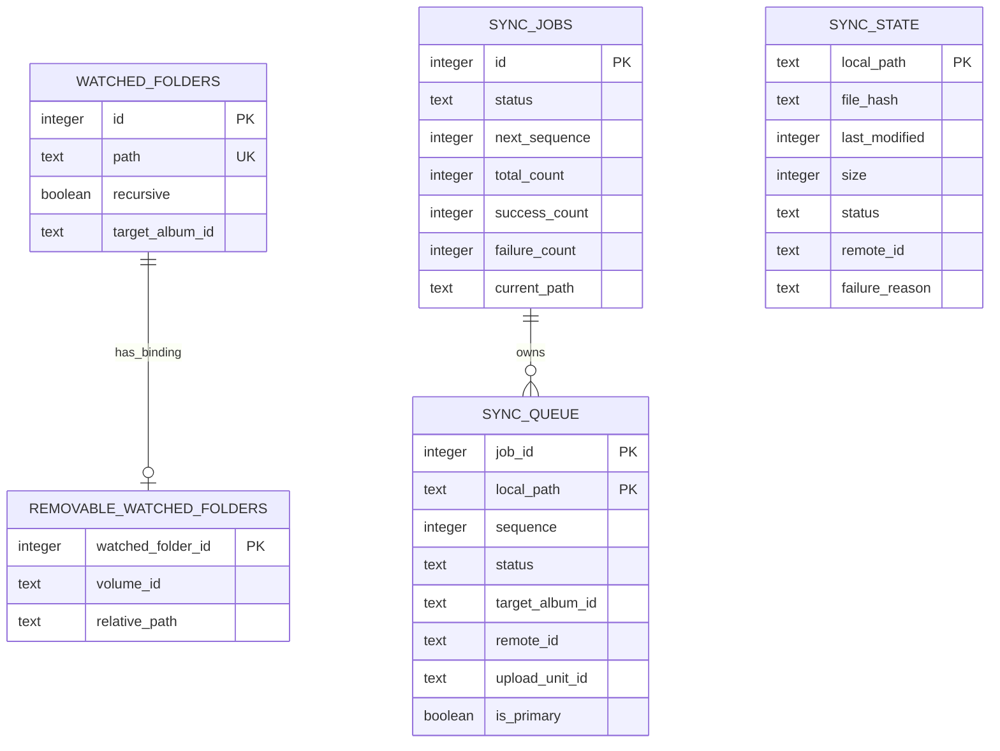
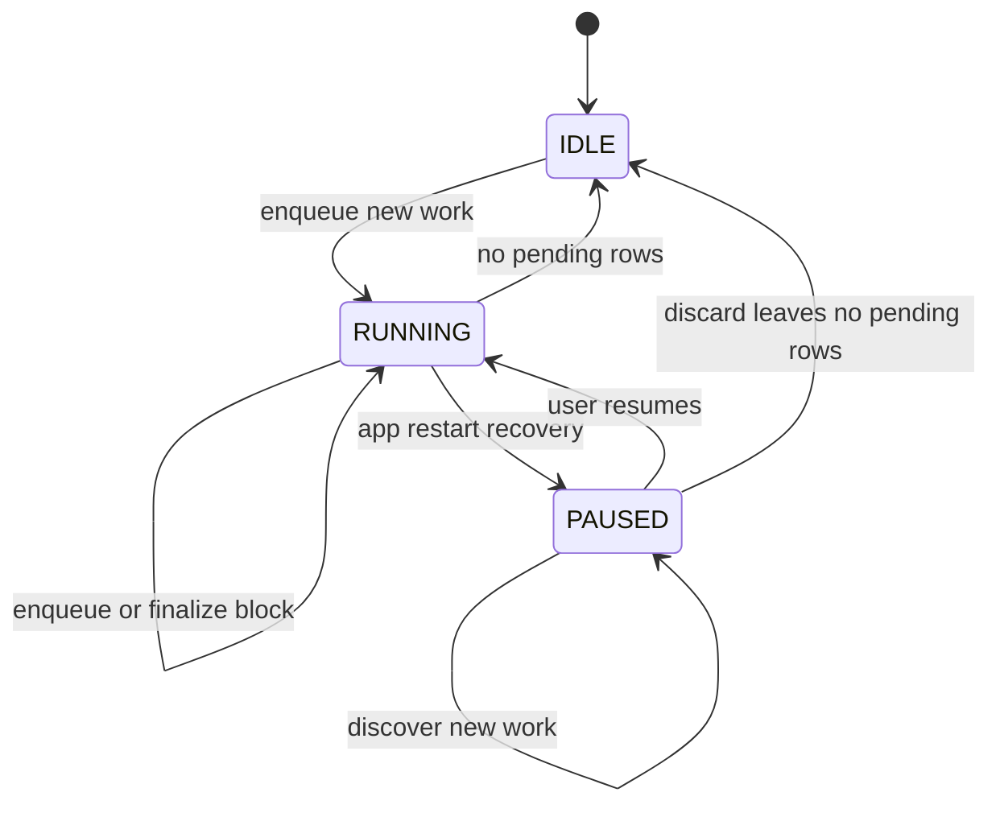
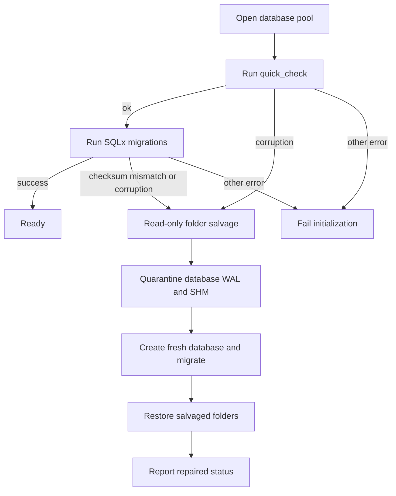

# Local Persistent State

Lymic keeps operational state in an SQLite database under the application data directory as `immich_sync.db`. It is the durable boundary for watched-folder configuration and synchronization work: a restarted application recovers the persisted queue rather than reconstructing an in-progress run solely from a new scan. Credentials are a separate concern and are stored in the platform keyring; see [Authentication and Credential Security](../security/authentication.md).

## What SQLite owns

The database has one logical synchronization job (`sync_jobs.id = 1`) and its ordered queue (`sync_queue`). The job records `RUNNING`, `PAUSED`, or `IDLE`, aggregate counts, the current path, and the next sequence number. Queue rows are keyed by job and local path, have `PENDING`, `SYNCED`, or `FAILED` status, and retain file metadata, failure reason, target album, and remote-asset identifiers. An upload unit can group the primary image with a live-photo video, so recovery reconstitutes the unit rather than treating its members as unrelated uploads.

`sync_state` is the longer-lived per-path record used for duplicate and hash decisions. A cached hash is usable only when the local path, nanosecond modification time, size, and `SYNCED` status agree. Successful persistence records all members of an upload unit atomically, but assigns the remote asset ID only to its primary image. Failed entries retain their reason for user-facing failure reporting.

Watched folders persist their path, recursive flag, and optional target album. A removable-folder binding maps a watched-folder ID to a volume ID and relative path; its foreign key cascades when the watched folder is removed.

This diagram shows the durable entities. `sync_state` is keyed by path independently of the queue, while the job owns queue rows.

## Queue lifecycle and restart safety

Discovery enqueues upload units and discovery failures in a transaction. New paths obtain increasing sequence numbers; an existing path is updated in place, retaining `SYNCED` status but returning other existing rows to `PENDING`. The job is reset and old queue records deleted only when starting new work from `IDLE`, or from a `RUNNING` job with no pending items. Thus a paused queue can accept newly discovered items while retaining its terminal records and remains paused.

Consumers retrieve pending units in sequence order. They record an uploaded remote ID before later work that needs it, and finalize a block by updating row statuses, recomputing counts, updating `current_path`, and committing the snapshot as one transaction. A job becomes `IDLE` only after no pending rows remain; failed rows are terminal for this purpose and contribute to completed-byte accounting.

At application startup, `recover_sync_job` changes persisted `RUNNING` to `PAUSED` before returning the snapshot. This deliberately requires the user to confirm resumption because the process cannot know whether an HTTP upload in flight at the time of a crash completed remotely. Startup then reloads persisted watched folders and registers available paths with the watcher. See [Synchronization Workflow](../workflows/synchronization.md) and [Watched Folders and Media Discovery](../workflows/watched-folders.md) for the producers and consumers of this state.

This diagram shows job status transitions; `SYNCED` and `FAILED` are terminal states of individual queue rows, not job states.

## Folder removal and explicit discard

Removing a folder configuration itself deletes its `watched_folders` row. The synchronization workflow can first test whether that folder contains pending queue work. Its discard operation carefully normalizes and checks candidate paths rather than relying on a SQL prefix alone, then deletes matching queue rows and **non-`SYNCED`** state in batches. Synchronized state is deliberately retained, preserving hash and duplicate knowledge for files that were already uploaded. The same transaction recomputes job totals and changes the job to `IDLE` only if it removed the last pending item.

Explicitly discarding selected failed paths is broader: it deletes those paths from both `sync_state` and `sync_queue`, then recomputes the job snapshot transactionally.

## Initialization, migrations, and repair

`db::init` ensures the app-data directory exists and opens `immich_sync.db` with foreign keys enabled, WAL journal mode, a five-second SQLite busy timeout, and a pool of one to four connections with a ten-second acquisition timeout. WAL helps reads remain responsive while SQLite serializes writers.

Every open runs `PRAGMA quick_check(1)` **before** SQLx migrations. Migrations are embedded from `src-tauri/migrations/` and tracked by SQLx; add a new forward-only migration for schema changes rather than editing an already applied migration. The migrations establish folder and state tables, failure details, application settings, the singleton job and queue, target-album/remote-ID data, removable-folder bindings, and upload-unit grouping.

Only recognized recoverable conditions trigger rebuild: SQLite corruption or `SQLITE_NOTADB` error codes, a non-`ok` quick-check result, and an SQLx migration checksum/version mismatch. Other open, lock, or migration errors fail initialization and do not quarantine a database. On recovery, Lymic:

1. Tries a short, read-only query to salvage watched folders.
2. Renames the database to a timestamped `.corrupted.*` name, retrying rename and falling back to copy-and-remove; it moves matching `-wal` and `-shm` files too.
3. Creates and migrates a fresh database, then restores each salvageable watched-folder record, including recursion and target album.
4. Reports the backup location, reason, and restored-folder count through startup notification/audit data.

The repair contract is intentionally narrow: settings, queue history, and hash cache are not restored. If the fresh database also cannot pass initialization, startup fails rather than claiming recovery succeeded.

This flow distinguishes the narrow set of repairable failures from errors that must be surfaced without altering the database.

## Verification focus

Database tests exercise initial migration, queue ordering and deduplication, paging, byte/count snapshots, pause preservation, and conversion of a running job to paused recovery. They also verify cache invalidation for a differing nanosecond timestamp, all-or-nothing persistence of a multi-member upload unit, and path-safe scoped deletion. Recovery tests cover corrupt databases, salvageable folders, WAL/SHM quarantine, collision-free backup names, checksum mismatch rebuilding, and the important negative cases: locked databases and non-corruption migration failures are not quarantined.

## Related pages

- [Runtime Architecture](../architecture/runtime.md) explains startup ownership and managed application state.
- [Synchronization Workflow](../workflows/synchronization.md) describes queue production and consumption.
- [Watched Folders and Media Discovery](../workflows/watched-folders.md) explains configured-folder behavior.
- [Authentication and Credential Security](../security/authentication.md) describes the keyring-held credential complement to SQLite.
