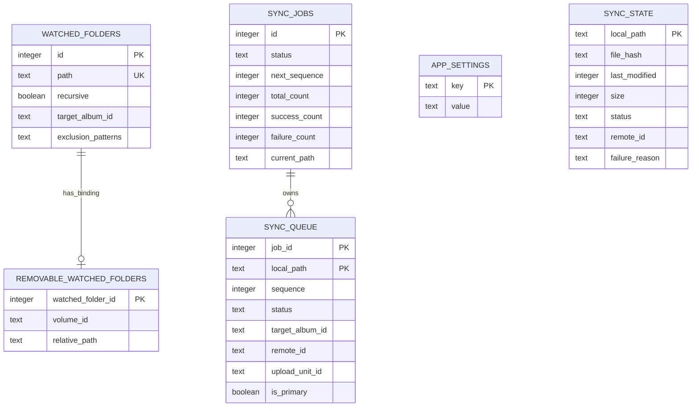
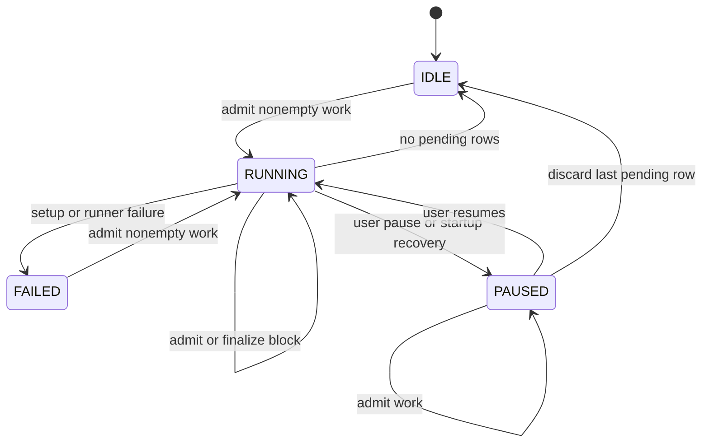
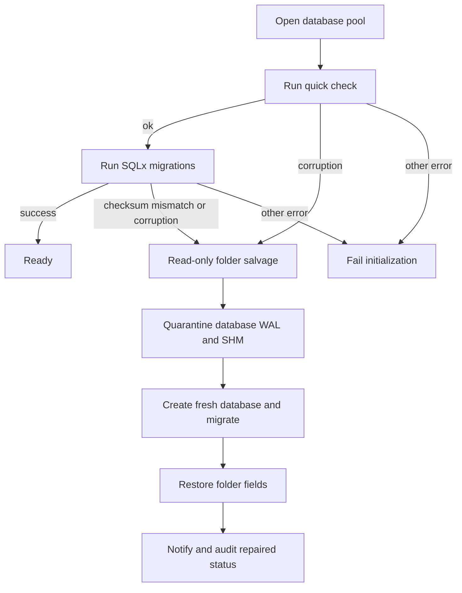

# Local State and Durable Queue

Lymic stores operational state in `immich_sync.db` in the application data directory. SQLite is the durable boundary for watched-folder configuration, synchronization work and outcomes, the upload-concurrency preference, and the local hash cache. Credentials are held separately in the platform keyring; see [Authentication and Credential Security](../security/authentication.md).

## Persisted model

`sync_jobs` is a singleton: its database constraint permits only `id = 1`. It records the job status (`RUNNING`, `PAUSED`, `IDLE`, or `FAILED`), aggregate counts, the current path, and the next sequence number. Its `sync_queue` children are uniquely identified by `(job_id, local_path)`, ordered by `sequence`, and have `PENDING`, `SYNCED`, or `FAILED` row status. Each row includes file metadata, an optional target album and remote ID, and upload-unit fields. Upload units retain the association between a primary image and an optional live-photo video; the primary owns the target album and remote ID when reconstructed for processing.

`sync_state` is independent, longer-lived per-path state. It stores the hash, mtime, size, status, remote ID, and failure information used for cache and duplicate decisions. A hash-cache hit requires an exact path, nanosecond mtime, and size match, plus `SYNCED` status and a nonempty hash. Completion of an uploaded unit is transactional, and only its first (primary) member is assigned the remote asset ID.

A watched folder stores its unique path, recursive setting, optional target album, and JSON-encoded exclusion patterns. A removable-volume binding associates one watched-folder ID with a volume ID and relative path; the foreign key cascades when the folder is deleted. `app_settings` is a key/value table. Its `upload_parallelism` value defaults to 3 when absent or invalid, and writes are restricted to 1 through 8.

*Persisted entities and database-enforced relationships. `sync_state` is independently keyed; the schema has no foreign key from either synchronization-state table to a watched folder.*

## Admission, ownership, and execution

`Synchronization::admit_and_run` is the producer boundary for manual scans, watcher batches, removable-media reconnects, startup work, and recovery. It first admits the scan result to SQLite, assigning a watched folder's current target album when the asset does not already have one. Producers therefore do not choose queue ordering or runner ownership.

Admission is transactional. New paths receive increasing sequences. Re-admitting an existing row refreshes metadata and upload-unit membership, retains `SYNCED` status, and otherwise makes the row `PENDING`; it deliberately does not replace the stored target album. Discovery failures are queued as terminal `FAILED` rows. If the job is `IDLE` or `FAILED`, or is `RUNNING` without pending rows, admitting nonempty work resets job counters and sequence state and deletes the old queue before inserting new work. A paused job instead preserves its terminal history while accepting newly discovered work.

An atomic `running` flag elects one lifecycle starter; concurrent callers join it, and an async mutex serializes the actual runner. A `PAUSED` job is not claimed by ordinary admission. The runner reads the durable queue—rather than the producer's scan result—in windows of at most 50 upload units, so recovered work uses the same path. It checks current exclusions at that boundary and transactionally discards only matching pending rows before processing.

*Durable job-status lifecycle. Queue rows independently become `SYNCED` or `FAILED`; only `PENDING` rows keep a `RUNNING` job from completing.*

## Queue invariants and recovery

Pending units are read in sequence order. The runner can persist a primary asset's remote ID before later processing needs it. After a processor block, it persists only the terminal outcomes reported by that block; items not reported—for example after a pause boundary—remain pending for a lossless resume. Finalization updates queue statuses, aggregate counts, `current_path`, and the returned snapshot in one transaction. Snapshot byte totals derive from queue sizes, with `SYNCED` and `FAILED` rows contributing to completed bytes.

When the runner observes no pending units, it clears its in-memory ownership before a conditional completion update. The update changes the job from `RUNNING` to `IDLE` and clears `current_path` only when no `PENDING` row exists. This ordering allows a producer admitted in the narrow handoff window to claim a successor runner instead; its new pending row makes the conditional completion a no-op.

At startup, `recover_sync_job` converts a persisted `RUNNING` job to `PAUSED` before returning the snapshot. Since the application cannot know whether an in-flight HTTP upload reached the server, recovery requires an explicit resume rather than guessing. Resuming a recovered job restarts the runner if pending work exists; if none does, it completes the job immediately. A setup or runner failure is durable as `FAILED` without discarding queued work, and a later nonempty admission resets that job for a new run.

## Folder-scoped retention and path changes

Removing a folder configuration deletes its `watched_folders` row, but synchronization data is explicitly managed. Folder-work checks and folder discard normalize paths and use component-aware containment, avoiding a false match such as `drive2` beneath `drive`. Folder-scoped discard deletes matching queue rows and only non-`SYNCED` `sync_state` rows. Synced state is retained so hash and duplicate knowledge survive folder removal. The same transaction recomputes the snapshot and makes the job idle when no pending work remains.

Discarding selected failed paths intentionally deletes the selected paths from both `sync_state` and `sync_queue`, then recomputes counts in the same transaction. Changing exclusions discards only pending queue paths supplied by the caller; materialized work is outside that operation. Retrying failures within a folder targets that folder and descendants, clears failure reasons, restores matching queue and state rows to `PENDING`, and moves an idle job to `RUNNING` if it reset queue work.

For a removable volume whose mount path changes, `remap_watched_folder_path` transactionally updates the watched-folder path plus matching descendant paths in `sync_state`, `sync_queue.local_path`, `sync_queue.upload_unit_id`, and `sync_jobs.current_path`. This is a coordinated persistent-state change rather than a watched-folder-only update.

## Initialization, migrations, and repair

`db::init` creates the application-data directory if needed and opens `immich_sync.db` with foreign keys enabled, WAL journal mode, a five-second SQLite busy timeout, and a pool of one to four connections with a ten-second acquisition timeout. Each open runs `PRAGMA quick_check(1)` before SQLx applies the embedded migrations in `src-tauri/migrations/`. The migration history establishes folders and sync state, failure details, settings, the singleton queue, queue album and remote IDs, removable bindings, upload units, exclusions, and the durable `FAILED` job status. Add schema changes as new migrations: SQLx validates previously applied versions and checksums.

Repair is intentionally narrow. SQLite corruption (`SQLITE_CORRUPT` primary code 11 or `SQLITE_NOTADB` primary code 26), a non-`ok` quick check, and a SQLx migration version/checksum mismatch are recoverable. A lock or another open or migration failure is returned without quarantining the database. For a recoverable failure, the application:

1. Attempts a short read-only folder query to salvage watched folders.
2. Moves the database to a collision-free timestamped `.corrupted.*` name, retrying rename and falling back to copy then removal; matching `-wal` and `-shm` files move with it.
3. Creates and migrates a fresh database, then restores each salvageable folder's path, recursion, and target album.
4. Presents a repair notice and records the `database.repaired` audit event with the backup path, reason, and restored-folder count.

Only those three watched-folder fields are restored. Settings, queue history, hash/cache state, removable bindings, and exclusion patterns are not restored. If the fresh database cannot be initialized, startup fails rather than reporting repair success. After initialization, startup reloads watched folders and attempts to register each watcher; unavailable folders are deferred and failures are reported without stopping registration of remaining folders.

*Initialization distinguishes narrowly recoverable database failures from errors that must leave the existing database in place and fail startup.*

## Safe changes and focused verification

- Preserve the singleton constraint, composite queue identity, sequence ordering, upload-unit reconstruction, and the conditional no-pending completion check when changing queue storage.
- Keep related queue and state mutations transactional, especially for upload units, count snapshots, folder discard, retry, and path remapping.
- Extend both read-only salvage and `restore_folder` if a new watched-folder field must survive database repair; current recovery intentionally preserves only path, recursion, and target album.
- Test a new migration against both a new database and an existing one. The database and runner tests cover ordering and deduplication, pause preservation, terminal bytes and completion, settings validation, nanosecond cache invalidation, upload-unit atomicity, folder deletion/remapping, retry isolation, partial processor outcomes, exclusion filtering at the queue boundary, recovery, WAL/SHM quarantine, checksum mismatch, and failures that must not trigger repair.

## Related pages

- [Runtime Architecture](../architecture/runtime.md) describes application startup and managed runtime state.
- [Audit Logging](../operations/audit-logging.md) describes durable recovery and startup events.
- [Synchronization Workflow](../workflows/synchronization.md) describes queue production and consumption.
- [Watched Folders and Media Discovery](../workflows/watched-folders.md) describes configured-folder behavior.
- [Authentication and Credential Security](../security/authentication.md) describes the keyring-held credential complement to SQLite.
