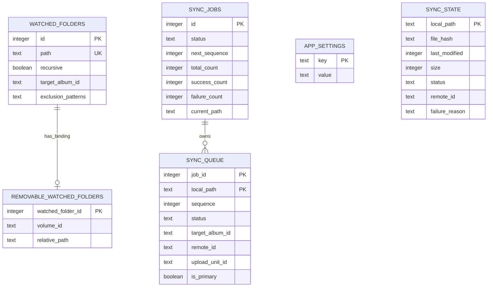
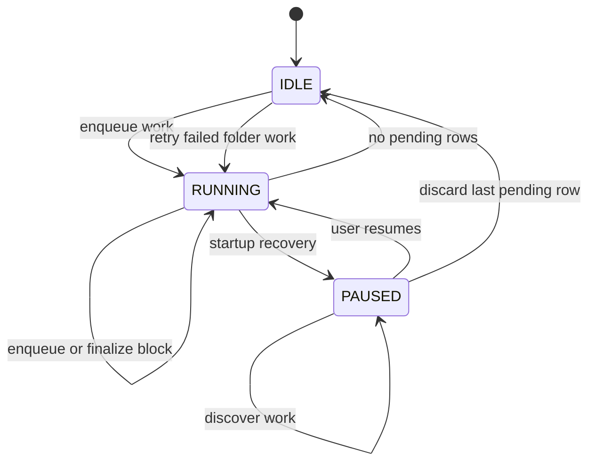
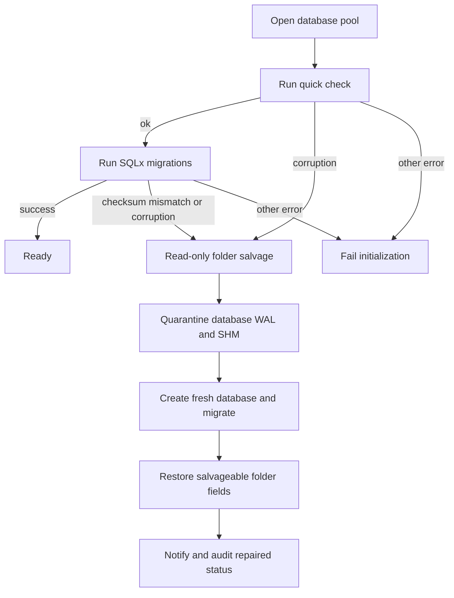

# Local State and Recovery

Lymic keeps operational state in `immich_sync.db` in the application data directory. SQLite is the durable boundary for watched-folder configuration, synchronization work, upload outcomes, the upload-concurrency preference, and the local hash cache; credentials are held separately in the platform keyring. See [Authentication and Credential Security](../security/authentication.md).

## Durable model

The database contains one synchronization job, enforced by `sync_jobs.id = 1`, and its ordered `sync_queue`. A job has `RUNNING`, `PAUSED`, or `IDLE` status, aggregate counts, a current path, and the next sequence number. Queue records are keyed by `(job_id, local_path)`, carry local metadata and optional target-album and remote-asset IDs, and are `PENDING`, `SYNCED`, or `FAILED`. A queue item may belong to an upload unit, allowing a primary image and live-photo video to be recovered and processed together.

`sync_state` is an independent, longer-lived per-path record. It holds the hash, mtime, size, status, remote ID, and failure information used by duplicate and cache decisions. A hash cache hit requires an exact match of path, nanosecond mtime, size, `SYNCED` status, and a nonempty hash. Persisting a completed upload unit is transactional; only the primary member receives the remote asset ID.

A watched folder stores its unique path, recursive setting, optional target album, and JSON-encoded exclusion patterns. A removable-volume binding associates one watched-folder ID with a volume ID and relative path; deleting its folder cascades to the binding. `app_settings` is a key/value table and currently stores `upload_parallelism`: invalid or absent stored values fall back to 3, while writes accept only 1 through 8.

This diagram shows the persisted entities and database-enforced relationships. `sync_state` is keyed independently of the queue; the current schema does not define a foreign key from either state table to a watched folder.

## Queue lifecycle and crash recovery

Discovery enqueues upload units and discovery failures in one transaction. Newly seen paths receive increasing sequence numbers. Re-enqueuing an existing row refreshes metadata and upload-unit membership, retains `SYNCED` status, and otherwise returns it to `PENDING`; its originally stored target album is not overwritten. Starting work from `IDLE`, or from a `RUNNING` job with no pending rows, resets the job and deletes the prior queue before adding new work. A paused job instead retains terminal records and accepts newly discovered rows without resuming.

Consumers read pending upload units in sequence order. Before later work needs a remote ID, it can be stored on the queued primary asset. Finalizing a block updates row statuses, counts, and `current_path`, reads the snapshot, and commits as one transaction. `complete_sync_job_if_finished` transitions the job to `IDLE` only when no `PENDING` rows remain; both synced and failed rows count as completed bytes.

On startup, `recover_sync_job` changes a persisted `RUNNING` job to `PAUSED` before returning its snapshot. The application therefore requires explicit user confirmation before it resumes a crash-interrupted upload, rather than assuming an in-flight HTTP request did or did not reach the server. Startup then reloads watched folders and attempts to register each path. An unavailable folder is deferred and reported, while another registration failure is reported but does not prevent the rest of startup.

This diagram is the durable job-status lifecycle. `SYNCED` and `FAILED` are terminal queue-row states; retrying a folder changes its failed queue and state rows back to `PENDING` and changes an idle job to `RUNNING` when work was reset.

## Folder changes and retention boundaries

Removing a folder configuration deletes its `watched_folders` row, but synchronization data is managed explicitly. To determine whether a folder has pending work, and to discard its data, the code first obtains candidate paths and then applies normalized, path-component-aware checks; this avoids treating a sibling such as `drive2` as a descendant of `drive`. Folder-scoped discard deletes matching queue rows and only non-`SYNCED` `sync_state` rows. Synced state is retained so its hash and duplicate knowledge survive folder removal. It recomputes the job snapshot atomically and makes the job `IDLE` if no pending work remains.

Discarding selected failed paths is intentionally broader: it deletes the selected paths from both `sync_state` and `sync_queue` and recomputes totals in the same transaction. Changing exclusions only discards *pending* queue paths supplied by the caller; already materialized work is outside that operation. Conversely, retrying failures in a folder safely targets that folder and descendants, clears failure reasons, and returns matching queue and state records to `PENDING` without affecting sibling paths.

For a removable volume whose mount path changes, `remap_watched_folder_path` transactionally updates the watched-folder path plus matching descendant paths in `sync_state`, `sync_queue.local_path`, `sync_queue.upload_unit_id`, and `sync_jobs.current_path`. This makes path moves a coordinated persistent-state change rather than a folder-row update alone.

## Initialization, migrations, and repair

`db::init` creates the app-data directory if needed and opens `immich_sync.db` with foreign keys enabled, WAL journal mode, a five-second SQLite busy timeout, and a pool of one to four connections with a ten-second acquisition timeout. WAL keeps readers responsive while SQLite serializes writers.

Every database open runs `PRAGMA quick_check(1)` before embedded SQLx migrations from `src-tauri/migrations/`. The migration history builds the base folder and state tables, failure details, settings, singleton queue, queue album/remote IDs, removable bindings, upload-unit grouping, and watched-folder exclusions. Because SQLx validates applied migration versions and checksums, schema changes should be introduced as new migrations rather than by modifying a migration that may already have been applied.

Repair is deliberately narrow. Corruption (`SQLITE_CORRUPT` primary code 11 or `SQLITE_NOTADB` primary code 26), a non-`ok` quick check, and a SQLx migration version/checksum mismatch are recoverable. Other open or migration failures—such as a locked database or an unrelated migration failure—are returned without quarantining the database. For a recoverable failure, the application:

1. Tries a short, read-only folder query to salvage watched folders.
2. Moves the database to a collision-free timestamped `.corrupted.*` path, retrying rename and falling back to copy then removal; matching `-wal` and `-shm` files move with it.
3. Creates and migrates a fresh database, then restores each salvageable folder's path, recursion, and target album.
4. Emits a user notification, startup recovery notice, and `database.repaired` audit event with the backup path, reason, and restored-folder count.

Only those three watched-folder fields are restored. Settings, queue history, hash/cache state, removable bindings, and exclusion patterns are not restored; a fresh database that also cannot be initialized fails startup rather than reporting a successful repair.

This flow distinguishes the limited repair set from failures that must be surfaced without changing the existing database.

## Safe change and verification checklist

- Treat `sync_jobs` as a singleton and preserve queue status checks, composite queue identity, sequence ordering, and the queue-to-upload-unit reconstruction contract when evolving queue storage.
- Put related queue/state mutations in one transaction. This is particularly important for a live-photo unit, count snapshots, safe folder discard, path remapping, and retry state.
- If adding watched-folder fields that must survive repair, extend both read-only salvage and `restore_folder`; current recovery intentionally preserves only path, recursion, and target album.
- Test migrations from an existing database as well as a new one. The database tests cover schema creation, ordering/deduplication and paging, pause preservation, bytes and terminal completion, settings validation, hash invalidation at nanosecond precision, upload-unit atomicity, folder-scoped deletion and remapping, and failure retry isolation. Recovery tests cover corrupt databases, WAL/SHM quarantine, collision-free backup paths, checksum mismatch, and the negative cases that must not trigger quarantine.

## Related pages

- [Audit Logging](../operations/audit-logging.md) describes durable recovery and startup events.
- [Synchronization Workflow](../workflows/synchronization.md) describes queue production and consumption.
- [Watched Folders and Media Discovery](../workflows/watched-folders.md) describes configured-folder behavior.
- [Authentication and Credential Security](../security/authentication.md) describes the keyring-held credential complement to SQLite.
