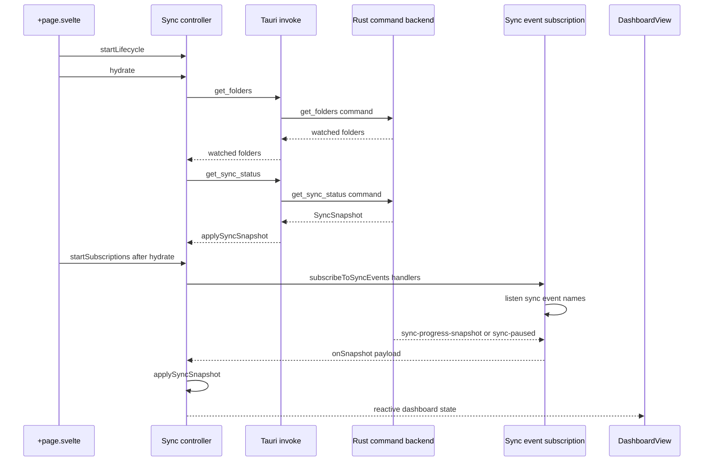

# Frontend State and Tauri IPC

The authenticated desktop shell is deliberately thin: [`+page.svelte`](../../src/routes/+page.svelte) selects a view and composes controllers, while presentational components receive state and callbacks. Keep Tauri invocation, long-lived subscriptions, and cross-view state in controllers rather than moving them into Dashboard, Logs, Settings, or Info components.

## Shell and view ownership

After authentication, the root route renders a sidebar with four local `currentView` choices: **Synchronization** (`dashboard`), **Logs**, **Settings**, and **Info**. It always mounts only the selected content view, but the controllers live at route scope, so synchronization state and the in-memory activity log survive navigation between Dashboard and Logs. Logout is owned by the auth controller; its callback clears sync-facing user state and returns navigation to the dashboard before the unauthenticated layout is rendered.

The route constructs feedback, removable-volume, sync, auth, preferences, and update controllers once. It supplies dependencies explicitly: sync reports errors through feedback, auth refreshes failures after login and clears sync state after logout, preferences append recovery notices through `sync.addLog`, and the updater reads `sync.isActive` to protect update installation. This composition is the intended controller-to-controller boundary; a view should call its supplied callback instead of importing a sibling controller or Tauri API.

| View | Inputs and callback owner | Responsibilities that remain outside the view |
| --- | --- | --- |
| `DashboardView` | `sync.dashboard` and server URL | The sync controller hydrates, derives status/progress, invokes sync and folder commands, and owns the target-folder modal state. The component renders controls, transfer measurements, failed-sync details, and folder list. |
| `ActivityLog` | `sync.dashboard.logs` | The sync controller converts UI log events to newest-first entries, bounds the list to 50, and formats their time. The view localizes a keyed message, falling back to its backend message. |
| `SettingsView` | Auth, preferences, and update values plus callbacks | Preferences owns theme, locale, autostart, locale catalog, and upload-parallelism requests; auth owns logout; update owns checking and installation state. |
| `InfoView` | `updater.appVersion` | The update controller obtains the application version. Info uses the opener plugin for its external project and issue links, and logs opener failures locally. |

## Synchronization state and hydration

`createSyncController` is the authoritative frontend owner of dashboard state: status, last-sync time, item and byte progress, current filename, transfer estimates, watched folders, persisted failures, logs, action-pending flag, and add-folder dialog state. Its `dashboard` getter exposes a value-and-callback interface used directly by `DashboardView`; this prevents component-local copies of backend-derived state.

On route mount, `startLifecycle()` first makes state application legal. `hydrate()` then requests `get_folders` followed by `get_sync_status`; snapshot status maps `PAUSED` to `paused`, `RUNNING` to `syncing`, and an idle snapshot with failures to `error`. It computes progress from byte fields when `totalBytes` is positive, otherwise from completed item counts. The route starts event subscriptions only after this hydration promise resolves. A failed folder request is reported through feedback, while failure to retrieve the snapshot is only warned, so subscription setup can still proceed.

The synchronization button is guarded in both UI and controller code: a new run requires at least one watched folder and no active or pending action. Idle/error invokes `start_sync`; active status invokes `pause_sync` or `resume_sync`, whose returned snapshot is applied immediately. A `trigger-sync` event follows the same guarded start path, so it cannot replace a paused queue with a newly scanned run. Retry refreshes the persisted failure list and folders after the command completes. Folder removal is a two-step contract: request `remove_folder` for warning metadata, ask the native confirmation dialog, then reinvoke with `confirmCancellation: true` only if confirmed.

This shows mount-time command hydration followed by the live event-update path. User actions travel in the reverse command direction through controller callbacks; events are not emitted by the view.

## Event and command contract

[`sync-event-subscription.ts`](../../src/lib/tauri/sync-event-subscription.ts) is the frontend event boundary. It registers `sync-progress`, `sync-progress-percent`, `sync-started`, `sync-transfer-stats`, `sync-progress-snapshot`, `sync-paused`, `sync-resumed`, `sync-error`, `trigger-sync`, `log-message`, and `sync-idle`. The controller maps those handlers to state updates: a snapshot drives status and progress; start resets only transfer statistics; error sets error status and zero progress; idle runs the same completion refresh used by command completion.

Subscription is asynchronous, so the helper tracks disposal and checks the controller's active lifecycle when each `listen()` resolves. It immediately unlistens a late registration after destruction; normal destruction calls the returned cleanup and clears timer state. Event handlers also check `mounted` before applying most updates. Preserve both protections when adding events or moving lifecycle code.

Rust and TypeScript event names and serialized payloads are a compatibility surface. The native event module emits `log-message` with a structured `UiLogMessage`: normalized level (`INFO`, `SUCCESS`, `WARN`, or `ERROR`), message, millisecond timestamp, and optional localization key/parameter map. The controller maps recognized levels into view levels, uses the current locale for a valid timestamp (or `Date.now()` when malformed), and keeps at most 50 entries. A keyed log is translated in `ActivityLog`; its raw message is the fallback. Change producers, the subscription type assertions, controller conversion, and tests together.

The Rust invoke handler is the command allowlist. In addition to auth, album, folder, locale, and recovery commands, it registers the synchronization state commands used by the controller: `start_sync`, `pause_sync`, `resume_sync`, `get_sync_status`, `get_failed_syncs`, `retry_failed_syncs`, `get_upload_parallelism`, and `set_upload_parallelism`. Native sync commands persist and return snapshots for pause/resume, and the backend emits corresponding `sync-paused`/`sync-resumed` snapshots. Do not rename a command or alter its camel-cased argument shape on just one side.

## Settings, updates, and information

The preferences controller starts its lifecycle on mount to apply the saved `lymic-theme` preference and listen to system color-scheme changes only while the preference is `system`; it unregisters that listener at teardown. Hydration obtains the locale catalog and upload parallelism through Tauri commands and the autostart state through the autostart plugin. A locale change updates Svelte's locale and `localStorage` before invoking `update_locale`; upload-parallelism saving disables the selector and restores its DOM value on failure. Theme preference is a browser-side setting stored in `localStorage`, not a native command.

The update controller starts independently at route mount. Settings receives its status and check callback; its dialog also receives `sync.isActive`, which blocks installation while sync status is `syncing` or `paused`. Info receives the version retrieved from the Tauri app API; failure to obtain it leaves the version absent without preventing shell initialization.

## Failure, lifecycle, and change checklist

- Start a controller lifecycle before it accepts events, hydrate backend-backed state before subscribing, and destroy subscriptions/timers on unmount.
- Treat command results and snapshots as authoritative. After sync completion, refresh persisted failed entries and folders rather than inferring success solely from a resolved command.
- Route user-visible command failures to the supplied feedback reporter where the controller does so. Do not make a presentational component swallow an IPC failure.
- Preserve the dashboard's no-folder and pending-action guards, and preserve the removal confirmation handshake.
- When changing an IPC command, update the Rust `generate_handler!` registration, its TypeScript caller and argument names, types, and focused tests. When changing an event, update its Rust producer, subscription helper, controller handler, and payload tests in the same change.

## Focused verification

[`+page.svelte.test.ts`](../../src/routes/+page.svelte.test.ts) is the primary integration-style UI contract test: it mocks `invoke`, `listen`, dialog plugins, updater APIs, and opener API. It covers snapshot hydration and pause/resume behavior, byte-prioritized progress, incoming snapshots and transfer statistics, the no-folder guard, persisted failure retries, two-stage folder removal, structured/keyed log rendering, settings persistence/error rollback, update blocking during a paused sync, and Info's version fallback. Extend the nearest such case whenever changing a controller boundary or event/command contract.

## Navigation

- [Desktop Runtime Architecture](../architecture/runtime.md) covers native startup, plugins, and command registration.
- [Synchronization Workflow](../workflows/synchronization.md) covers the native work performed by sync commands.
- [Watched Folders and Media Discovery](../workflows/watched-folders.md) covers adding and removing folder sources.
- [Authentication and Credential Security](../security/authentication.md) covers login, logout, and credential persistence.
- [Development and Testing](../operations/development-and-testing.md) covers project test commands and development workflow.
