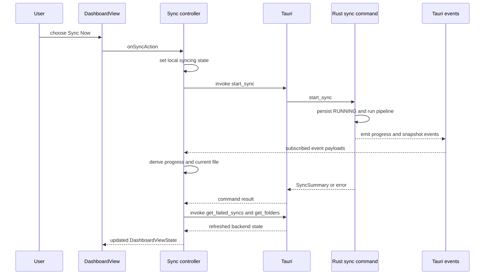

# Frontend State and Tauri IPC

The frontend is a thin, stateful client of the desktop backend. `src/routes/+page.svelte` composes controllers and passes their values and intent callbacks to views; views do not own synchronization or credential operations themselves. In particular, synchronization state is hydrated from and reconciled with backend snapshots, while controller state supplies transient concerns such as the selected pane, dialogs, pending actions, timers, and formatted activity entries.

## Route composition and ownership

`+page.svelte` has two top-level modes determined by the auth controller:

- When unauthenticated, it renders `LoginView` and binds the login fields to the auth controller.
- When authenticated, an in-memory `currentView` selects **Dashboard**, **Logs**, **Settings**, or **Info** in the sidebar shell. The dashboard receives the sync controller's single `DashboardViewState`; the log pane receives the same controller's log collection; settings receives auth, preferences, and update state; and the info pane receives the update controller's app version.

The route is also the composition boundary between controllers. It gives the sync controller the feedback reporter, localization functions, and a callback that removes an accepted removable volume prompt. Auth refreshes failed items after login, and logout clears sync-facing user state and returns the selected pane to the dashboard. Preferences can append a recovery notice to the same activity-log collection, and the update controller is passed a predicate so installation is blocked while synchronization is active.

### Controller responsibilities

| Controller | Owns in the webview | Desktop boundary it coordinates |
| --- | --- | --- |
| Auth | authentication flag, connection identity, in-memory login inputs and errors | `get_auth_status`, `get_server_url`, `get_current_user_name`, `login`, and `logout` |
| Sync | derived dashboard status, progress and transfer values, folders, failed items, the bounded activity log, folder/album dialog state, and subscription cleanup | sync, folder, and removable-media commands plus sync events |
| Preferences | theme and locale selection, autostart status, upload parallelism and its save-pending flag | local storage, autostart plugin, and locale/settings commands |
| Update | version, update availability/dialog, check/install progress, and mounted guard | app/updater/process plugins and startup-phase command |
| Removable-volume | queued detected volumes, dismissed IDs, and event cleanup | volume events and notification plugin |

This division does **not** make the controller the persistent source of truth. For example, sync hydration calls `get_folders` and `get_sync_status`; after an operation it refreshes folders or failed items; and pause/resume applies the `SyncSnapshot` returned by the command. The controller does optimistically set a local status while a manual sync or retry is pending, but completion and failure resolution are reconciled against the backend result and refreshed failure list.

## Lifecycle, hydration, and disposal

On mount the route marks sync, update, and preferences controllers live, starts removable-volume subscriptions, then begins auth, sync, and preferences hydration. Sync subscriptions start only after `sync.hydrate()` resolves. The mount callback returns a cleanup that destroys sync and update controllers, removes the preferences media-query listener, and unregisters removable-volume listeners. The mounted guards prevent asynchronous work and event callbacks from updating a controller after disposal.

The sync controller's `destroy()` clears its delayed progress-reset timer and calls the unsubscriber returned by the event boundary. `subscribeToSyncEvents` additionally handles an important race: each Tauri `listen` resolves asynchronously; if the controller was disposed or is no longer active by then, the just-created listener is immediately removed rather than retained.

Preferences keeps theme and locale as webview preferences: theme is stored under `lymic-theme`, reapplied for system color-scheme changes, and locale under `lymic-locale`. It still asks the backend for the locale catalog and persists a locale update with `update_locale`. Upload parallelism, by contrast, is read and written through backend commands; on write failure the controller reports the error and restores the select control to its prior value.

## Synchronization command and event contract

The Rust application registers the command names consumed by controllers in its Tauri invoke handler, including auth, folders, albums, synchronization, and settings commands. Treat a command name, its argument casing, and its serialized result as a cross-process API: changing one requires coordinated Rust, controller, and test changes.

The sync event adapter centralizes the reverse direction. It subscribes to `sync-progress`, `sync-progress-percent`, `sync-started`, `sync-transfer-stats`, `sync-progress-snapshot`, `sync-paused`, `sync-resumed`, `sync-error`, `trigger-sync`, `log-message`, and `sync-idle`. The controller maps those events to derived view state: snapshots map durable `RUNNING` and `PAUSED` state to `syncing` and `paused`, progress events select the current file and percentage, transfer events update throughput/ETA, `sync-error` enters the error state, and `sync-idle` refreshes failures and folders before deciding whether the final state is idle or error.

`log-message` carries a structured UI log payload with a normalized level, fallback message, timestamp, and optional translation key/parameters. The controller prepends it to the in-memory list, retaining the newest 50 entries. `ActivityLog` renders the translated keyed message when possible and falls back to the backend message, so backend messages can remain meaningful even when a translation is unavailable.

*Representative manual-sync flow: the controller provides immediate interaction state, while command results, snapshots, and refreshes reconcile it to backend-owned state.*

A `start_sync` request is not merely a UI action. The backend requires at least one watched folder, atomically rejects a concurrent manual run, persists `RUNNING`, updates the tray, obtains credentials, scans folders, and runs the pipeline. It clears the in-memory run guard when done; on an error it attempts to persist `IDLE`, updates the tray, and returns the error. The UI must therefore handle a rejected invocation rather than assuming its provisional `syncing` state was accepted. For a pause request, the backend persists `PAUSED` immediately, emits `sync-paused`, and returns its snapshot. Resume returns the current snapshot unchanged unless it was paused; otherwise it persists `RUNNING`, emits `sync-resumed`, and may restart work from the persisted queue.

## Folder and removable-media actions

Adding a folder starts with the dialog plugin, then records a pending path and opens album selection rather than immediately invoking `add_folder`. Confirmation invokes `add_folder` with the optional target album and refreshes the folder list. Removal is deliberately two-stage: the controller first asks `remove_folder` whether cancellation is required, requests user confirmation with the appropriate warning, and only then invokes it with `confirmCancellation: true`.

A removable-volume event is de-duplicated by volume ID, queued for the prompt, and—only when the app is in the background—may trigger a native notification if permission has already been granted. Accepting the prompt opens the native folder picker at the volume mount path. Confirming invokes `accept_removable_media_folder` with the volume ID, selected path, and optional album; only after success does the route dismiss that prompt.

## Settings, updates, info, and external links

Settings delegates autostart enablement to the Tauri autostart plugin and checks the resulting state. Update checks use the updater plugin; installation is refused while sync is active and otherwise downloads, installs, and relaunches through the process plugin. Startup also records best-effort webview update/version phases through `record_webview_startup_phase_probe`; recording failures are logged but do not stop the update flow.

`InfoView` is deliberately a display/integration view: it receives the version from the update controller and exposes source and issue URLs. Its links retain ordinary `href`, `target="_blank"`, and `rel="noopener noreferrer"` behavior, but intercept a click to call the opener plugin's `openUrl`. Failures to launch the external handler are logged to the console rather than changing application state.

## Focused verification

The controller tests mock `invoke`, dialog calls, and event listeners to verify snapshot-to-dashboard mapping, pause/resume event handling, retry behavior, two-stage folder removal, removable-volume arguments, and cleanup of the progress timer. Component tests verify that dashboard actions are forwarded through supplied callbacks, logs render both empty and localized keyed cases, settings callbacks are wired, and info links use the opener plugin. Run the project’s frontend test commands described in [Development and Testing](../operations/development-and-testing.md) after changing these contracts.

## Related topics

- [Desktop Runtime Architecture](../architecture/runtime.md) explains backend startup, plugins, and command registration.
- [Synchronization Workflow](../workflows/synchronization.md) explains the pipeline behind the sync command.
- [Watched Folders and Media Discovery](../workflows/watched-folders.md) covers watched-folder persistence and media discovery.
- [Authentication and Credential Security](../security/authentication.md) covers backend credential handling and login validation.
