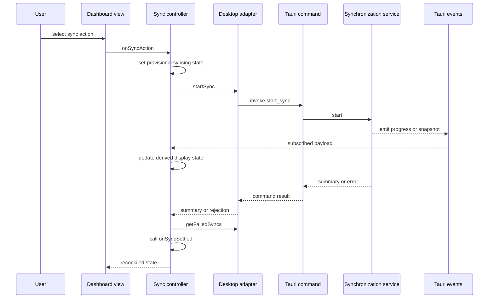

# Frontend UI and IPC Boundary

The webview is a client of desktop state rather than the owner of persisted credentials, folders, or synchronization work. The root Svelte route composes controllers around presentational components. Controllers own interaction and display state, use a typed adapter for request/response operations, and reconcile meaningful state with backend snapshots and native events.

## Composition and ownership

`src/routes/+page.svelte` creates the production `tauriDesktopAdapter`, then composes feedback, auth, sync, watched-folder, removable-volume, preferences, update, target-album, timeline, people, and album-catalogue controllers. Components receive state and intent callbacks rather than invoking Tauri directly.

- Watched folders own picking, pending album selection, mutations, and the list used by `sync.canStartSync`. A removable-volume acceptance dismisses its prompt only after the backend mutation succeeds; a folder removal refreshes sync failures.
- Sync owns progress, failed work, logs, and native sync subscriptions. Its settlement callback refreshes both watched folders and the main timeline.
- Authentication refreshes the main timeline, failed work, and folders after login. Logout clears shared catalogue, prompt, feedback, sync, folder, timeline, people, and album state before returning to Photos.
- Selecting a person or album creates a scoped timeline controller and refreshes it. Returning clears that controller and restores the prior People or Albums scroll position. Preferences can append a database-recovery notice to the sync log, and updates receive `sync.isActive` to prevent installation while sync is running or paused.

Authentication selects the outer UI: unauthenticated users see `LoginView`; authenticated users see the sidebar shell. Route-local `currentView` selects Photos, People, Albums, their scoped timelines, Dashboard, Logs, Settings, or Info. The route owns selection and controller wiring; views render the supplied state and forward user intent.

| Owner | Frontend state and interaction | Desktop boundary |
| --- | --- | --- |
| Auth controller | credentials form, authentication, current user, and login errors | auth commands and confirmation dialog |
| Sync controller | dashboard status, failed work, progress, transfer metrics, activity log, and event cleanup | sync commands and sync events |
| Watched-folders controller | folders, native picker, pending target-album modal, removal confirmation, and removable-folder acceptance | folder commands and dialog plugin |
| Timeline, people, and album controllers | paged people, album catalogue, time buckets, assets, and scoped album or person timelines | timeline, people, and album commands; opener plugin is passed to views |
| Preferences controller | theme, locale, autostart, parallelism, and saving state | local storage, autostart plugin, and settings commands |
| Update controller | channel, version, update dialog, and install progress | updater/process plugins and startup probes |
| Removable-volume controller | volume prompts and volume-event subscriptions | volume events and notification plugin |

## Typed adapter and change surface

`DesktopAdapter` combines narrower capability interfaces for auth, sync, watched folders, albums and album catalogues, timelines, people, preferences, updates, and removable volumes. Controllers depend on their narrow capability interface; `tauriDesktopAdapter` satisfies the complete contract. It maps application operations to `invoke` command strings and camel-case argument objects such as `targetAlbumId`, `confirmCancellation`, `timeBucket`, and `uploadParallelism`. It also encapsulates dialogs, autostart, updater and process operations, opener, notifications, and event listeners behind the same controller-facing boundary.

The Rust app registers the application commands in its `invoke_handler`. A Rust source-level test enumerates every application command used by the adapter and checks that its quoted command name occurs in the adapter and that the handler is registered. The frontend adapter test, by contrast, mocks Tauri APIs and pins the complete command/payload mapping plus plugin delegation. Together these tests protect command-registration coverage and TypeScript-side argument casing; they do not validate Rust deserialization or serialized result shapes. Treat a command change as a coordinated API change:

1. Change the capability interface, adapter invocation, TypeScript contract, and camel-case arguments together.
2. Change and register the Rust command, then validate service-level authorization, persistence, and error semantics.
3. Update the owning controller and its fake-adapter tests; update component tests only for callback wiring or presentation.
4. Preserve result shapes where possible. If a shape changes, update Rust serialization, `contracts.ts`, controller reconciliation, and affected tests in the same change.

## Lifecycle, hydration, and disposal

On mount, the route starts sync, watched-folder, update, and preferences lifecycles, and begins removable-volume subscriptions. It independently hydrates authentication, watched folders, sync status, and preferences. Sync event subscriptions begin only after `sync.hydrate()` resolves. Update startup concurrently discovers the release channel/checks for an update and loads the app version.

Unmount destroys sync, watched-folder, update, preferences, and removable-volume lifecycles. The sync controller clears its progress-reset timer and invokes its subscription disposer. Subscription registration is asynchronous: the helper immediately calls an unlisten function that resolves after disposal or after its supplied `isActive` predicate becomes false. Controllers also use mounted or generation checks to avoid applying late command results to disposed state.

## Synchronization feedback path

The sync controller hydrates a backend `SyncSnapshot` through `getSyncStatus`; `RUNNING`, `PAUSED`, and `FAILED` map to the display states `syncing`, `paused`, and `error`, while an idle snapshot with failures is also an error. Pause and resume apply the snapshots returned by their commands. Manual start is guarded against active sync, a pending action, and no hydrated watched folders; it first provides provisional syncing state, then reconciles the returned `SyncSummary`. On `sync-idle`, the controller refreshes persisted failed entries and calls its settle callback; the route uses that callback to refresh watched folders and the main timeline before the controller selects `idle` or `error`.

`subscribeToSyncEvents` is the sole sync-event registration helper. It listens for `sync-progress`, `sync-progress-percent`, `sync-started`, `sync-transfer-stats`, `sync-progress-snapshot`, `sync-paused`, `sync-resumed`, `sync-error`, `log-message`, and `sync-idle`. Progress and transfer events update display fields, snapshot events restore authoritative state, errors set the error state, and idle invokes terminal reconciliation. There is no `trigger-sync` subscription in the current event contract.

*Manual synchronization combines the command result with asynchronous events and a terminal backend refresh.*

The `start_sync` command itself is a thin Tauri adapter to `Synchronization::start`; concurrency, lifecycle transitions, persistence, and pipeline execution remain in the backend service. This is why the frontend must treat its provisional state as feedback, rather than proof that its request exclusively started work.

Backend UI logs arrive as `log-message` payloads with a normalized level, fallback message, timestamp, and optional localization key/parameters. The sync controller assigns its own entry IDs, formats timestamps for the current locale, and retains the newest 50 entries. `ActivityLog` can translate a keyed entry and fall back to its supplied message.

## Watched folders and removable media

The watched-folders controller separates folder ownership from sync state. A normal add opens the directory picker, records a pending path, then opens target-album selection; confirmation invokes `addFolder` and refreshes the list. It refreshes after successful exclusion-pattern changes too.

Removal is deliberately two-stage. The first `removeFolder(id)` obtains whether sync cancellation is required. The controller shows either the cancellation warning or normal confirmation, and invokes `removeFolder(id, true)` only after approval. It then refreshes folders and failed syncs.

For a detected removable volume, the picker is rooted at the volume mount path. The controller retains the chosen path and volume until the target-album modal confirms. It invokes `acceptRemovableMediaFolder(volumeId, path, targetAlbumId)`, dismisses the volume prompt only after that succeeds, and refreshes folders. Errors report feedback without dismissing the prompt.

## Preferences, authentication, and updates

Preferences store theme and locale locally while coordinating desktop state independently. Theme is persisted under `lymic-theme`, applied to the document, and reapplied for system color-scheme changes. Lifecycle startup selects a valid stored locale from `lymic-locale` (or the current locale), applies it immediately, and sends `updateLocale`; a failed write is logged without rolling back the local choice. Hydration independently loads the locale catalogue, autostart plugin state, upload parallelism, and a database-recovery notice. Autostart writes through its plugin and rereads the state. A failed upload-parallelism write restores the select's prior value.

The auth controller hydrates status before server URL and current-user data. Login requires server URL and API key, rejects an incomplete Cloudflare Access client-id/secret pair before IPC, clears sensitive fields after success, and then executes the route's post-login refresh. Logout requires dialog confirmation and only clears frontend user state after the backend logout succeeds.

Update checks and installation are disabled for the `store` release channel. For supported channels, the update controller guards against duplicate checks, disregards late results after destruction, and records startup probes on a best-effort basis. Installation returns without action when no update is available, synchronization is active, or an install is already underway. Otherwise it records download bytes/content length from updater events, transitions to installing on completion, downloads/installs through the updater plugin, and calls the process relaunch plugin; a mounted controller records an error state on failure.

## Tests and safe extension

Prioritize controller tests that inject a fake capability interface: hydration/snapshot mapping, terminal reconciliation, pause/resume, event disposal, folder confirmation, removable-media acceptance, locale and parallelism failures, login validation, and update guards/progress. Adapter tests should pin command names and argument casing. Keep the Rust adapter-registration test aligned with the application command set, then test service behavior independently. Run the frontend and backend checks described in [Development and Testing](../operations/development-and-testing.md) whenever changing this boundary.

## Related topics

- [Desktop Runtime Architecture](../architecture/runtime.md) describes backend startup, plugins, and command registration.
- [Release Distribution](../operations/release-distribution.md) explains release channels and updater distribution.
- [Authentication and Credential Security](../security/authentication.md) describes backend credential handling.
- [Synchronization Workflow](../workflows/synchronization.md) describes the pipeline behind sync commands and events.
- [Watched Folders and Media Discovery](../workflows/watched-folders.md) describes watched-folder persistence and discovery.
