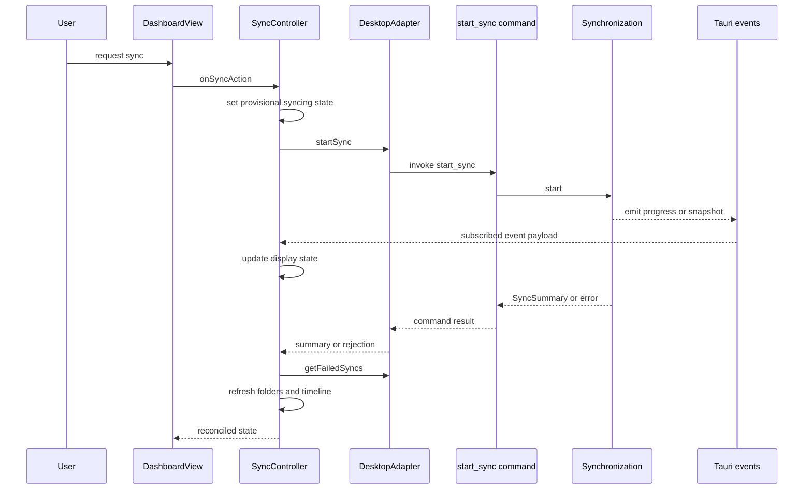

# Frontend UI and Desktop IPC

The webview renders desktop state; it does not persist credentials, watched folders, or synchronization work. `src/routes/+page.svelte` composes stateful Svelte controllers around presentational views. Controllers own user interaction and display state, invoke narrow adapter capabilities, and reconcile that state with backend snapshots and native events.

## Composition root and view ownership

The route creates the production `tauriDesktopAdapter`, feedback, auth, sync, watched-folder, removable-volume, preference, update, target-album catalogue, timeline, map, people, and album controllers. It owns route-local `currentView`, selected album/person state, and the scroll positions used when returning from scoped timelines.

Authentication selects the outer shell: an unauthenticated user receives `LoginView`; an authenticated user receives a sidebar and the selected Photos, Map, People, Albums, person timeline, album timeline, Dashboard, Logs, Settings, or Info pane. The route passes controller state and intent callbacks to these views. Where a view needs an operation such as opening a URL, loading asset details, or downloading an asset, the route passes the relevant adapter function explicitly rather than having the view construct a Tauri client.

| Owner | State and coordination responsibility |
| --- | --- |
| Auth controller | Login form values, authentication status, user identity, validation, and login errors. |
| Sync controller | Dashboard state, progress, transfer metrics, failed entries, activity logs, and sync-event lifecycle. |
| Watched-folders controller | Folder list, native-picker flow, target-album dialog state, removal confirmation, and removable-folder acceptance. |
| Timeline, map, people, and album controllers | Catalogues and paged/scoped media data; the route creates scoped album/person timelines on selection. |
| Preferences and update controllers | Local UI preferences, desktop settings, release/update state, and installation progress. |
| Removable-volume controller | Volume prompt queue and native volume-event subscriptions. |

Selecting a person or album saves the catalogue pane's scroll position, creates the corresponding scoped timeline with that entity ID, changes the view, and refreshes it. Returning clears the scoped controller and restores the saved scroll position in a microtask. Opening Map marks it as created and refreshes it; it remains mounted and receives an `active` flag thereafter.

### Cross-controller dependencies

The route deliberately composes callbacks instead of coupling controllers to one another:

- `sync.canStartSync` reads whether watched folders exist. On terminal sync reconciliation, the route refreshes watched folders and the main timeline.
- A folder removal refreshes failed sync entries. A successful removable-folder mutation calls the removable-volume controller to dismiss the matching prompt.
- Login clears map state, selects Photos, and refreshes the main timeline, failures, and folders. Logout clears catalogues, prompts, feedback, sync/folder/media state, scoped timelines, and returns to Photos.
- Preferences can append a recovery notice to the sync log. The update controller receives `sync.isActive`, preventing update installation while sync is syncing or paused.

## The typed desktop boundary

`DesktopAdapter` is the complete controller-facing contract. It is an intersection of capability interfaces for authentication, sync, watched folders, albums and assignment, catalogue and timelines, map and people, preferences, updates, and removable volumes. Controllers type against the smallest relevant interface, which makes fake adapters practical in controller tests.

`tauriDesktopAdapter` maps application operations to `invoke` with the Rust command name and camel-case payload keys—for example `targetAlbumId`, `confirmCancellation`, `timeBucket`, and `uploadParallelism`. It also hides Tauri plugins behind the same boundary: dialog open/save/confirm, autostart, updater, process relaunch, external opener, notifications, and native event listeners. `checkForUpdate` stores the updater result in module-local `pendingUpdate`; `downloadAndInstallUpdate` rejects if no prior check found an update.

The Rust builder registers application commands in its `invoke_handler`, including the adapter's sync, folder, auth, album, media, map, people, locale, startup-probe, recovery-notice, and release-channel commands. Plugin operations are intentionally not Rust command registrations.

### Safe command changes

Treat a command as one API spanning TypeScript and Rust:

1. Change the relevant narrow adapter interface, implementation, and `contracts.ts` result/request type together.
2. Add or change the Rust command and its `invoke_handler` registration; preserve Rust serialization names expected by the camel-case frontend payload.
3. Update the controller's reconciliation and error behavior, then its fake-adapter tests.
4. Update the adapter mapping test and the Rust registration list. Test authorization, persistence, and service behavior separately from registration coverage.

The adapter test mocks Tauri APIs and asserts the complete application-command sequence, argument casing, and plugin delegation. The Rust source-level test enumerates application command strings and asserts that each occurs in both `desktop-adapter.ts` and the Rust handler. Together they catch mapping and registration drift, but neither proves Rust deserialization nor serialized result-shape compatibility.

## Startup, disposal, and stale-result protection

On mount, the route starts sync, watched-folder, update, and preference lifecycles and begins removable-volume subscriptions. It hydrates auth, folders, sync, and preferences independently. Sync listeners start only after `sync.hydrate()` resolves; update startup runs its own probes. Unmount destroys sync, watched-folder, update, and removable-volume controllers and stops the preference lifecycle.

The sync controller holds a `mounted` guard, clears its progress-reset timer, and calls the event disposer on destruction. The subscription helper accommodates asynchronous `listen` registration: if disposal or the supplied active predicate occurs before `listen` resolves, it immediately calls the late unlistener; otherwise it retains the unlistener for disposal. Watched-folder refreshes additionally use a generation counter, so a response begun before `clear()` cannot repopulate logged-out state.

## Sync command and event reconciliation

A hydrated `SyncSnapshot` is authoritative for display state: `RUNNING`, `PAUSED`, and `FAILED` map to `syncing`, `paused`, and `error`; an otherwise idle snapshot with failures is also an error. A start is ignored while active, while a pause/resume action is pending, or when no watched folder exists. It initially displays provisional sync state, then reconciles the `SyncSummary` returned by `start_sync` or `retry_failed_syncs`. Pause and resume apply their returned snapshots.

`subscribeToSyncEvents` is the one sync-listener registration point. It listens for `sync-progress`, `sync-progress-percent`, `sync-started`, `sync-transfer-stats`, `sync-progress-snapshot`, `sync-paused`, `sync-resumed`, `sync-error`, `log-message`, and `sync-idle`. Progress and snapshot events update displayed work; errors set error state and report a nonempty reason; `sync-idle` invokes terminal reconciliation. There is no `trigger-sync` listener.

*The UI combines the `start_sync` result with asynchronous Tauri events, then refreshes persisted terminal state.*

The Rust `start_sync` command is a thin adapter to `Synchronization::start`; it does not implement the synchronization pipeline. Accordingly, provisional frontend state is feedback for the user, not proof that this webview exclusively started work. On terminal completion, the controller refreshes persisted failed entries, invokes the route's settlement callback, then selects `idle` or `error`. It keeps the newest 50 UI log entries, assigns local IDs, and formats their timestamps using the current locale.

## Folder, authentication, and error flows

Adding a folder first opens the directory picker, then stores a pending path and opens target-album selection. Confirmation invokes either `addFolder` or `acceptRemovableMediaFolder` and refreshes the list. For removable media, the picker defaults to the mount path; the native volume prompt is dismissed only after the backend acceptance succeeds. Failed picker or mutation operations report feedback.

Folder removal is deliberately two-stage: the first `removeFolder(id)` determines whether cancellation is necessary, the controller displays the corresponding warning, and only a confirmed action calls `removeFolder(id, true)`. Success refreshes folders and failed sync entries. Exclusion-pattern writes likewise refresh only after success.

The auth controller first obtains authentication status, then loads server URL and user data only when authenticated. Login requires a URL and API key and rejects a partial Cloudflare Access client-id/secret pair before IPC. On successful login it clears the API key and secret, runs the route's refresh callback, and loads the user. Logout requests native confirmation and clears frontend user state only after the backend command succeeds. Controller failures either surface a shared dismissible feedback error or, for login validation/known login errors, populate login-specific state.

## Focused testing

Prioritize controller tests with fake capability interfaces for snapshot mapping, terminal reconciliation, event disposal, guarded start/pause/resume, stale refreshes after logout, folder confirmation, removable-media acceptance, login validation, and update guards/progress. Keep the adapter test authoritative for command names and camel-case argument objects, and keep the Rust registration test's command list aligned with application commands. Run the frontend and backend checks described in [Quickstart](../quickstart.md) when changing this boundary.

## Related topics

- [Desktop Runtime Architecture](../architecture/runtime.md) covers backend startup, plugins, and command registration.
- [Immich API Integration](../integrations/immich-api.md) describes the remote service behind user-facing media operations.
- [Authentication and Credential Security](../security/authentication.md) describes credential handling beyond the UI form.
- [Synchronization Workflow](../workflows/synchronization.md) covers the pipeline behind sync commands and events.
- [Watched Folders](../workflows/watched-folders.md) describes watched-folder persistence and discovery.
