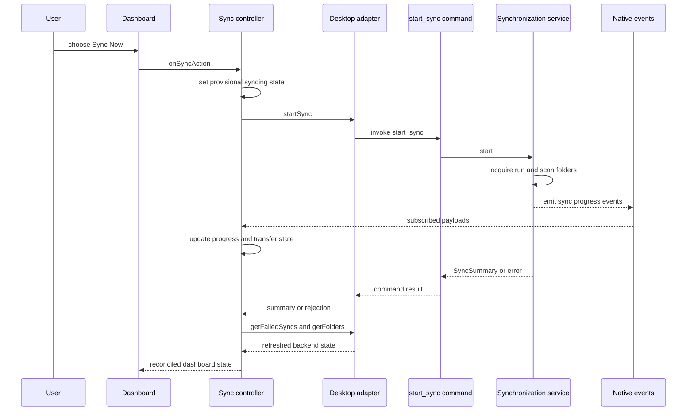

# Frontend, Controllers, and Desktop IPC

The webview is a stateful client of the desktop backend, not the owner of synchronization, credentials, folders, or settings persisted by Rust. The root route composes view components around controllers; controllers hold presentation and interaction state, call a typed desktop adapter for request/response work, and reconcile important state with command results and native events.

## Composition root and ownership

`src/routes/+page.svelte` constructs one shared `tauriDesktopAdapter`, feedback controller, album catalogue, removable-volume controller, sync controller, auth controller, preferences controller, and update controller. It injects dependencies between them rather than letting components reach directly into Tauri:

- The auth controller refreshes failed syncs after login; logout clears sync-facing user state and resets the local pane to **Dashboard**.
- The sync controller receives localized error/reporting functions and a callback to dismiss a removable-volume prompt only after its folder acceptance succeeds.
- Preferences can append a database-recovery notice to the sync activity log. The update controller receives a predicate derived from `sync.isActive`, so it can refuse an installation during a running or paused synchronization.

Authentication selects the outer UI. An unauthenticated user gets `LoginView`; an authenticated user gets the sidebar shell. The route-only `currentView` state selects **Dashboard**, **Logs**, **Settings**, or **Info**. It passes `sync.dashboard`—state plus intent callbacks—to the dashboard, exposes the same dashboard log collection in the log pane, supplies controller values/callbacks to settings, and passes the update controller's app version to the info view. Consequently, components render inputs and forward intent, while cross-process actions and shared lifecycle live in controllers.

| Controller | Webview responsibility | Boundary it coordinates |
| --- | --- | --- |
| Auth | login fields, authentication state, identity, and login errors | auth/status commands |
| Sync | derived dashboard state, folders, failures, progress, logs, dialogs, action pending state, and event cleanup | sync/folder commands, dialog plugin, and sync events |
| Preferences | theme/locale selection, autostart state, upload parallelism, and its saving indicator | local storage, autostart plugin, and settings commands |
| Update | version, check/dialog status, and download/install progress | app, updater, and process plugins plus startup-probe command |
| Removable volume | queued/dismissed volume prompts and their subscriptions | volume events and notification plugin |

## Adapter: the command contract

`DesktopAdapter` is the frontend's explicit request/response contract. Its methods express application operations such as `startSync`, `getSyncStatus`, folder mutations, auth, albums, locale settings, recovery notices, and startup-phase probes. `tauriDesktopAdapter` is the sole production implementation: it maps each method to an `invoke` command name and serializes camel-case argument keys such as `targetAlbumId`, `confirmCancellation`, and `uploadParallelism`.

The Rust builder registers those command handlers in its `invoke_handler`. A Rust test reads the adapter source and registration list and asserts that every adapter command appears in both. That test protects registration coverage, but cannot verify argument names or serialized request/result shapes. Treat all three of these as one versioned IPC API:

1. Update the adapter interface and its `invoke` call, including its TypeScript result type and argument casing.
2. Add or update the Rust `#[tauri::command]` handler and register it in `app/mod.rs`.
3. Update the controller that owns the interaction and its mocked-adapter tests; update backend command/service tests for validation and failure semantics.
4. Preserve a response shape when possible; otherwise coordinate the Rust serialization, adapter type, controller reconciliation, and affected component tests in the same change.

Commands are deliberately thin at the Tauri edge. For example, the `start_sync`, pause/resume, status, retry, and failed-item commands construct a `Synchronization` service or read persisted data; the service owns concurrency, state transitions, and pipeline execution. The adapter is also a useful test seam: controller tests can provide a fake `DesktopAdapter` instead of mocking every global `invoke` call.

## Mount, hydration, and disposal

On route mount, sync, update, and preferences controllers first enter their lifecycle; removable-volume subscriptions start; then auth, sync, and preferences hydrate. Sync event subscriptions begin only after `sync.hydrate()` resolves. Auth hydration triggers a failed-sync refresh only when it establishes that the user is authenticated. Update startup independently checks for an update and loads the app version.

The route cleanup destroys sync and update controllers, removes the preferences media-query listener, and destroys removable-volume subscriptions. The sync controller marks itself unmounted, clears its delayed progress-reset timer, and invokes the event unsubscriber. The event adapter accounts for `listen` being asynchronous: if an unlisten function arrives after disposal or deactivation, it immediately invokes that function rather than retaining a leaked native listener. Mounted checks also prevent late command results and event callbacks from changing disposed controller state.

## Sync reconciliation and event flow

The sync controller hydrates folders via `getFolders` and applies `getSyncStatus` as a snapshot. A snapshot maps backend `RUNNING` to `syncing`, `PAUSED` to `paused`, and other statuses to `idle` or `error` according to failures; it also derives counts, progress, and current file. This makes backend data authoritative after hydration and pause/resume, while local state supplies immediate interaction feedback.

A manual start and retry provisionally set `syncing`, reset progress/transfer fields, then await their respective command. `finishSync` refreshes failed items *and* folders before choosing the visible terminal state: any failed summary or persisted failure yields `error`; otherwise it records a completion time, shows 100% progress, and schedules a reset. A failed retry reports the error, refreshes failures, and enters `error`. A failed manual start enters `error` directly. The controller does not start when already active, an action is pending, or no watched folder has been hydrated.

`subscribeToSyncEvents` centralizes native subscriptions for `sync-progress`, `sync-progress-percent`, `sync-started`, `sync-transfer-stats`, `sync-progress-snapshot`, `sync-paused`, `sync-resumed`, `sync-error`, `trigger-sync`, `log-message`, and `sync-idle`. Progress and transfer events update derived display state; snapshots apply durable state; `sync-error` sets error; and `sync-idle` calls the same `finishSync` reconciliation. A `trigger-sync` event uses the normal guarded start path. Log payloads are normalized into an in-memory, newest-first collection capped at 50 entries; keyed messages can be translated by `ActivityLog`, with the backend message available as fallback.

*Representative manual synchronization: provisional UI feedback is reconciled with the command result, native events, and backend refreshes.*

The backend service requires at least one folder, scans it, persists admitted work, and atomically claims the running lifecycle before constructing authenticated pipeline execution. If a run is already claimed, a second producer joins it and receives no independent summary; a paused lifecycle similarly is not started again. Manual producers await the runner they claimed, then clear the in-memory guard. A failed run clears that guard, persists a `FAILED` snapshot when possible, updates the tray, emits that snapshot, audits the abort, and returns the error. The UI must therefore reconcile its provisional status with the command result and events rather than assuming its request claimed a run. Pause returns and emits the persisted paused snapshot. Resume returns the existing snapshot when it was not paused; otherwise it persists/emits a running snapshot and may resume recovered queued work.

## Folder, removable-media, and preference operations

Adding a normal folder uses the dialog plugin to choose a path, stores it as pending, and opens target-album selection; confirmation calls `addFolder` with an optional album and refreshes folders. Removal is a two-stage protocol: first invoke `removeFolder(id)` to learn whether cancelling active work is required, then display the appropriate warning, and invoke `removeFolder(id, true)` only after confirmation. Folder exclusion-pattern writes refresh the folder list after a successful command.

For a removable volume, accepting the route prompt opens the native chooser rooted at its mount path. The controller retains the selected path and volume until album selection; confirmation calls `acceptRemovableMediaFolder(volumeId, path, targetAlbumId)`, then invokes the route's dismissal callback and refreshes folders. Failure reports an error without calling that callback.

Preferences separate local presentation preference from desktop settings. Theme is stored in `localStorage` under `lymic-theme`, applied as a document data attribute, and reapplied for a system color-scheme change when the preference is `system`. Locale is locally stored under `lymic-locale`, validated, applied to Svelte i18n, and then sent through `updateLocale`; a failed backend locale write is logged but does not roll back the chosen local locale. Hydration obtains the backend locale catalogue and upload parallelism, asks the autostart plugin for its actual enabled state, and adds any database-recovery notice to the activity log. Autostart toggles through its plugin and rereads its state. Upload parallelism is persisted through commands; while saving, its state is exposed to the view, and a failed write restores the HTML select to its prior value.

## Updates, external integration, and focused tests

The update controller obtains the release channel from the adapter at startup, then loads the app version and, for the `github` channel, performs an updater check while recording best-effort webview startup phases through the adapter. The `store` channel disables update checks, installation, and update UI (`isUpdatesSupported` is false); an adapter failure leaves the initially configured channel in effect. The controller ignores failed phase recording, ignores check/version results after destruction, and avoids duplicate checks. For a supported channel, installation returns immediately if no update is available, synchronization is active, or download/install is already in progress; otherwise it tracks updater started/progress/finished events, calls `downloadAndInstall`, and then asks the process plugin to relaunch. Errors move a mounted controller to the `error` install state.

Focused controller tests should cover the behavior at this boundary: adapter request arguments/results, snapshot mapping, terminal reconciliation, pause/resume, two-stage removal, removable-media acceptance, and timer/listener cleanup. Adapter tests should assert the `invoke` mapping and argument casing; the Rust registration test should remain aligned with the adapter. Component tests are best limited to callback wiring and observable presentation. Run the frontend and backend commands described in [Development and Testing](../operations/development-and-testing.md) after changing a boundary contract.

## Related topics

- [Desktop Runtime Architecture](../architecture/runtime.md) explains backend startup, plugins, and command registration.
- [Synchronization Workflow](../workflows/synchronization.md) explains the pipeline behind these commands and events.
- [Watched Folders and Media Discovery](../workflows/watched-folders.md) covers watched-folder persistence and media discovery.
- [Authentication and Credential Security](../security/authentication.md) covers login validation and backend credential handling.
