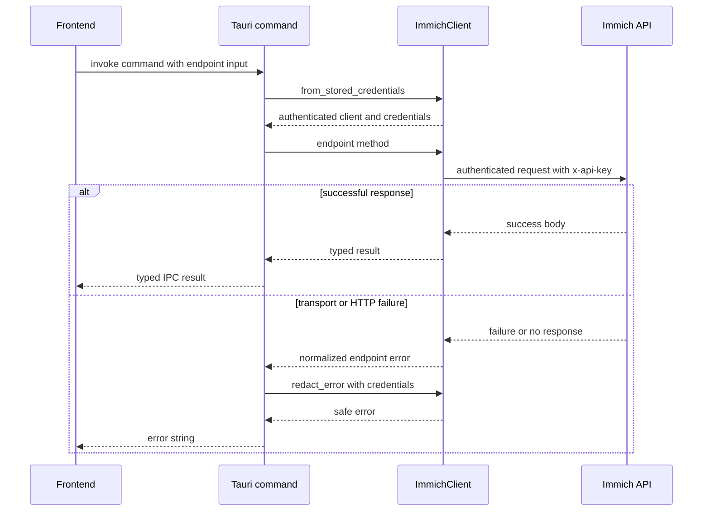
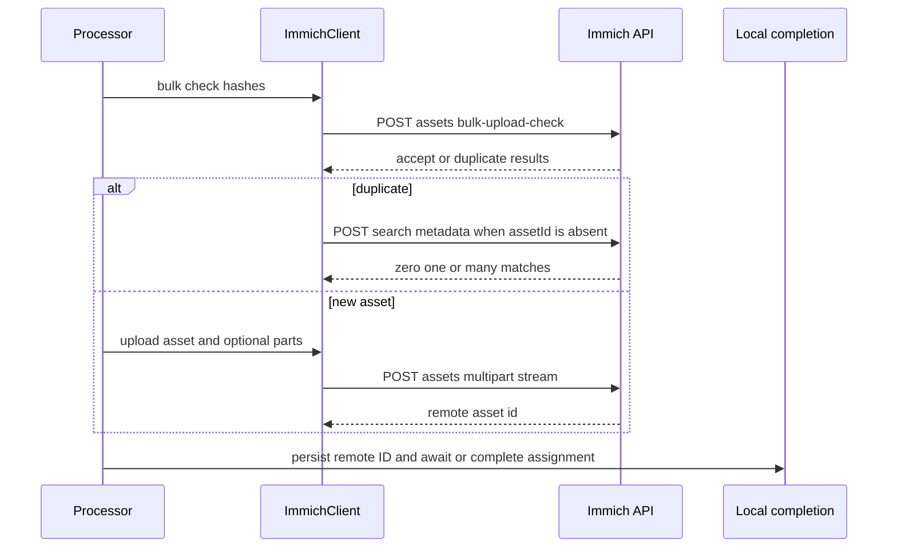
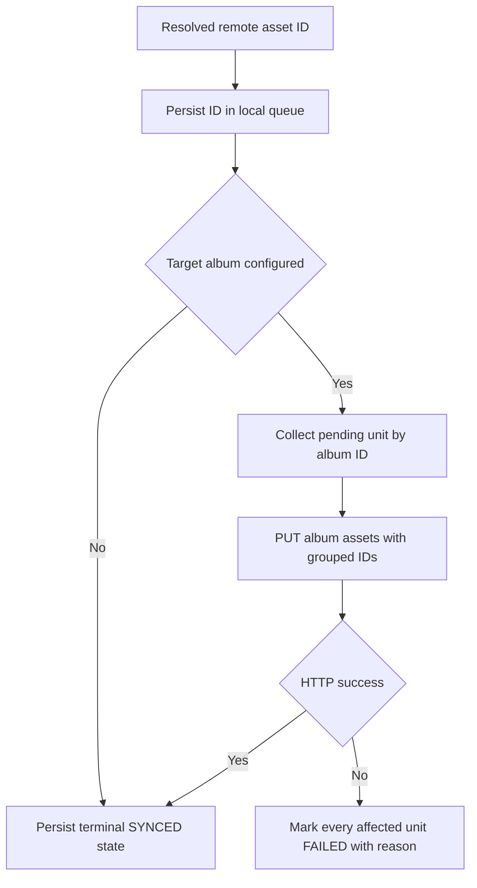

# Immich API Integration

`ImmichClient` is the backend boundary for authenticated Immich REST calls. It owns normalized API URLs, the `x-api-key` header, optional Cloudflare Access headers, request construction, response limits, and compatibility decoding. It does **not** own queue scheduling or terminal synchronization state: the sync processor and completion layer decide when a local upload unit is complete or failed.

## Authentication and transport boundary

Credentials contain the server URL, Immich API key, an opt-in local-HTTP setting, and an optional Cloudflare Access client-ID/secret pair. They are stored as one JSON value in the OS keyring; debug formatting redacts the API key and Cloudflare secret. Login first constructs a temporary client and calls `GET users/me`; credentials are stored only after that validation succeeds. The current-user display name is `name`, falling back to `email`, and an empty result is rejected.

The client normalizes a server URL to an `/api/` base while retaining a configured path prefix. It accepts HTTPS, or HTTP only when `allow_local_http` is enabled **and** the host is `localhost` or a loopback IPv4/IPv6 address. URLs without a host, with embedded credentials, query parameters, or fragments are rejected. Redirects are disabled so an API-key request cannot be redirected from HTTPS to HTTP. Cloudflare Access is all-or-nothing: both configured values become default request headers, with the secret marked sensitive.

Stored-credential callers use `ImmichClient::from_stored_credentials()`. It derives an account identifier, reuses a cached `Arc<ImmichClient>` only while the complete credentials match, and redacts all credential values from construction and downstream errors. Thin Tauri commands either use this helper or load credentials and construct the client directly; this keeps the UI from supplying a server URL or API key per request.

## Endpoint contracts and compatibility

Every Immich request uses `x-api-key`. The boundary uses explicit response shapes rather than passing Immich JSON through unchanged.

| Area | Request and local contract |
| --- | --- |
| Connection and profile | `GET users/me` supplies ID, display name, and `profileImagePath`; `GET users/{userId}/profile-image` is used only when an image is advertised. |
| Synchronization | `POST assets/bulk-upload-check` receives local SHA-1 Base64 values as both `id` and `checksum`; `POST assets` is multipart and sends `x-immich-checksum`. |
| Album target management | `GET albums` for `get_albums` produces sorted id/name `Album` values; `POST albums` sends a trimmed nonempty `albumName`; `PUT albums/{albumId}/assets` sends `{ "ids": [...] }`. |
| Album catalogue | A separate `GET albums` call preserves Immich ordering and decodes presentation fields: thumbnail asset ID, count, sharing status, and order. |
| Timeline | `GET timeline/buckets` and `GET timeline/bucket` use `size=MONTH`; album timelines use paged `POST search/metadata` with `albumIds`, `withExif`, descending order, and a size of 1,000. |
| People and media | `GET people` is paged with `page` and `size`; thumbnail, preview, and original asset calls use the `people/{id}/thumbnail` and `assets/{id}/...` endpoints. |
| Map | `GET map/markers` returns marker IDs and coordinates for the map view; malformed, missing, non-finite, or out-of-range coordinates are excluded locally. |

`Album` and `AlbumCatalogueItem` intentionally remain separate. Target-album selection needs only a typed `AlbumId` and name and is sorted case-insensitively for its established UI contract. The read-only catalogue instead retains server order and display metadata, so catalogue changes cannot alter synchronization selection behavior. `get_album_catalogue`, `get_albums`, and `create_album` are authenticated Tauri entrypoints; the latter rejects a blank name before credential lookup and the client validates it again.

Compatibility decoding is deliberately localized. Timeline bucket responses accept either ordinary asset arrays or Immich's columnar form; columnar entries derive dimensions from a ratio and map `isImage` to `IMAGE` or `VIDEO`. Asset fields accept established naming variants for EXIF dimensions and timestamps, duration accepts milliseconds or colon-delimited text, and `nextPage` accepts a number or numeric string. Album search likewise accepts `assets.items`, `items`, or a bare array. Invalid pagination that does not advance is rejected rather than looping indefinitely.

Recognized-people endpoints turn `401` and `403` into stable, user-actionable tokens; the latter names the required `person.read` and `asset.read` API-key permissions. Their page result uses Immich's `hasNextPage` when present, otherwise computes it from `total`, page, and size. The map endpoint similarly normalizes transport and non-success results to `map_unavailable`, with distinct authentication and permission tokens; a `403` tells the user to configure `map.read`, `asset.read`, and `asset.view`. It accepts a large (128 MiB) marker list but filters each coordinate to finite latitude `[-90, 90]` and longitude `[-180, 180]`. The compatibility evidence records that the inspected upstream v2.4.1 route had no dedicated permission whereas v2.5.0 requires `map.read`; Lymic does not declare a minimum supported Immich version, so supported releases must be tested before claiming a compatibility range. Other endpoint failures report a redacted status-only error.

## Response and error limits

Most JSON methods—including album, bulk-check, people, timeline, and upload responses—read successful bodies through the shared 1 MiB bounded reader. It rejects both an oversized declared `Content-Length` and a streamed body that crosses the limit. Current-user JSON is decoded directly, so it is not covered by that general success-body cap.

The shared error-body reader caps a diagnostic read at 8 KiB, flattens whitespace, and marks truncation. However, `response_status_error` deliberately discards that server-provided detail and returns only `request failed with status ...`; endpoint errors therefore do not relay server response bodies outside the Immich boundary. Profile images independently reject declared or received bodies over 10 MiB and retain a content type only when it starts with `image/`.

Media has endpoint-specific limits: asset thumbnails and previews use a 20 MiB bounded reader, person thumbnails reject received bodies over 20 MiB, and original asset responses are limited to 32 MiB. Dynamic IDs are validated as a single safe path segment before interpolation, rejecting empty, traversal-like, slash, whitespace, control, query, and fragment values.

## Authenticated request and failure propagation

Tauri commands obtain the stored client rather than accepting transport credentials from the frontend. They delegate the endpoint call and redact the returned error with the same credentials before returning it across IPC. Within most client methods, an unsuccessful HTTP response is converted to a status-only error; people and map calls instead return their documented stable access tokens.

This sequence shows stored-credential authentication and the normalized, redacted failure path used by Tauri-facing Immich operations.

## Duplicate detection and upload protocol

The sync processor hashes units and submits their asset hashes to the bulk-check endpoint in chunks of at most 100. The parser treats the response as a strict correspondence contract: it requires exactly one result for each requested ID, rejects unexpected/duplicated/omitted IDs and unknown actions, and recognizes a duplicate as `reject` with no reason or reason `duplicate`. It returns the optional `assetId` supplied with a duplicate. `401 Unauthorized` and `403 Forbidden` are non-retryable bulk-check errors; network, malformed-response, and other HTTP-status failures are retryable at this boundary.

A nonduplicate is sent as a multipart upload. `assetData` is streamed from an async file handle and includes the file creation and modification times. A live-photo video, when present, is streamed as `livePhotoData`. The uploader also looks for an XMP sidecar named either `stem.xmp` or `filename.ext.xmp` (case-insensitively), prefers the stem form, and streams a regular sidecar as `sidecarData`; a sidecar over 10 MiB fails preparation. File chunks update transfer statistics as they are read rather than buffering the upload in memory. A successful upload response must contain a nonblank `id`.

Upload timeout is payload-sensitive: it starts at five minutes and adds two hours per GiB, rounding partial GiB values upward. This applies to the combined asset, live-photo, and attached-sidecar byte count.

This sequence shows the source-defined duplicate-resolution and upload calls before the API boundary hands a remote ID to local completion.

## Album API versus local orchestration

`AlbumId` and `RemoteAssetId` are separate transparent string newtypes, including in serialization and SQLite bindings. Keep the distinction at integration boundaries: album API methods consume `AlbumId`, whereas queue completion and membership batching carry `RemoteAssetId`, avoiding accidental interchange of the two remote identifiers.

Album methods are API primitives: fetch, create, add IDs, and checksum search. Assignment validates a safe album path segment and requires nonempty, unique asset IDs. On a successful `PUT albums/{albumId}/assets`, it decodes one `{ id, success }` result per requested ID, rejects incomplete, duplicate, or unexpected result sets, and returns success and failure counts; the convenience method treats any failed item as an error. They do not know about watched folders, queues, retries, or synchronization state. Conversely, the sync pipeline carries the target album selected for an asset into the queued work and invokes the client only after it has a remote asset ID.

That ID can originate from a fresh upload, a previously persisted queue ID, or a duplicate. For a duplicate, Lymic uses the bulk-check `assetId` when available; otherwise it performs the checksum search and requires exactly one match. Failure to resolve a unique ID fails the local upload unit rather than silently treating it as complete.

For target-album work, local completion persists the remote ID **before** returning a pending-album result. The processor accumulates pending units for one bulk-check chunk, then the album batching layer groups them by `AlbumId` and calls `add_assets_to_album` once per group. Only after the corresponding API call succeeds does local completion write terminal `SYNCED` state. This makes album membership a required local outcome rather than a best-effort post-upload action.

This is local queue and completion control flow; grouping and failure marking are not requirements imposed by the Immich album endpoint itself. If the album request fails, every unit in that album group is marked failed, with UI and audit events. If the request succeeds but durable local completion fails, that unit is also marked failed to avoid reporting a false synchronized result. The queue remains the recovery boundary and retains its persisted remote ID, so retry processing can resume assignment without another upload.

## Local media protocols

The frontend does not receive authenticated Immich URLs. Tauri URI schemes obtain the stored client and proxy bytes to the webview:

- `lymic-asset://asset/{id}` requests the preview thumbnail; `lymic-asset://video/{id}` requests the original asset with a `Range` header. The protocol bounds missing, malformed, open-ended, and oversized video ranges to at most 8 MiB, then preserves Immich's status and `Content-Type`, `Content-Range`, `Content-Length`, and `Accept-Ranges` headers.
- `lymic-thumb` serves asset WebP thumbnails and person WebP or JPEG thumbnails. It validates payload signatures before returning or caching bytes. The cache is partitioned by a SHA-256-derived account directory and uses SHA-256-derived filenames, has a 2 GiB limit, and evicts least-recently-used entries based on modification time.
- Thumbnail downloads are capped at 12 concurrent requests. A full waiter queue holds at most 256 entries, drops the oldest scrolled-past waiter, and dispatches the most recent waiter first so visible content is favored. Cache lookup is repeated after a permit is acquired, avoiding duplicate downloads after a concurrent fill.

## Failure behavior and change boundaries

The processor honors pause and per-path cancellation before starting further hashes, checks, uploads, or album assignment; cancellation of an in-flight upload produces no terminal queue result. New uploads are executed with configured upload parallelism, while the batch check remains bounded at 100 units. Remote upload failure marks every asset in the upload unit failed locally. If a successful upload cannot be durably completed in local state, the production processor reports the completion failure and marks the unit failed; it does not recheck remote hashes or retry persistence in that path.

### Bulk-check retries

Only duplicate checks receive an explicit retry policy. `check_assets_exist_with_backoff` makes at most three attempts. Retryable failures wait one second after the first failed attempt and two seconds after the second; a third failure aborts the sync. `401 Unauthorized` and `403 Forbidden` are classified as non-retryable and abort immediately. The retry layer emits a warning UI event and a `file.bulk_check.failed` audit event for each scheduled retry; terminal or non-retryable failures are emitted as errors. It passes errors through the audit context's safe-error transformation before putting them in UI or audit payloads, so server responses cannot expose the configured server URL or credentials through those reporting paths.

When extending this integration, keep the split explicit:

- Add or change an Immich endpoint in `src-tauri/src/immich/`, with endpoint-specific validation, bounded success reads, and a compatibility decoder only where an observed API variation requires it.
- Keep scheduling, duplicate-to-queue decisions, target-album grouping, audit/UI reporting, and terminal state changes in `src-tauri/src/sync/`.
- Preserve the invariant that a target-album unit is not `SYNCED` until both a remote ID is durable locally and its album assignment has succeeded.
- Exercise mock-server tests for request shape and error responses, parser tests for strict contracts and alternate Immich payloads, protocol tests for range and cache invariants, and completion/processor tests for local state transitions.

## Navigation

- [Authentication and Credential Security](../security/authentication.md) covers credential storage and login behavior.
- [Runtime Architecture](../architecture/runtime.md) describes Tauri runtime boundaries.
- [UI and IPC](../frontend/ui-and-ipc.md) covers frontend-facing commands and protocols.
- [Synchronization Workflow](../workflows/synchronization.md) places this boundary in the end-to-end pipeline.
- [Watched Folders and Media Discovery](../workflows/watched-folders.md) explains where target-album configuration originates.
