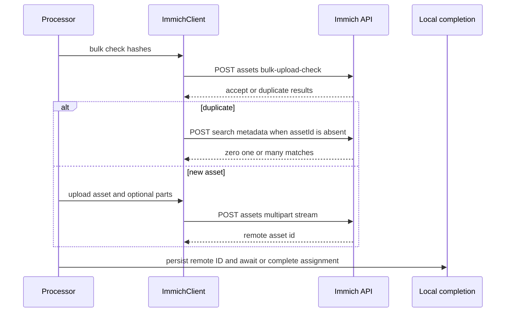
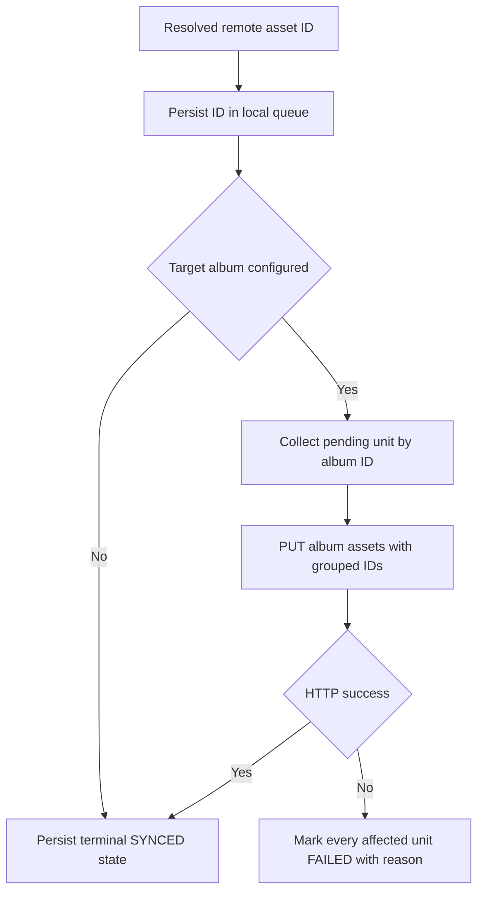

# Immich API Integration

`ImmichClient` is the backend boundary for Immich REST calls. It owns normalized API URLs, the `x-api-key` header, optional Cloudflare Access headers, request construction, and defensive response handling. It does **not** own queue scheduling or terminal synchronization state: the sync processor and completion layer decide when a local upload unit is complete or failed.

## Authentication and transport boundary

Credentials contain the server URL, Immich API key, an opt-in local-HTTP setting, and an optional Cloudflare Access client-ID/secret pair. They are stored as one JSON value in the OS keyring; debug formatting redacts the API key and Cloudflare secret. Login first constructs a temporary client and calls `GET users/me`; credentials are stored only after that validation succeeds. The current-user display name is `name`, falling back to `email`, and an empty result is rejected.

The client normalizes a server URL to an `/api/` base while retaining a configured path prefix. It accepts HTTPS, or HTTP only when `allow_local_http` is enabled **and** the host is `localhost` or a loopback IPv4/IPv6 address. URLs without a host, with embedded credentials, query parameters, or fragments are rejected. Redirects are disabled so an API-key request cannot be redirected from HTTPS to HTTP. Cloudflare Access is all-or-nothing: both configured values become default request headers, with the secret marked sensitive.

Every Immich request uses `x-api-key`. The bulk-check, upload, and album methods use a 1 MiB bounded reader for successful response bodies; current-user JSON is decoded directly, so this is not a universal success-body cap. Error diagnostics are capped at 8 KiB, normalized to one line, and annotated when truncated. Profile-image retrieval is separately limited to 10 MiB by declared and received byte length, and retains a content type only when it begins with `image/`.

### Current-user profile retrieval

The `get_current_user` Tauri command loads the stored credentials and constructs an `ImmichClient`. It calls `GET users/me` for the user ID, display name, and whether `profileImagePath` is nonblank. When an image is advertised, it then calls `GET users/{userId}/profile-image`; an image-fetch failure still leaves the fetched ID and display name available to the profile-cache resolver. Client construction or current-user refresh failures are likewise passed to that resolver rather than returned as a profile-fetch error.

Before resolving or persisting the result, the command rereads credentials and compares the derived account ID. A logout or account switch during the asynchronous refresh returns `Session changed during profile refresh`, preventing data fetched for one account from being written under another account's cache.

## External API contract

The boundary currently uses the following Immich endpoints. All endpoint paths are relative to the normalized `/api/` base.

| Operation | Request and interpretation |
| --- | --- |
| Connection validation | `GET users/me`; success requires a parseable user with a nonblank name or email. |
| Duplicate check | `POST assets/bulk-upload-check` with `assets` entries whose `id` and `checksum` are both the local SHA-1 Base64 value. |
| Upload | `POST assets` as multipart, with `x-immich-checksum` set to the image checksum. |
| Album list/create | `GET albums` returns albums sorted case-insensitively by name in Lymic; `POST albums` sends a trimmed nonempty `albumName`. |
| Album membership | `PUT albums/{albumId}/assets` with `{ "ids": [...] }`; an empty ID list makes no request. A successful HTTP status is the client-level success criterion—the response’s per-asset result objects are not parsed. |
| Duplicate ID lookup | `POST search/metadata` with `{ "checksum": ... }`; zero matches means no ID, one means that ID, and more than one is an error because assignment would be ambiguous. |

## Duplicate detection and upload protocol

The sync processor hashes units and submits their asset hashes to the bulk-check endpoint in chunks of at most 100. The parser treats the response as a strict correspondence contract: it requires exactly one result for each requested ID, rejects unexpected/duplicated/omitted IDs and unknown actions, and recognizes a duplicate as `reject` with no reason or reason `duplicate`. It returns the optional `assetId` supplied with a duplicate. `401 Unauthorized` and `403 Forbidden` are non-retryable bulk-check errors; network, malformed-response, and other HTTP-status failures are retryable at this boundary.

A nonduplicate is sent as a multipart upload. `assetData` is streamed from an async file handle and includes the file creation and modification times. A live-photo video, when present, is streamed as `livePhotoData`. The uploader also looks for an XMP sidecar named either `stem.xmp` or `filename.ext.xmp` (case-insensitively), prefers the stem form, and streams a regular sidecar as `sidecarData`; a sidecar over 10 MiB fails preparation. File chunks update transfer statistics as they are read rather than buffering the upload in memory. A successful upload response must contain a nonblank `id`.

Upload timeout is payload-sensitive: it starts at five minutes and adds two hours per GiB, rounding partial GiB values upward. This applies to the combined asset, live-photo, and attached-sidecar byte count.

This shows the external calls and the point where the API boundary hands a resolved remote ID back to local completion.

## Album API versus local orchestration

Album methods are API primitives: fetch, create, add IDs, and checksum search. They do not know about watched folders, queues, retries, or synchronization state. Conversely, the sync pipeline carries the target album selected for an asset into the queued work and invokes the client only after it has a remote asset ID.

That ID can originate from a fresh upload, a previously persisted queue ID, or a duplicate. For a duplicate, Lymic uses the bulk-check `assetId` when available; otherwise it performs the checksum search and requires exactly one match. Failure to resolve a unique ID fails the local upload unit rather than silently treating it as complete.

For target-album work, local completion persists the remote ID **before** returning a pending-album result. The processor accumulates pending units for one bulk-check chunk, then the album batching layer groups them by `AlbumId` and calls `add_assets_to_album` once per group. Only after the corresponding API call succeeds does local completion write terminal `SYNCED` state. This makes album membership a required local outcome rather than a best-effort post-upload action.

This is local queue and completion control flow; grouping and failure marking are not requirements imposed by the Immich album endpoint itself. If the album request fails, every unit in that album group is marked failed, with UI and audit events. If the request succeeds but durable local completion fails, that unit is also marked failed to avoid reporting a false synchronized result. The queue remains the recovery boundary and retains its persisted remote ID, so retry processing can resume assignment without another upload.

## Failure behavior and change boundaries

The processor honors pause and per-path cancellation before starting further hashes, checks, uploads, or album assignment; cancellation of an in-flight upload produces no terminal queue result. New uploads are executed with configured upload parallelism, while the batch check remains bounded at 100 units. Remote upload failure marks every asset in the upload unit failed locally. If a successful upload cannot be durably completed in local state, the production processor reports the completion failure and marks the unit failed; it does not recheck the remote hashes or retry persistence in that path. A `persist_with_reconciliation` helper exists only under `#[cfg(test)]`, so it is not a production duplicate-upload safeguard.

When extending this integration, keep the split explicit:

- Add or change an Immich endpoint in `src-tauri/src/immich/`, with endpoint-specific validation and an explicit response-size policy.
- Keep scheduling, duplicate-to-queue decisions, target-album grouping, audit/UI reporting, and terminal state changes in `src-tauri/src/sync/`.
- Preserve the invariant that a target-album unit is not `SYNCED` until both a remote ID is durable locally and its album assignment has succeeded.
- Exercise mock-server tests for request shape and error responses, parser tests for strict contracts, and completion/processor tests for local state transitions.

## Navigation

- [Authentication and Credential Security](../security/authentication.md) covers credential storage and login behavior.
- [Local State](../data/local-state.md) describes the queue and persistent synchronization state.
- [Synchronization Workflow](../workflows/synchronization.md) places this boundary in the end-to-end pipeline.
- [Watched Folders and Media Discovery](../workflows/watched-folders.md) explains where target-album configuration originates.
