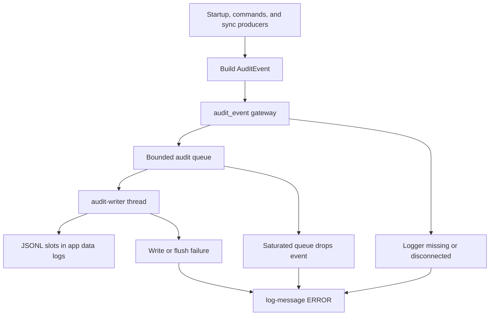

# Audit Logging and Operational Diagnostics

The desktop backend maintains a local, structured audit trail for consequential application lifecycle, authentication, watcher, and synchronization activity. It is an operational diagnostic mechanism, not the source of truth for sync state: sync queue and lifecycle state are persisted separately. See [Runtime Architecture](../architecture/runtime.md) for application startup ownership and [Synchronization](../workflows/synchronization.md) for the sync pipeline.

Audit records are JSON Lines (`.jsonl`) files under the application data directory's `logs` directory. A record is constructed synchronously but its disk write is normally handed to a dedicated writer thread so callers such as the upload pipeline do not wait for filesystem I/O.

*Event producers enqueue serialized records for the writer; logger availability, writer errors, and saturation are surfaced as UI error log messages rather than recursively audited.*

## Event contract and correlation

`AuditEvent` serializes schema version `1` with a nanosecond RFC 3339 UTC timestamp, a UUID event ID, and the following operational fields:

| Field | Meaning |
| --- | --- |
| `operation_id` | UUID used to correlate records from one logical operation. |
| `event_type` | Stable dotted event name, such as `auth.login`, `sync.started`, or `file.upload.completed`. |
| `outcome` | `success`, `failure`, `started`, `skipped`, or `info`. Only success and failure are terminal outcomes. |
| `severity` | `info`, `warn`, or `error`. |
| `actor_id` | Optional pseudonymous account/server identifier; absent when no credential context is available. |
| `source` | Producer context such as `startup`, `command`, `manual_sync`, or `retry_failed_syncs`. |
| `message` and `details` | Human-oriented summary plus event-specific JSON. Messages are normalized to one line and bounded to 2,048 bytes. |

Each `SyncAuditContext` creates one operation ID and actor ID from a credential set, then supplies them to sync events. The queue runner records sync start, pause/resume, and completion with that context; upload processing records started and completed records and uses a distinct file-operation ID in upload details. Login likewise emits a started record and a terminal success/failure record sharing its operation ID. This makes a sync run or login traceable without placing the credential itself in the record.

Typical event families include startup phases and startup recovery, watcher registration, login/logout, synchronization lifecycle, hashing and upload failures, and per-file upload activity. Producers call the `audit_event` gateway rather than accessing the Tauri-managed logger directly.

## Sensitive-data boundary

Audit data must be handled as sensitive operational data. In particular, upload details intentionally include local paths and file names, byte size, the SHA-1 value used by the remote service, timestamps, and optionally a remote asset ID or sanitized failure reason. That is useful for diagnosis but can disclose file and activity metadata.

The account identifier is not a raw URL or API key. It is `sha256:` plus a SHA-256 digest over a versioned domain-separation prefix, a normalized server URL, and the API key. URL case and a trailing slash are normalized for stable identity. This permits correlation for the same account configuration without serializing those inputs.

Error values added to credential-aware login and sync events pass through `audit_safe_error`. It replaces supplied server URL, API key, and optional Cloudflare Access client ID and secret with `[redacted]`, collapses whitespace, and limits the result to 512 characters. This is an important producer responsibility: arbitrary fields placed in `details` are not automatically redacted. Do not put credentials, authorization headers, tokens, or unreviewed remote responses into an event or into a UI diagnostic parameter. For credential storage and login behavior, see [Authentication](../security/authentication.md).

## Writer lifecycle, limits, and durability

Startup initializes `AuditLogger` before other startup phases and registers it as managed application state. If its log directory cannot be resolved or initialized, startup returns an error and does not continue. Once initialized, the logger serializes each event before admission and uses a synchronous channel with one consumer thread named `audit-writer`.

| Control | Behavior |
| --- | --- |
| Queue count | At most 4,096 queued records. |
| Queue bytes | At most 16 MiB of serialized queued records. Both limits apply. |
| Admission | `append` uses non-blocking `try_send`; a full count or byte budget drops the new event rather than blocking the producer. An individual serialized record larger than 5 MiB is rejected. |
| Disk layout | Five cyclic slots named `audit-0.jsonl` through `audit-4.jsonl`; each is capped at 5 MiB. Before a write that would exceed the cap, the writer truncates and advances to the next slot. |
| Restart selection | Initialization resumes the most recently modified non-full slot, or the newest full slot so the next write rotates. |
| Sync behavior | Success and failure events call `sync_data` after writing; other records are buffered until a later terminal record or explicit flush. |

Therefore the normal on-disk slot set is bounded by five 5 MiB files, and older slot contents are overwritten as the writer wraps. This is capacity rotation, **not** a retention policy: the implementation makes no duration or archival guarantee. Avoid treating these files as a complete compliance ledger, particularly because saturation deliberately permits loss.

`flush` inserts a queue barrier and waits up to one second for the writer to sync its active file. It can fail immediately when the queue is full, fail after the timeout when an accepted barrier cannot run, or fail when the logger is disconnected. It is an explicit caller API; ordinary `audit_event` emission does not flush after every event.

## Failure reporting and operational consequences

The gateway first obtains the managed logger. A missing managed state or a disconnected writer produces an audit-failure diagnostic. Asynchronous serialization-independent write errors are detected on the writer thread, and the same reporting path is used. Reports invoke `log_to_ui_keyed` with level `ERROR`, key `log_audit_failure`, and an `error` parameter; the frontend receives the stable `log-message` payload with a local-millisecond timestamp. These reports deliberately do not create another audit event, preventing a failed audit path from recursively retrying itself.

Queue saturation is a distinct degraded mode. The first dropped event in an episode produces an error saying events are being dropped; further drops increase a counter without spamming reports. After a successful enqueue when both pending records and pending bytes have fallen to half their respective limits or below, one recovery report states how many audit events were dropped. A subsequent saturation can begin a new episode.

Consequences for operators:

- Audit failure does not itself abort the underlying login, sync, or startup phase after the logger has been initialized; production work may continue while the trail is incomplete.
- Saturation means a successful producer call can still correspond to a dropped audit record. Treat the UI saturation/recovery messages as evidence of a gap, not as ordinary event records.
- A startup initialization failure is different: it prevents the application initialization sequence from continuing.
- Writer failures, unavailable logger state, oversized records, and flush failures should be investigated through the UI diagnostic message and local filesystem conditions. Do not attempt to log the remediation failure through the same audit path.

## Safe changes and focused tests

When adding an auditable operation, create an explicit event type, choose an outcome and severity, keep a stable operation ID across start/terminal records, and construct `details` from an allowlist. Credential-derived contexts should use `SyncAuditContext`; direct event construction is appropriate for unauthenticated startup activity. Keep write-side behavior non-blocking and report failures through the existing UI path.

The audit unit tests cover event serialization without secret input, actor normalization/domain separation, Cloudflare credential redaction, oversized-record rejection, slot rotation and restart handling, concurrent JSONL writing, asynchronous write-error reporting, byte/count queue saturation, recovery episode reporting, and flush saturation/timeout behavior. The sync tests additionally assert the intended upload-detail checksum shape. See [Development and Testing](development-and-testing.md) for the project test workflow.
