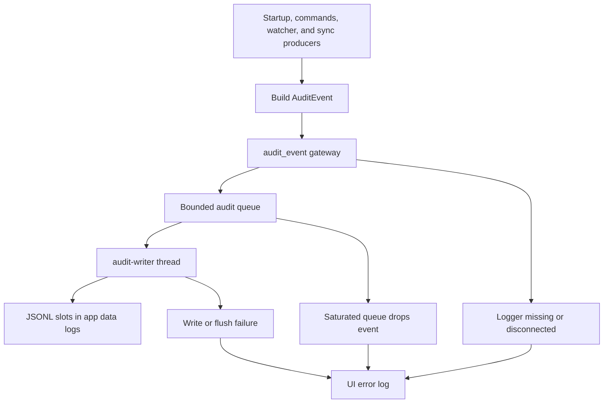

# Audit Logging and Operational Signals

The desktop backend keeps a local structured audit trail for consequential lifecycle, authentication, watched-folder, and synchronization activity. It is a troubleshooting signal, **not** the source of truth for a sync job: the durable queue and job state live separately. See [Runtime Architecture](../architecture/runtime.md), [Local State](../data/local-state.md), [Synchronization](../workflows/synchronization.md), and [Watched Folders](../workflows/watched-folders.md).

Audit events are JSON Lines (`.jsonl`) in the application data directory's `logs` directory. Producers construct an event synchronously but normally hand its disk write to a dedicated thread, so work such as upload processing does not wait for filesystem I/O.

*Operational producers enqueue audit records for the writer; unavailable logging, writer errors, and saturation report through UI logs instead of recursively creating audit events.*

## Event contract, identity, and sensitive data

`AuditEvent` serializes schema version `1` with a nanosecond RFC 3339 UTC timestamp, a UUID event ID, and these fields:

| Field | Meaning |
| --- | --- |
| `operation_id` | UUID correlating records for one logical operation. |
| `event_type` | Stable dotted name, for example `auth.login`, `sync.started`, or `file.upload.completed`. |
| `outcome` | `success`, `failure`, `started`, `skipped`, or `info`. Only `success` and `failure` are terminal, and terminal writes call `sync_data`. |
| `severity` | `info`, `warn`, or `error`. |
| `actor_id` | Optional pseudonymous account/server identity. |
| `source` | Producer context, such as `startup`, `command`, `manual_sync`, or `watcher_sync`. |
| `message`, `details` | A one-line, bounded human summary and event-specific JSON. Messages are capped at 2,048 bytes. |

Credential-associated actors are `sha256:` values over a domain-separation prefix, normalized server URL, and API key. `SyncAuditContext` creates one operation ID and actor ID from credentials and supplies them to sync events, without recording those credentials.

Treat audit files as sensitive operational data. File-upload details deliberately include the local path and name, file size, SHA-1 Base64 checksum, upload timestamps, and optionally remote asset ID or failure reason. They reveal file and activity metadata.

`audit_safe_error` replaces supplied server URL, API key, and optional Cloudflare Access client ID and secret with `[redacted]`, collapses whitespace, and limits output to 512 characters. Login and credential-aware sync producers use it. This is not automatic redaction of arbitrary `details`, UI-log parameters, or remote responses: changes must use an allowlist and must never add credentials, authorization headers, tokens, or unreviewed response bodies. See [Authentication](../security/authentication.md).

## Initialization, startup, and watched folders

Startup initializes `AuditLogger` first, stores it as Tauri-managed state, and records `audit_logger_ready`; inability to resolve or create the log directory aborts startup. Subsequent startup phases record `app.startup.phase` events for watcher initialization, database initialization, sync recovery, tray setup, and queued/displayed main-window work, with the phase name and an optional failure reason. A successful initialization also records `app.started`.

Watched-folder registration is explicitly observable at startup: `watcher.registration` records success, unavailable paths as `skipped`, and registration errors as failures. The same unavailable/error cases also send localized UI log messages containing folder context. A background retry reconciles folders that become available every 30 seconds; each successful registration emits `watcher.reconciliation`. If the watcher event queue overflows, the application warns the UI and emits a `watcher.rescan` started event before reconciling all watched folders.

A repaired database has two signals: a `database.repaired` warning audit event containing the backup path, salvaged-folder count, and reason; and a native desktop notification followed by a keyed UI warning. That notification path intentionally also writes to the UI log.

## Sync, upload, and transfer signals

The synchronization service creates `SyncAuditContext` only after it has credentials and has claimed a runner. Its source label distinguishes manual, retry, watcher, startup, deferred-folder, folder-change, removable-media, and recovery runs. The runner emits context-correlated `sync.started`, `sync.paused`, `sync.resumed`, and terminal `sync.completed` events. Its completion detail contains processed, uploaded, and failed counts; a failed count makes the completion outcome `failure` with warning severity.

Login emits `auth.login` started and terminal records under one operation ID. Upload processing emits per-file started and terminal records with a separate `file_operation_id` embedded in the upload details, while retaining the sync context for the surrounding run. This supports following a login or run and then diagnosing an individual transfer.

The runner also drives live, non-audit telemetry: it emits `sync-started`, `sync-paused`, `sync-resumed`, progress snapshots, and `sync-transfer-stats` Tauri events, while updating tray status. Transfer statistics are emitted immediately at run start, periodically only when the tracker says they changed, and once more inactive when the runner exits through its cleanup guard. They are UI/status telemetry rather than durable audit evidence.

When a run reaches an empty queue, automatic runs emit `sync-idle`; a manual run, or a run that uploaded or failed work, sends a localized completion desktop notification. `send_notification_keyed` shows the native notification and emits the same keyed `log-message` UI record with its parameters, so an operator can correlate the visible notification with the frontend log.

## Bounded writer, failures, and shutdown

The logger serializes before admission and sends records through a synchronous channel to the `audit-writer` thread.

| Control | Behavior |
| --- | --- |
| Queue | At most 4,096 records and 16 MiB of serialized records are pending. Both limits apply. |
| Admission | `append` uses non-blocking `try_send`. A full record or byte budget drops the new event; a record larger than 5 MiB is rejected. |
| Disk layout | Five cyclic `audit-0.jsonl` through `audit-4.jsonl` slots, each capped at 5 MiB. The writer rotates before exceeding a slot and truncates the next slot on wraparound. |
| Restart | Initialization resumes the newest non-full slot, or the newest full slot so the next write rotates. |
| Durability | Terminal events sync file data after writing; nonterminal records remain buffered until a terminal event or explicit flush. |

This bounds normal storage to five 5 MiB files and intentionally permits loss under pressure; it is capacity rotation, not archival retention or a compliance ledger. On saturation, the first dropped event reports an error, later drops are counted without repeated reports, and a successful enqueue below half of both limits reports recovery and the number dropped.

The `audit_event` gateway retrieves the managed logger and reports absent state or append errors through `log_to_ui_keyed` at `ERROR` with key `log_audit_failure`. The writer thread and saturation reporter use that same path. `UiLogMessage` is emitted as the stable `log-message` event with normalized level, a local-millisecond timestamp, optional localization key, and optional string parameters. Audit failures therefore do not recursively re-enter the audit writer.

`flush` enqueues a barrier and waits at most one second for the active file to sync. It can fail promptly for queue saturation, on timeout, or if the logger is unavailable. On Tauri `RunEvent::Exit`, the app appends a terminal `app.shutdown` event and calls `flush`, deliberately ignoring either error because shutdown is already underway. A missing shutdown record is therefore possible; inspect preceding UI diagnostics and filesystem conditions rather than assuming clean termination.

## Safe changes and focused tests

When adding an auditable operation:

1. Define a stable dotted event type, appropriate outcome/severity, and an explicit source.
2. Reuse one operation ID for start and terminal records. Use `SyncAuditContext` for credential-aware sync work; direct construction is suitable for unauthenticated startup work.
3. Keep `details` allowlisted and sanitize credential-aware errors. Consider local paths and checksums sensitive.
4. Use `audit_event` rather than taking managed logger state directly, and do not block a producer on file I/O or flush except at an intentional lifecycle boundary.
5. Add or update a keyed UI log or notification when the condition must be actionable in the frontend; do not imply that UI telemetry is persisted audit evidence.

Audit tests cover secret-free event serialization and redaction, rotation and restart selection, concurrent JSONL writing, asynchronous writer-error reporting, count/byte saturation and recovery, and flush saturation/timeout behavior. The background test verifies that consolidated watcher work reaches synchronization admission. See [Development and Testing](development-and-testing.md) for the project test workflow.
