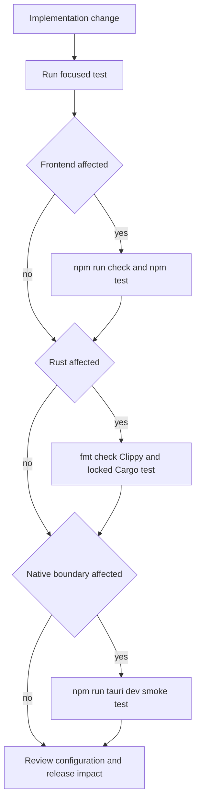
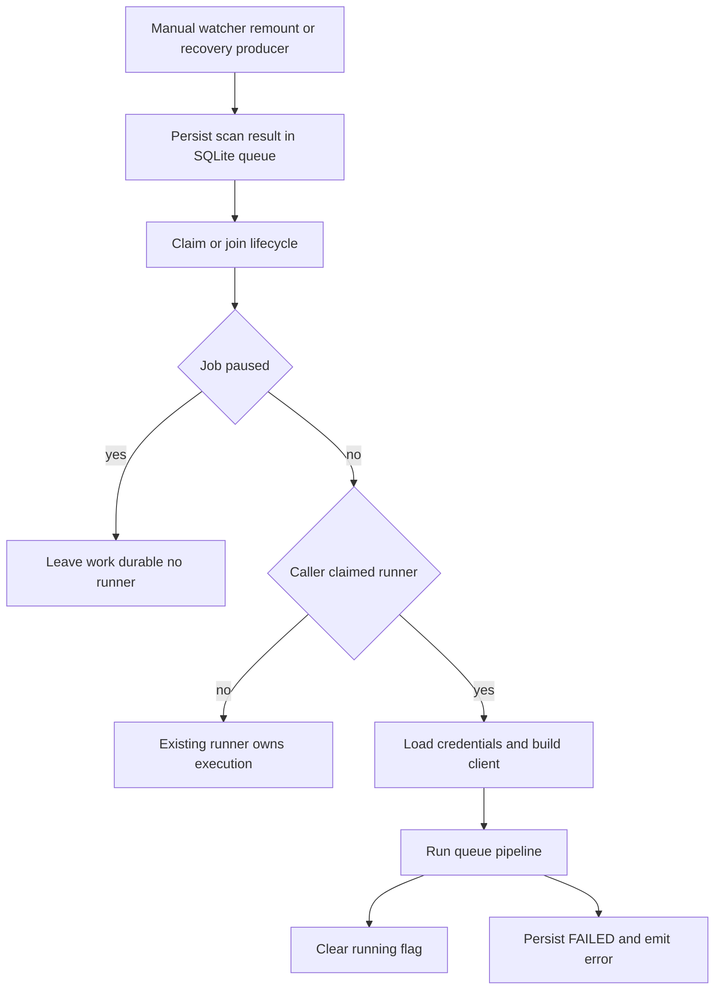

# Development, Validation, and Test Boundaries

Lymic has two executable layers: a SvelteKit/TypeScript webview built by Vite and a Rust/Tauri desktop host in `src-tauri/`. Validate a change at the narrowest useful layer first, then cross the desktop boundary when its behavior depends on native commands, permissions, the filesystem, or a packaged updater.

## Toolchain and local entrypoints

Use the development prerequisites in the [README](../../README.md) and install the lockfile-resolved frontend dependencies:

```bash
npm ci
```

The Rust crate lives at `src-tauri/Cargo.toml`; there is no root Cargo workspace manifest. Consequently, invoke Cargo with `--manifest-path src-tauri/Cargo.toml`. Contributors are expected to add appropriate tests, pass the suite, and lint/format their changes; the project style guidance names `cargo fmt` and `cargo clippy` for Rust.

| Need | Command | What it covers |
| --- | --- | --- |
| Frontend dev server | `npm run dev` | Vite/SvelteKit only; it does not open a native window. |
| Static frontend validation | `npm run check` | `svelte-kit sync` followed by `svelte-check --tsconfig ./tsconfig.json`. |
| Watch static validation | `npm run check:watch` | The same validation in watch mode. |
| Frontend tests | `npm test` | A one-shot `vitest run`. |
| Production webview bundle | `npm run build` | `vite build`; this is the configured pre-package frontend build. |
| Native desktop development | `npm run tauri dev` | The Tauri CLI starts the configured frontend command and opens the desktop app. |
| Native package build | `npm run tauri build` | The Tauri CLI's production build route. |

`npm run tauri dev` runs `npm run dev` and expects `http://localhost:1420`. Vite deliberately uses strict port 1420; it can bind to `TAURI_DEV_HOST` and, when that variable is set, serves HMR on port 1421. Its watcher ignores `src-tauri`, so frontend HMR is not evidence that a Rust change has rebuilt or works.

## Handoff validation

Run the gates applicable to the changed layer before handoff. The following sequence is also the core verification performed for a tagged release:

```bash
npm run check
npm test
cargo fmt --manifest-path src-tauri/Cargo.toml --check
cargo clippy --manifest-path src-tauri/Cargo.toml -- -D warnings
cargo test --manifest-path src-tauri/Cargo.toml --locked
```

`cargo fmt --check` detects formatting drift, `-D warnings` turns Clippy warnings into failures, and `--locked` requires the checked-in Cargo resolution. These gates provide static, unit, and native-test confidence, but they do not run a real webview-to-Rust invocation or an external Immich transfer.



This decision flow distinguishes fast, isolated feedback from validation that requires the actual desktop shell.

## Frontend and IPC contract tests

Vitest uses `jsdom`. Controller tests construct controllers with a mocked `DesktopAdapter`, mocked dialog/event APIs, and controlled promises; for example, the sync-controller suite checks lifecycle cleanup, state projection, pause/resume and retry intentions, confirmation handling, and adapter-error reporting. This is the right layer for UI state and user-intention behavior, not native execution.

`src/lib/tauri/desktop-adapter.test.ts` mocks Tauri `invoke` and asserts the complete command-name and argument serialization list. It is a useful wire-contract alarm when an adapter method, snake-case command name, or camel-case payload field changes. It does **not** execute a Rust command. Cargo adds a complementary registration test: it reads the adapter source and asserts every command string is present in Tauri's `generate_handler!` registrations. That protects adapter/registration drift, but neither source-text test proves Rust argument deserialization or command behavior. For changed IPC behavior, combine the adapter test and Cargo test with a native behavior test where practical and a desktop smoke test.

The frontend suite also includes repository-content checks for the public privacy/support pages and Microsoft Store listing/release evidence. Such tests protect required release collateral; they are not browser rendering or Store-submission tests.

## Durable database and synchronization tests

Rust database tests use a unique in-memory SQLite database with foreign keys enabled and run the production migrations. They test persistence semantics directly: a `RUNNING` job recovers as `PAUSED`; queue admission deduplicates paths while preserving sequence; queue blocks page only after finalization; terminal accounting waits for every item; and settings validation/defaulting is retained in storage. Tests are intentionally isolated from a native window, actual mounted volumes, filesystem watchers, keyring, and Immich.

Synchronization has a second valuable test seam below the desktop shell. `SynchronizationLifecycle` works with the real SQLite schema and a coordinator/running flag: it refuses a new runner for a paused job, atomically lets one caller start while others join, persists `RUNNING` only after claiming the flag, and clears that flag if persistence fails. Its pause/resume operations persist state and coordinate the runner notification. `Synchronization::admit_and_run` first persists scan results, then claims or joins that lifecycle; manual and retry sources await the runner, while automatic sources spawn it after admission. Failed execution is made durable as `FAILED` and surfaced to desktop listeners.



This is the admission and runner-ownership boundary: queue work is durable before a runner observes it, and overlapping producers do not each start a pipeline.

When changing queue or recovery code, assert observable database outcomes rather than implementation details: migration compatibility, ordering/deduplication, pagination, pause/restart behavior, terminal counts and bytes, failed-item retry, and corruption recovery. For removable media, test reconnect path changes, watcher reconciliation/rescan, and the invariant that removal unwatches a folder without deleting its persisted folder or volume binding. Exercise real media, watchers, credentials, and server transfer separately in a desktop run with disposable data and non-production credentials.

## Desktop smoke tests and configuration

Run `npm run tauri dev` when a change crosses IPC, startup, filesystem watching, permissions, dialogs, updater behavior, or native configuration. Confirm that the window starts and that the changed IPC-backed action completes. For synchronization work, use a disposable folder/account and explicitly exercise the changed path and its failure/recovery path.

Review configuration together with dependent code:

- `vite.config.js` makes the SvelteKit application a static SPA with the `index.html` fallback, configures Tauri's dev server behavior, exposes only `VITE_` and `LYMIC_` environment prefixes, and selects Vitest's `jsdom` environment.
- `src-tauri/tauri.conf.json` couples Tauri development and packaging to the frontend commands, URLs, and output directory. It also defines the initially hidden `main` window, CSPs, bundle targets, and updater endpoint.
- `src-tauri/capabilities/default.json` is the native permission boundary for the `main` window. Add the smallest plugin permission needed; importing a JavaScript API alone does not grant native permission.

For updater changes, test the GitHub-release channel rather than assuming all builds use it. The update controller obtains the release channel on startup and skips checks/installation for the `store` channel. On supported channels, an available update opens a dialog; installation refuses to run during sync or while already downloading/installing, tracks download progress, then relaunches after installation. The configured updater verifies artifacts using its public key and latest-release manifest endpoint. See [Release and Distribution](release-distribution.md) for delivery details.

## CI and release gates

Pushing a tag matching `v*` runs the `publish` workflow on macOS, Ubuntu 22.04, and Windows. Each matrix job installs Node 22, stable Rust with `clippy` and `rustfmt`, and on Ubuntu the GTK/WebKit/AppIndicator/librsvg/patchelf prerequisites. It then runs `npm ci`, frontend checking/testing, Rust format/Clippy/locked tests, and `tauri-apps/tauri-action` with signing secrets, a draft release, and locked resolution.

The Windows job additionally builds the Store channel with `LYMIC_RELEASE_CHANNEL=store`, packages an x64 MSIX, validates its expected version, uploads it as a workflow artifact, and attaches it to the corresponding GitHub release when present. A release change should therefore be validated against both updater-distributed and Store-channel assumptions, including version alignment among `package.json`, `src-tauri/Cargo.toml`, and `src-tauri/tauri.conf.json`.

See [Desktop Runtime Architecture](../architecture/runtime.md) for desktop lifecycle, [Local Persistence and Recovery](../data/local-state.md) for database recovery, [Frontend UI and IPC](../frontend/ui-and-ipc.md) for the bridge, and [Synchronization Workflow](../workflows/synchronization.md) for operational sync behavior.
