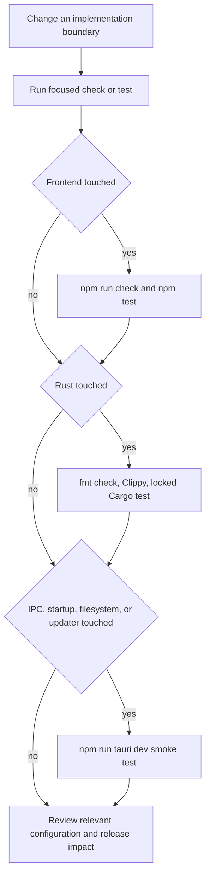

# Development, Testing, and Release Operations

Lymic is a Tauri v2 desktop application: the SvelteKit/TypeScript frontend is built with Vite, and the Rust crate and desktop configuration live below `src-tauri/`. Work from the repository root. Use a focused test while iterating, then run the appropriate layer gates before handoff; use the desktop app when a change crosses the webview/native boundary.

## Local toolchain and entrypoints

The repository documents **latest stable Rust**, **Node.js 18+**, and the operating-system prerequisites required by Tauri. Those are environment prerequisites, not version pins in the project manifests. The release workflow currently uses Node 22 and Rust stable with the `clippy` and `rustfmt` components; matching that environment is a useful way to reduce release-only surprises. On Ubuntu, the release job additionally installs GTK, WebKitGTK, AppIndicator, librsvg, and `patchelf`, so a Linux desktop build needs equivalent native dependencies.

Install the lockfile-resolved frontend dependencies, then start the integrated desktop development path:

```bash
npm ci
npm run tauri dev
```

`npm run tauri dev` is the end-to-end local entrypoint: Tauri runs `npm run dev`, expects the frontend at `http://localhost:1420`, and opens the native application. The Vite server is deliberately fixed to port 1420 and fails rather than selecting another port. `TAURI_DEV_HOST` optionally changes the Vite bind host and enables HMR on port 1421. Vite ignores `src-tauri` while watching, so Rust changes require Tauri's native rebuild path rather than relying on frontend HMR.

The package scripts are the verified repository commands:

| Need | Command | Boundary |
| --- | --- | --- |
| Frontend development server | `npm run dev` | Vite/SvelteKit only; no native window or Rust process. |
| Static Svelte/TypeScript check | `npm run check` | Runs `svelte-kit sync` then `svelte-check --tsconfig ./tsconfig.json`. |
| Watch static checks | `npm run check:watch` | The same check in watch mode. |
| Frontend tests | `npm test` | Runs `vitest run` once. |
| Production frontend bundle | `npm run build` | Runs `vite build`; Tauri invokes this before a packaged build. |
| Serve frontend bundle | `npm run preview` | Runs `vite preview`; it is not a desktop integration test. |
| Native development or package command | `npm run tauri <subcommand>` | Delegates to the Tauri CLI, for example `npm run tauri build`. |

The Rust manifest is **`src-tauri/Cargo.toml`**, not a root-level Cargo workspace manifest. Run Rust commands with `--manifest-path src-tauri/Cargo.toml`.

## Verification workflow

Use this handoff sequence for the touched layers. It is also the sequence enforced by the publish workflow before packaging.

```bash
npm run check
npm test
cargo fmt --manifest-path src-tauri/Cargo.toml --check
cargo clippy --manifest-path src-tauri/Cargo.toml -- -D warnings
cargo test --manifest-path src-tauri/Cargo.toml --locked
```

`cargo fmt --check` detects formatting drift; Clippy treats warnings as errors; and `--locked` requires the checked-in Cargo resolution. These checks establish type, style, lint, and test coverage respectively—they do not replace an end-to-end smoke test. `CONTRIBUTING.md` requires contributors to add tests where appropriate, pass relevant tests, and format/lint their code.



This flow scopes verification to the changed boundary; the desktop smoke test supplements rather than replaces unit tests.

### Frontend test boundary

Vitest runs in the `jsdom` environment. The controller tests exercise Svelte state and user-intention handling with mocked Tauri APIs and a mocked `DesktopAdapter`; the desktop-adapter test asserts the command name and serialized payload passed to `invoke`. They are valuable contract tests, but do **not** start a Tauri runtime, exercise registered Rust commands, test OS dialogs, or contact an Immich server.

When changing a controller, add or update a behavior test in its colocated `*.svelte.test.ts` file: verify state transitions, cleanup, error reporting, and adapter calls. When changing IPC names or payload fields, update `src/lib/tauri/desktop-adapter.test.ts` and inspect the corresponding Rust command registration as well. An adapter unit test alone cannot prove that the Rust side still accepts that wire contract; cover that with a native test where practical and a desktop smoke test.

### Rust test boundary

Rust tests run through Cargo from `src-tauri/Cargo.toml`. The database and removable-media suites create isolated, in-memory SQLite pools, run migrations, and use mocks for the external coordinator callbacks. They validate durable-state and reconciliation rules without an actual card, filesystem watcher, Tauri webview, native keyring, or Immich instance.

High-value database regressions should assert observable persistence behavior: migrations, queue ordering/deduplication and pagination, paused/restart recovery, terminal accounting, failed-item handling, and database repair/quarantine. The existing tests explicitly protect transactional upload-unit persistence and corruption recovery. For removable media, cover arrival, removal, changed mount paths, watcher reconciliation, remount scan, and recovery of only the disconnected folder's failed queue work. In particular, removal unwatches the folder but leaves its watched-folder and volume-binding rows in SQLite so a later arrival can reconnect it.

For integration changes—authentication, upload, filesystem watching, tray/startup, native dialogs, updater installation, or real server behavior—unit tests are insufficient. Use a safe test server and non-production credentials where server interaction is necessary, and manually exercise the changed lifecycle in the desktop app.

## Desktop smoke testing

Run `npm run tauri dev` and validate the smallest path that crosses the changed boundary. At minimum, confirm the native window starts and that an IPC-backed action completes. For synchronization-facing work, use a disposable test folder and account: authenticate, add/select the folder, trigger the changed scan or sync path, inspect progress/error UI, and confirm the intended durable outcome. Test error and recovery paths separately—especially restart recovery and removal/reconnection of a removable volume.

For a new or changed permission-dependent feature, inspect `src-tauri/capabilities/default.json`. The default capability is restricted to the `main` window and grants the core defaults, open/confirm dialogs, process restart, updater defaults, and opener defaults. Do not assume a JavaScript import supplies a native permission: add the smallest required capability permission and validate it in a packaged-like desktop run.

Runtime diagnostics remain useful during smoke tests. Audit records are local JSON Lines under the application data directory's `logs` directory, retained as `audit-0.jsonl` through `audit-4.jsonl` with rotation at 5 MiB. The asynchronous, bounded logger can report dropped records to the UI when saturated; missing logger or append errors also surface as UI errors. To validate shutdown output, quit the process rather than merely closing the main window, which hides it to the tray. See [Audit Logging](audit-logging.md) for the logging contract and [Desktop Runtime Architecture](../architecture/runtime.md) for application and tray lifecycle.

If the database reports migration or validation failure, use the recovery notice and preserved backup to diagnose it rather than deleting data speculatively. Repair creates a fresh database and can restore watched-folder configuration, but does not establish recovery of former queue/history state. See [Local Persistence and Recovery](../data/local-state.md).

## Configuration touchpoints

Review configuration together with code that depends on it:

- `vite.config.js` configures SvelteKit's static adapter with an `index.html` fallback, making the frontend a SPA because Tauri does not provide a Node SSR server. It also defines the Tauri-specific port, host/HMR behavior, native-directory watch exclusion, and Vitest's `jsdom` environment.
- `src-tauri/tauri.conf.json` connects the desktop build to `npm run dev`/`npm run build`, the 1420 dev URL, and `../build` frontend output. It defines the `main` window (initially invisible), production and development CSP connection sources, bundle targets/icons, and updater settings. A configuration change here can affect both `tauri dev` and packaged behavior.
- `src-tauri/capabilities/default.json` is the native permission boundary for the `main` window. Review it alongside a plugin/API change and avoid broadening permissions merely to make a test pass.

## Release and updater operations

A push of a tag matching `v*` starts the `publish` workflow. It runs on macOS, Ubuntu 22.04, and Windows, installs dependencies with `npm ci`, runs the frontend and Rust gates above, and then uses `tauri-apps/tauri-action` to create a draft GitHub release. Packaging is invoked with `--locked`; the workflow requests updater artifacts and passes the Tauri signing key and optional key password from GitHub secrets. The action configuration prefers NSIS for updater JSON when Windows artifacts are available.

The packaged app is configured for all bundle targets and for updater artifacts. The updater trusts the configured public key and reads its release manifest from `https://github.com/xXRoxXeRXx/lymic/releases/latest/download/latest.json`; Windows uses passive installation mode. Therefore a release/change that affects versioning, artifacts, or update delivery must keep the frontend package version, Cargo package version, and Tauri configuration version aligned, preserve a compatible signed manifest/artifact publication path, and be checked on each target platform represented by CI.

At runtime, the update controller checks through the Tauri updater plugin after its lifecycle starts and independently loads the app version. If an update exists it opens the update dialog; installation is blocked while synchronization is active. Otherwise it downloads while tracking progress, installs, and relaunches the application; failure leaves the controller in its `error` installation state. Test both the unavailable/current and available/update-failure UI paths with mocked updater tests, then validate the actual signed update path only against safe release artifacts.

For product setup and architecture context, see [Getting Started](../quickstart.md), [Frontend UI and IPC](../frontend/ui-and-ipc.md), and [Desktop Runtime Architecture](../architecture/runtime.md).
