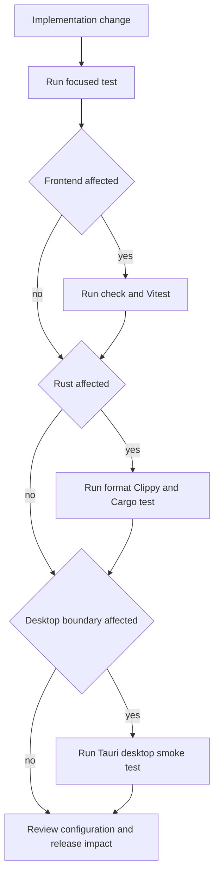
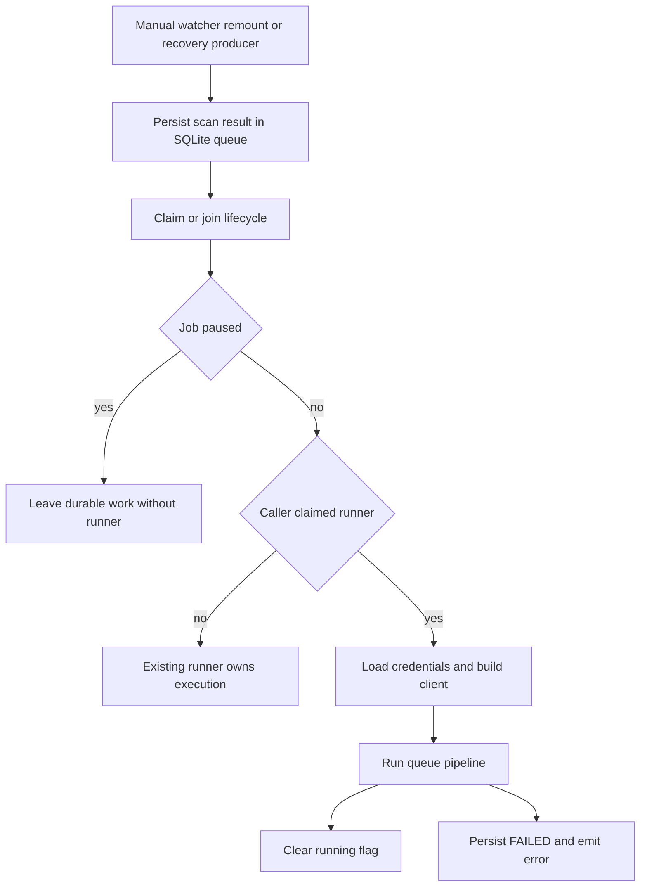

# Development, Verification, and Contract Tests

Lymic has two executable layers: a SvelteKit/TypeScript webview built by Vite and a Rust/Tauri desktop host in `src-tauri/`. Start with the narrowest test that can falsify a change, then cross the desktop boundary when correctness depends on native commands, permissions, the filesystem, credentials, or packaging.

## Toolchain and local entrypoints

Install the lockfile-resolved frontend dependencies:

```bash
npm ci
```

The repository manifest defines the npm scripts below and declares the Tauri CLI as a development dependency. `src-tauri/Cargo.toml` is the Rust crate manifest. The handoff commands also assume a locally available Rust toolchain with `cargo`, `rustfmt`, and Clippy; the manifest does not install those tools or establish that they are available on a contributor's machine.

| Need | Command | Boundary covered |
| --- | --- | --- |
| Frontend development | `npm run dev` | Vite/SvelteKit only; no native window. |
| Static frontend validation | `npm run check` | `svelte-kit sync` and `svelte-check --tsconfig ./tsconfig.json`. |
| Frontend tests | `npm test` | One-shot `vitest run`. |
| Production webview bundle | `npm run build` | `vite build`, the frontend packaging build. |
| Desktop smoke test | `npm run tauri dev` | Configured Vite server plus native desktop host. |
| Native package route | `npm run tauri build` | Tauri production build. |

Tauri development expects Vite at `http://localhost:1420`. The port is strict; `TAURI_DEV_HOST` changes the bind host and enables HMR on port 1421. Vite ignores `src-tauri`, so frontend HMR is not evidence that Rust code rebuilt or works.

## Handoff gates and scope

Run focused tests while iterating, then run the applicable shared gates before handoff:

```bash
npm run check
npm test
cargo fmt --manifest-path src-tauri/Cargo.toml --check
cargo clippy --manifest-path src-tauri/Cargo.toml -- -D warnings
cargo test --manifest-path src-tauri/Cargo.toml --locked
```

Formatting detects Rust style drift, Clippy treats warnings as errors, and `--locked` requires the checked-in Cargo resolution. These gates give static, unit, and native-test confidence, but do not perform a real webview-to-Rust request, operate a filesystem watcher, retrieve native credentials, or transfer to Immich.



The verification flow moves from focused checks to shared gates and a desktop smoke test when a change crosses the native boundary.

## Frontend behavior and IPC contracts

Vitest runs in `jsdom`. Controller tests inject mocked desktop adapters and Tauri APIs, allowing them to verify UI state, lifecycle cleanup, event handling, confirmations, error reporting, and the user intent sent to an adapter. For example, synchronization-controller tests can verify projection of backend status and handling of `sync-error`; update-controller tests can verify Store-channel suppression and refusal to install while sync is active. They do not execute Rust.

`src/lib/tauri/desktop-adapter.test.ts` mocks Tauri `invoke` and asserts command names plus camel-case argument serialization across the adapter interfaces. The Rust application test complements this by requiring the adapter command strings to appear in the `generate_handler!` registrations. Together they catch adapter/registration drift, but they do not prove Rust deserialization or command behavior. For an IPC change, update the frontend contract, adapter, controller caller, Rust command registration, and tests together; add a native behavior test where practical and perform a desktop smoke test.

`src/site.test.ts` is also a repository-content suite: it reads the landing, privacy, support, Store listing, Flight-validation, and release-record files and checks required copy, links, metadata, and assets. It protects release collateral, not browser rendering or Store submission.

## Map fixtures and manual performance probing

The map-fixture generator produces deterministic UTF-8 Immich marker responses with 300,000 valid, uniquely identified locations. `distributed` exercises global distribution, zero coordinates, both sides of the antimeridian, and high latitudes; `regional` clusters points around Berlin; `identical` puts every point at one coordinate, while `dense` remains its alias. These synthetic datasets are for functional and profiling exploration, not a frame-rate or memory guarantee; invalid coordinates require separate tests.

On Windows PowerShell, retain `cmd /c` when redirecting the generator so the JSON fixture is UTF-8 rather than PowerShell's UTF-16 output:

```powershell
cmd /c "node scripts/map-fixtures/generate.mjs distributed > distributed.json"
cmd /c "node scripts/map-fixtures/generate.mjs regional > regional.json"
cmd /c "node scripts/map-fixtures/generate.mjs identical > identical.json"
```

Run the loopback-only server against a generated fixture, optionally with a non-private MP4 for odd-numbered video assets:

```powershell
node scripts/map-fixtures/serve.mjs "$env:TEMP\identical.json" "$env:TEMP\fixture.mp4"
```

Test a packaged application in an isolated OS user profile against `http://127.0.0.1:3001`, explicitly allowing loopback HTTP and using API key `fixture-key`. The server implements only the current-user, marker, asset-detail, thumbnail, original-media, and favorite endpoints; it returns empty timeline and album data and returns 404 for other endpoints. Favorite state lasts only for the server process. Its request and thumbnail-concurrency counters help inspect the test run, but cannot observe WebView work or cache hits. Do not use a real account's location data as a fixture.

## Durable synchronization and removable-media tests

Database tests create isolated, single-connection in-memory SQLite pools with foreign keys enabled; tests that need schema behavior run the production migrations. They cover observable persistence contracts such as recovery of `RUNNING` work as `PAUSED`, ordered queue admission and duplicate handling, retry and terminal accounting, transactional rollback of uploaded-unit persistence, and repair of a migration-incompatible database while preserving salvageable folder settings and removable bindings.

Synchronization has a test seam below the desktop shell. `Synchronization::admit_and_run` persists scan output before it claims a lifecycle. The lifecycle returns `Paused` for a paused snapshot and `Joined` when another caller owns the atomic running flag; only the caller that claims the flag persists `RUNNING` and starts a runner. If that persistence fails, it clears the flag. Manual sources await their pipeline; automatic sources spawn it after admission. Credential or client setup failures and pipeline failures go through the durable failure path.



The durable admission flow ensures overlapping producers do not each start a synchronization pipeline.

When changing queue, migration, or recovery code, assert database outcomes rather than implementation details: ordering and deduplication, pause/restart behavior, failed-item retry, terminal counts, and repair. Removable-volume coordinator tests model remounting under a changed path, reconciliation of old and new watcher paths, a rescan, and removal. Removal unwatches a bound folder but retains its persisted folder and binding rows so the volume can be recognized on return. Real mounts and filesystem watchers still require a desktop run.

## Audit logging test boundary

The audit facade gets the managed `AuditLogger`; if the logger is absent or append fails, it reports an error to the UI. The writer stores JSON Lines slots under the application-data `logs` directory, rotates across five 5-MiB files, and uses a bounded asynchronous queue. Saturation drops events and reports saturation; after both queued records and bytes fall below recovery thresholds, it reports recovery and the drop count. Terminal events flush file data, and process exit makes a best-effort shutdown append and flush.

For audit changes, test serialization, rotation, queue saturation/recovery, and reporting in Rust. Exercise application-data resolution and the visible UI error path in a desktop smoke test. See [Audit Logging](audit-logging.md) for the operational format and retention boundary.

## Desktop smoke tests and high-risk changes

Run `npm run tauri dev` when changing IPC, startup, native permissions, dialogs, filesystem watching, credentials, updater behavior, or Tauri configuration. Confirm the window starts and the changed IPC-backed action completes. Use disposable folders and non-production credentials for synchronization tests; explicitly exercise both the intended action and its failure or recovery path.

The repository identifies migrations, pause/recovery, credential handling, queue retry, duplicates, and target-album failures as high-risk behavior. Validate the observable outcome for those paths, not only compilation. For watched folders and removable media, test a changed mount location, removal, return, watcher reconciliation, and rescan. For synchronization, include unavailable or invalid credentials, a failed upload followed by retry, duplicate candidates, and target-album failure. Related operational behavior is described in [Synchronization](../workflows/synchronization.md) and [Watched Folders](../workflows/watched-folders.md).

Review configuration with its dependent code: `vite.config.js` owns Tauri-facing Vite server behavior and the `jsdom` test environment; `src-tauri/tauri.conf.json` couples frontend commands and output to packaging; and `src-tauri/capabilities/default.json` is the native permission boundary. JavaScript imports do not themselves grant a Tauri plugin permission. The default capability is assigned to the `main` window and permits core defaults, open/save/confirm dialogs, process restart, updater, and opener access; review that file when a native-plugin feature requires a new permission.

For updater work, distinguish channels. The updater configuration uses a public key and GitHub latest-release endpoint. The frontend loads the release channel at startup and bypasses in-app checks and installation on `store`; on other channels, an available update opens its dialog. Installation refuses while synchronization is active or an installation is already underway, tracks download progress, installs, and relaunches. See [Release and Distribution](release-distribution.md) and [Frontend UI and IPC](../frontend/ui-and-ipc.md).

## Release CI gates

The `publish` workflow runs on a `v*` tag and by manual dispatch, with a macOS, Ubuntu 22.04, and Windows matrix. Every matrix job installs Node 22 and stable Rust with Clippy and rustfmt, runs `npm ci`, `npm run check`, `npm test`, and `npm run build`, then runs Rust format, warning-denying Clippy, and locked tests. It invokes `tauri-apps/tauri-action` with locked dependency resolution, a draft release, and updater-signing secrets.

Windows additionally builds with `LYMIC_RELEASE_CHANNEL=store`, packages and validates a versioned x64 MSIX, uploads the artifact, and attaches it to the GitHub release if present. Ubuntu validates Snapcraft configuration, builds a Snap, uploads and attaches the artifact, and publishes it to the candidate and stable Snap Store channels only when the Snapcraft credentials secret is available. A release change therefore needs both updater-distributed and Store/Snap assumptions checked, including version alignment among `package.json`, `src-tauri/Cargo.toml`, and `src-tauri/tauri.conf.json`.

After the cross-platform `publish` job succeeds for a version tag, `update-aur` runs on Ubuntu. It skips when no AUR SSH key is configured; otherwise it downloads the versioned Debian release asset, computes its SHA-256 checksum, updates the `lymic-bin` `PKGBUILD` and `.SRCINFO`, and pushes the result to the AUR repository.

See [Quickstart](../quickstart.md) for setup, [Audit Logging](audit-logging.md) for logs, and [Release and Distribution](release-distribution.md) for delivery operations.
