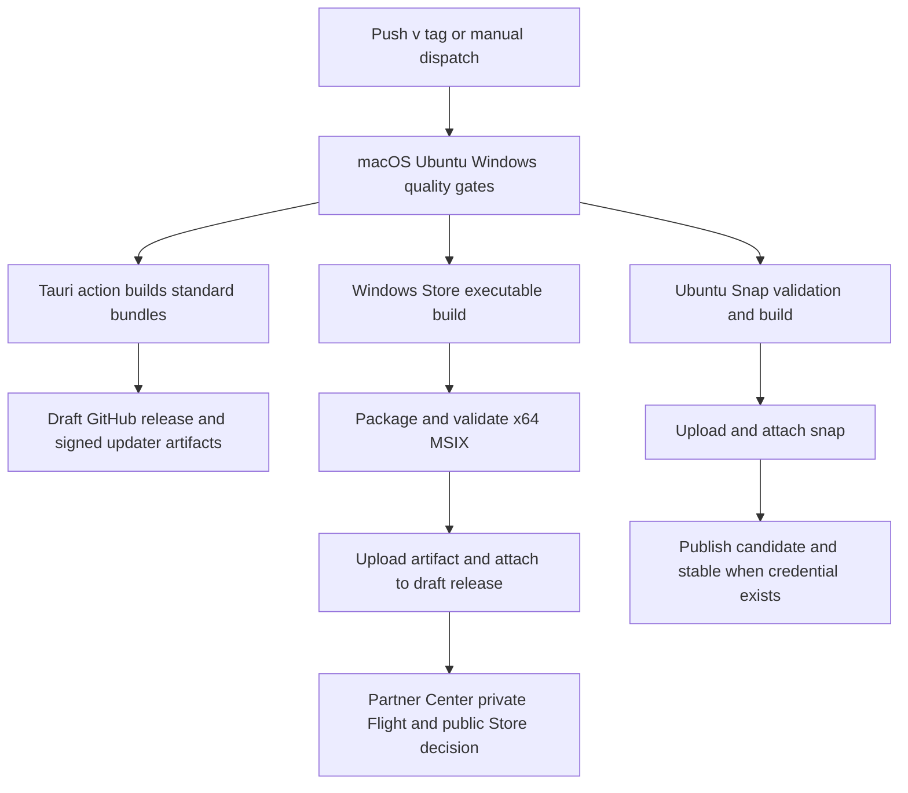

# Release and Distribution

Lymic distributes desktop builds through three operational paths:

- The default **GitHub** channel produces Tauri bundles and signed updater artifacts. On Windows, NSIS is preferred as the updater artifact.
- The **Microsoft Store** channel is a separate x64 MSIX build. Store delivery owns updates; the application must not use the GitHub/Tauri updater in this channel.
- The Linux **Snap** path builds a strictly confined `lymic` snap, attaches it to the GitHub release, and can publish it to Canonical's candidate and stable channels when its CI credential is available.

The Windows channels are intentionally isolated: the Store channel is not an NSIS migration, so the initial Store release does not migrate configuration or queued synchronizations. The rationale is recorded in the [Microsoft Store release-channel ADR](../../docs/adr/0004-microsoft-store-release-channel.md).

## Tagged release pipeline

A push of a `v*` tag, or a manual dispatch, runs the `publish` workflow on macOS, Ubuntu, and Windows. Each matrix job checks out the source, installs Node 22 and stable Rust with Clippy and rustfmt, runs `npm ci`, frontend checking and tests, then Rust format, Clippy, and locked tests. Ubuntu also installs the native GTK/WebKit and bundling prerequisites. Matrix failures do not cancel the other platforms.

After those gates, `tauri-apps/tauri-action` builds the standard bundles with `--locked` and creates or updates a draft release named `Lymic v__VERSION__`. The action receives the GitHub token and Tauri signing-key secrets, generates release notes, and prefers NSIS in updater metadata. The Tauri configuration enables updater artifacts, embeds the updater public key, and points clients at the GitHub `latest.json` endpoint; the release-only private key signs the material clients verify.

*The tagged workflow creates the normal signed release on all platforms, with additional Windows Store and Ubuntu Snap artifacts and publication paths.*

A tag therefore creates a **draft**, not an automatically public GitHub release. An operator must review its notes and artifacts before publishing it. The Windows and Ubuntu attachment steps use `gh release upload ... --clobber`, so a rerun replaces an existing MSIX or snap asset for that tag.

## GitHub updater and release-channel boundary

`LYMIC_RELEASE_CHANNEL` is a compile-time selection in the Rust backend. Only the exact value `store` selects Store; unset, `github`, and unknown values resolve to `github`. The `get_release_channel` command exposes that effective value to the webview. The frontend uses the same rule, reading `VITE_LYMIC_RELEASE_CHANNEL` before `LYMIC_RELEASE_CHANNEL` as its build-time fallback.

At startup, the update controller asks the desktop adapter for the backend-selected channel. In the GitHub channel it records the update-check phases, checks the Tauri updater, opens a dialog when an update is found, and separately loads the application version. Installation is blocked when there is no available update, synchronization is active, or a download or installation is already in progress. A failed install sets the install state to `error` and does not relaunch.

For `store`, channel selection is an update-authority invariant rather than presentation metadata:

- Startup returns before update-check probes or an updater request, although the version load still runs.
- Explicit check and install requests also return without contacting the updater or relaunching.
- `isUpdatesSupported` is false. Both the Settings Updates section and the update dialog are gated on that value, so Store users are not offered a competing GitHub updater path.

The focused controller test verifies the Store startup and install behavior, while the Rust unit test covers the resolver's default, unknown, GitHub, and Store cases. Preserve these tests whenever adding a channel or changing updater initialization.

## Windows Store MSIX

Only the Windows matrix job builds the Store executable. It sets `LYMIC_RELEASE_CHANNEL=store`, runs `npm run build`, and invokes locked release `cargo build` with `custom-protocol`; the normal Tauri matrix build does not receive that environment variable. It then packages and validates `dist/msix/Lymic_<version>_x64.msix`, uploads it as the `lymic-store-msix` workflow artifact, and attaches it to the corresponding GitHub release.

`package-msix.ps1` is the packaging entrypoint. It reads the Tauri version if none is supplied, strips an optional leading `v`, pads to four MSIX version components, and finds an x64 `makeappx.exe` from `PATH` or the installed Windows SDK. It requires the supplied release executable (the workflow uses `src-tauri/target/release/lymic-desktop.exe`) or chooses the newest recognized release executable. The script recreates `target/msix-staging`, copies the executable as `Lymic.exe` and four logo assets, substitutes the manifest template, then fails on a nonzero `makeappx pack` exit code.

The package defaults to identity `xXRoxXeRXx.Lymic` and publisher `CN=EB6D92C3-1B82-4D11-B562-6EA2D7C2FDEC`. Its template defines an x64 `Windows.FullTrustApplication`, Windows Desktop minimum `10.0.17763.0`, `runFullTrust`, and Internet/private-network capabilities. The package validator opens the MSIX archive and aggregates errors for a missing manifest; identity name, publisher, architecture, or normalized-version mismatches; a missing `runFullTrust`; or the presence of `broadFileSystemAccess`, which it explicitly rejects as unnecessary for this full-trust app and a Store-certification risk. Any errors exit with code 1.

This means the current implementation deliberately **does not** declare `broadFileSystemAccess`. The Flight and public Store record documents still describe that capability and its justification; reconcile those records before using them as release evidence. The validator and manifest are the executable release gate.

## Snap build and publication

On Ubuntu, the workflow first runs the Snapcraft validator test, then uses `snapcore/action-build` to produce the snap. The output is uploaded as `lymic-snap` and attached to the tag's GitHub release. If `SNAPCRAFT_STORE_CREDENTIALS` is nonempty, `snapcore/action-publish` publishes that same artifact to both `candidate` and `stable`; without the secret, the build and GitHub-release attachment still occur but Store publishing is skipped.

`snap/snapcraft.yaml` defines `lymic` version `0.23.1` on the `core22` base with `strict` confinement and the GNOME extension. It declares the network, home, removable-media, and password-manager-service plugs. Its build part either reuses an available Debian bundle or builds one with Tauri, extracts it, and requires a discovered executable before installing `bin/lymic`. WebKitGTK 4.1 layout bindings and the listed interface plugs are part of the confinement contract. `scripts/validate-snapcraft.ps1` can validate the configuration, version alignment, metadata, extension, plugs, WebKit layout, desktop file, and icon; the release workflow currently runs the corresponding Vitest validator instead.

For CI setup and Snap release sign-off, maintainers should retain the [Snap release record](../../docs/store/snap-release-record.md), including the documented `SNAPCRAFT_STORE_CREDENTIALS` setup procedure.

## Store Flight and required records

The MSIX attachment is traceability evidence, not Microsoft Store publication. Submit it through Partner Center for Store signing and Flight distribution. The [Flight validation runbook](../../docs/store/flight-validation.md) records the intended private-Flight scope and its pending acceptance checks: certification approval, a clean install with persisted watched folders, media synchronization, absence of GitHub update controls, and the hard block if required access is denied. Its status is open, so it does not authorize public release.

Before a public Store rollout, update and retain the [Microsoft Store release record](../../docs/store/release-record.md) with the Flight-validated package, listing and localization details, content rating, Store-only updater verification, capability approval, and public privacy/support endpoints. Update the Flight record with actual outcomes as well. Because those records currently contain historical capability assertions that differ from the manifest validator, resolve that discrepancy before sign-off rather than treating checkboxes as proof.

## Operator checklist

1. Set and commit the intended version in `src-tauri/tauri.conf.json`; keep the Snap version aligned when producing a Snap release, then push a `v*` tag or manually dispatch the workflow.
2. Require all matrix quality gates and the Windows MSIX/Snap build steps to pass. Investigate an OS-specific failure even though the matrix continues.
3. Review the draft GitHub release, signed updater artifacts, standard bundles, MSIX, and snap before making the release public.
4. Verify the extra Windows build used `LYMIC_RELEASE_CHANNEL=store`, MSIX validation passed, and the artifact was attached. Do not introduce `broadFileSystemAccess` without changing the validator and re-evaluating Store certification.
5. For Snap publication, configure `SNAPCRAFT_STORE_CREDENTIALS` only when the operator intends the workflow to publish to both candidate and stable.
6. For Microsoft Store publication, complete and record the real private Flight, capability/certification decision, and public-release checklist before rollout.

For local prerequisites and general verification, see [Development and Testing](development-and-testing.md). The Tauri/webview boundary is covered in [Runtime Architecture](../architecture/runtime.md), and frontend adapter and UI wiring are covered in [UI and IPC](../frontend/ui-and-ipc.md).
