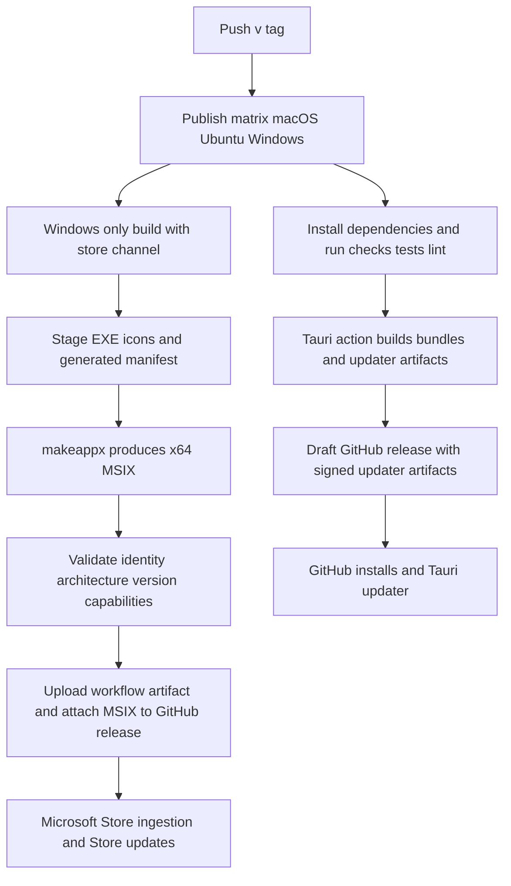

# Release Channels and Distribution

Lymic has two deliberately separate Windows distribution paths:

- **GitHub channel** (the default) publishes the normal Tauri bundles, including the Windows NSIS installer, and uses the Tauri updater.
- **Store channel** builds a separate x64 MSIX package for Microsoft Store distribution. The Store, rather than the application, owns package signing and update delivery.

This separation avoids two update authorities acting on the same installed application. It also means the initial Store release is not an in-place migration from NSIS: configuration and queued synchronizations are not migrated. See the [Microsoft Store channel ADR](../../docs/adr/0004-microsoft-store-release-channel.md).

## Tag-to-distribution flow

A push of a tag matching `v*` starts the `publish` workflow. It runs independently on `macos-latest`, `ubuntu-22.04`, and `windows-latest`; each job installs Node 22 and stable Rust, runs frontend checks and tests plus Rust formatting, Clippy, and locked tests, then invokes `tauri-apps/tauri-action`. The action creates or updates the versioned draft GitHub release (`v__VERSION__`, named `Lymic v__VERSION__`), generates release notes, and is supplied the GitHub token and Tauri signing private-key secrets. `updaterJsonPreferNsis: true` makes NSIS the preferred Windows updater artifact.



*Release and distribution flow: a version tag produces standard GitHub/Tauri artifacts on all platforms, while the Windows job additionally creates a validated Store MSIX that is ingested and updated by Microsoft Store.*

The workflow is intentionally fail-fast disabled, so a failure in one operating-system job does not cancel the other matrix jobs. On Ubuntu it additionally installs the GTK/WebKit, app-indicator, SVG, and `patchelf` system dependencies before the checks. Tauri is called with `--locked`, preserving the Rust lockfile as part of release reproducibility.

## GitHub releases and the Tauri updater

`src-tauri/tauri.conf.json` enables updater artifact creation for all bundle targets and configures the updater with a public key and the GitHub `latest.json` endpoint. On Windows its install mode is `passive`. The release workflow passes `TAURI_SIGNING_PRIVATE_KEY` and its password only to the Tauri action; this private key signs the updater material that clients verify using the configured public key.

Operationally, a tag alone creates a **draft** rather than an automatically public GitHub release. Review and publish the draft when its artifacts and notes are acceptable. The workflow gives the job `contents: write`, allowing the action to manage the release; the Windows job also runs `gh release upload "v$ver" $msix --clobber` when the expected MSIX exists, so a rerun replaces that release asset.

The application-side update controller loads the build/runtime channel at startup before it starts an update check. In the GitHub channel it calls the Tauri updater `check()`, opens an update dialog when an update is available, and offers download/install/relaunch. Installation is refused while synchronization is active, while a download/install is already underway, or when no update is available. Failures are logged and leave an `error` install state rather than relaunching.

## Channel selection and the Store invariant

The sole recognized non-default channel is `store`. Backend compilation reads `LYMIC_RELEASE_CHANNEL` using Rust's `option_env!`; exactly `store` resolves to Store, while unset, `github`, and unknown values resolve to `github`. The `get_release_channel` Tauri command exposes that resolved value to the frontend. The frontend has the corresponding build-time fallback: `VITE_LYMIC_RELEASE_CHANNEL`, then `LYMIC_RELEASE_CHANNEL`, with the same `store`-or-`github` interpretation. At startup, the update controller queries the desktop adapter and uses that backend answer when available.

The workflow sets `LYMIC_RELEASE_CHANNEL=store` only for the extra Windows Store executable build. It first runs `npm run build` and then `cargo build --release --locked`, ensuring both the frontend and compiled backend receive the Store selection. The standard Tauri matrix build remains on the default GitHub channel.

The channel is a security and ownership boundary, not merely a UI label:

- `checkForUpdates()` and `installUpdate()` return immediately for `store`, so they do not call the Tauri updater or relaunch for an in-app update.
- Startup returns before recording/running the update-check phase once it has established the Store channel.
- `isUpdatesSupported` is false for Store builds. The settings Updates section and the update dialog are conditionally absent, preventing a user-initiated GitHub update path as well.

This must remain true even though the shared Tauri configuration contains GitHub updater endpoints: Store delivery must not compete with the Store-managed package. The targeted controller test verifies that Store startup performs no updater check, leaves the dialog closed, and does not relaunch when an install is requested. The Rust unit test covers the backend channel resolver's default and `store` cases.

## MSIX build and validation

The Store packaging path is Windows-only and produces `dist/msix/Lymic_<version>_x64.msix`. The workflow reads the version from `src-tauri/tauri.conf.json`, then runs:

```powershell
./scripts/package-msix.ps1 -Version $ver -OutputDir dist/msix
./scripts/validate-msix.ps1 -MsixPath "dist/msix/Lymic_${ver}_x64.msix" -ExpectedVersion $ver
```

`package-msix.ps1` is the packaging entrypoint. It accepts overrideable version, identity, publisher, source executable, and output-directory parameters, but defaults to the repository's Store identity `xXRoxXeRXx.Lymic` and publisher `CN=xXRoxXeRXx`. It normalizes a release version (with an optional leading `v`) to the four-part MSIX version required by the manifest. It locates x64 `makeappx.exe` from `PATH` or an installed Windows SDK and fails explicitly if neither is available.

Before packing, the script requires a release executable—by default it searches `Lymic.exe`, `lymic.exe`, and `lymic-desktop.exe` under `src-tauri/target/release`—and fails with an instruction to build if none exists. It recreates `target/msix-staging`, copies the executable as `Lymic.exe`, copies the Store and tile logo assets, fills `AppxManifest.template.xml`, and runs `makeappx pack`. Any nonzero `makeappx` exit code fails packaging.

The generated manifest declares an x64 full-trust desktop application (`Windows.FullTrustApplication`) and Windows Desktop minimum version `10.0.17763.0`. It also declares the restricted `runFullTrust` and `broadFileSystemAccess` capabilities. These capabilities support the product's configured-folder watching model and require Store certification justification; do not remove or change them without revisiting Store certification and actual folder-access behavior.

`validate-msix.ps1` is the release gate for the archive's manifest. It opens the MSIX as a ZIP, requires `AppxManifest.xml`, and rejects mismatches in identity name, x64 architecture, or the normalized four-part expected version. It also rejects packages missing either restricted capability. Validation aggregates errors, writes them, and exits 1, causing the workflow step to fail. It does not replace Windows App Certification Kit or Partner Center validation.

After validation, the job uploads the MSIX as the `lymic-store-msix` workflow artifact and attaches it to the matching GitHub release. Attaching makes the package traceable alongside the tag release; Store distribution still requires ingestion through Partner Center, where Microsoft performs package signing. The documented private Flight targets restricted internal accounts and Windows 10 10.0.17763.0+ / Windows 11 x64. Its acceptance criteria still require actual Flight verification for capability approval, persisted watched-folder access, synchronization, and Store update behavior. The release gate remains open until those checks are completed; see the [Flight validation runbook](../../docs/store/flight-validation.md).

## Release operator checklist

1. Set the intended version in `src-tauri/tauri.conf.json`, commit the corresponding changes, and push a `v*` tag.
2. Confirm all three matrix jobs pass their checks, tests, formatting, and Clippy gates; investigate an OS-specific failure even though other jobs may continue.
3. Review the draft GitHub release, generated notes, standard bundles, and updater artifacts before publishing it.
4. On the Windows job, confirm the Store build used `LYMIC_RELEASE_CHANNEL=store`, the MSIX validation step passed, and `Lymic_<version>_x64.msix` was uploaded/attached.
5. Submit the MSIX to the intended Partner Center Flight and complete the manual certification and functional acceptance checks. Do not publicly release while restricted capability approval or required folder-access validation is pending.

For local build and test prerequisites, see [Development and Testing](development-and-testing.md). The runtime boundary between the webview and Tauri is described in [Runtime Architecture](../architecture/runtime.md), and the frontend's adapter/UI wiring is described in [UI and IPC](../frontend/ui-and-ipc.md).
