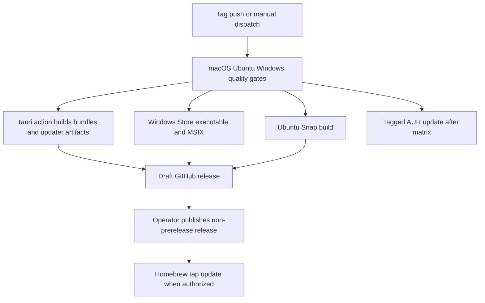

# Release and Distribution Pipeline

Lymic creates desktop bundles through a tagged GitHub workflow, then hands artifacts to several distribution channels. The Tauri action creates a **draft** GitHub release; publishing that release is an explicit operator boundary and is what triggers the Homebrew handoff. MSIX, Snap, and AUR work are separate outputs or publication paths, not evidence that a Store submission or every downstream publication has completed.

## Version and artifact contract

The current application manifests agree on `0.25.0`: `package.json`, `src-tauri/Cargo.toml`, `src-tauri/tauri.conf.json`, and `snap/snapcraft.yaml`. The expected release tag is therefore `v0.25.0`. They are distinct inputs, however: Tauri release naming and MSIX packaging read the Tauri configuration; the Snap attachment reads `package.json`; Snapcraft has its own metadata version; and the AUR job derives its version by stripping `v` from the tag. Keep all of these aligned whenever making a release.

Two checked-in downstream package templates are intentionally not release-version sources and currently still describe `0.23.0`: `packaging/arch/lymic-bin/PKGBUILD` and `packaging/homebrew/lymic.rb`. The release workflows overwrite version, URL/checksum data in the external AUR checkout and Homebrew tap from the published artifacts. Consequently, treat these repository copies as templates or snapshots, not proof that version `0.25.0` is already present in either external distribution channel.

The Tauri bundle configuration targets all bundle types and creates updater artifacts. It embeds an updater public key, retrieves `latest.json` from GitHub Releases, and uses passive installation on Windows. Only `tauri-apps/tauri-action` receives the private signing key and password; it also prefers NSIS when writing updater metadata. Those secrets must remain restricted to release automation.

## Tagged pipeline and publication boundary

A push of a `v*` tag, or manual dispatch, runs `publish` as a macOS, Ubuntu, and Windows matrix with `fail-fast: false`. Each runner installs Node 22 and stable Rust, runs frontend check, tests, and build plus Rust formatting, Clippy, and locked tests; Ubuntu additionally installs the native webview/bundling dependencies. Each matrix member then invokes the Tauri action with `--locked` to create or update draft `Lymic v__VERSION__`, generate notes, and upload normal bundles and signed updater material.

*The draft release is the shared artifact handoff; publication is a later, deliberate transition.*

`--clobber` is used when attaching MSIX and Snap artifacts, so reruns replace those release assets. Review the draft notes, platform bundles, signed updater files, MSIX, and Snap before publishing. A successful build is neither Store certification nor proof that an optional downstream credential was present.

## Windows: GitHub updater versus Store MSIX

The Windows matrix first makes the ordinary Tauri build without the Store environment value. A later Windows-only step sets `LYMIC_RELEASE_CHANNEL=store`, rebuilds the frontend, and builds the locked release executable with `custom-protocol`. It packages `dist/msix/Lymic_<version>_x64.msix`, validates it, uploads it as workflow artifact `lymic-store-msix`, and attaches it to the matching GitHub release.

`package-msix.ps1` defaults its version to `tauri.conf.json`, strips an optional `v`, and pads it to the four components required by MSIX. It finds x64 `makeappx.exe` on `PATH` or in a Windows SDK, requires a supplied or discovered release executable, recreates `target/msix-staging`, copies the executable as `Lymic.exe` and the four Store logos, substitutes the manifest template, and fails if packing fails. Its default identity is `xXRoxXeRXx.Lymic` and its default publisher is `CN=EB6D92C3-1B82-4D11-B562-6EA2D7C2FDEC`.

The validator opens `AppxManifest.xml` inside the archive and accumulates errors for missing/mismatched identity, publisher, x64 architecture, normalized version, and `runFullTrust`; any errors exit 1. It also rejects `broadFileSystemAccess`. This executable validation gate is current packaging policy.

Store builds intentionally do not use the in-app Tauri updater. Startup, manual checks, and installation return before updater activity; the Store channel reports updates unsupported and the Settings update section is hidden. Microsoft Store owns updates for that channel, while the GitHub/NSIS channel retains signed Tauri updates. The initial Store path does not migrate configuration or queued synchronization from NSIS; see the [release-channel ADR](../../docs/adr/0004-microsoft-store-release-channel.md).

The Store [release record](../../docs/store/release-record.md) is a **draft** (`Entwurf`) with unchecked Flight and public-rollout items. It still describes a `broadFileSystemAccess` justification, which conflicts with the current validator's rejection of that capability. It is planning/history rather than certification evidence: resolve that contradiction and record actual Partner Center/Flight results before treating a submission as ready for public Store rollout.

## Snap: build, attachment, and optional Store publication

On Ubuntu, the pipeline runs the focused Snapcraft validator test, builds through `snapcore/action-build`, uploads the result as `lymic-snap`, and attaches it to the GitHub release. `snapcore/action-publish` runs only when `SNAPCRAFT_STORE_CREDENTIALS` is nonempty and publishes the built file to both `candidate` and `stable`. Missing credentials therefore skip Snap Store publication without skipping build or release attachment.

The Snap is `core22`, `strict`, and GNOME-extended. Its app declares desktop/display plugs plus `network`, `home`, `removable-media`, and `password-manager-service`, and binds GNOME-platform WebKitGTK 4.1 locations for confinement. The build reuses a discovered Debian bundle where possible; otherwise it runs the Tauri Debian build, extracts the bundle, and fails if no recognized executable can be installed as `bin/lymic`. These permissions and layout bindings are runtime requirements, not decorative metadata.

## Arch AUR handoff

After the entire publish matrix succeeds, `update-aur` runs only for a tag ref beginning `refs/tags/v`. Without `AUR_SSH_PRIVATE_KEY`, it explicitly logs a skip. With the key it configures SSH, downloads `Lymic_<tag-version>_amd64.deb`, computes SHA-256, clones `lymic-bin` from AUR, copies the repository `PKGBUILD` and `.SRCINFO` templates, substitutes the version/source/checksum, and commits only a real diff.

The separate AUR validation workflow runs for changes beneath `packaging/arch/lymic-bin`. In an Arch container it verifies sources, runs `namcap` against the PKGBUILD and built package, builds with `makepkg`, regenerates `.SRCINFO`, and requires it to match the committed metadata. It validates the template; it does not publish to AUR.

## Homebrew Cask handoff

`Update Homebrew Cask` reacts only to a published, non-prerelease GitHub release. It checks out the release tag and, only when `HOMEBREW_TAP_TOKEN` is available, downloads `Lymic_<version>_aarch64.dmg`, clones `xXRoxXeRXx/homebrew-tap`, regenerates `Casks/lymic.rb`, and pushes only if the result differs. A missing token makes the download and tap update no-ops.

`scripts/update-homebrew-cask.mjs` accepts only a stable three-part version. It either uses the supplied DMG or downloads the versioned release artifact, hashes it with SHA-256, and writes an arm64-only Cask whose URL and checksum identify that artifact and which installs `Lymic.app`.

## Operator checklist

1. Align the four application version manifests and create the matching `v<version>` tag; do not use old repository package templates as external-channel status.
2. Require every matrix quality gate, the MSIX validation, and the Snap validator/build; inspect all platforms despite `fail-fast: false`.
3. Inspect draft assets and notes, then intentionally publish the stable GitHub release to trigger Homebrew.
4. Confirm the MSIX executable was built with `LYMIC_RELEASE_CHANNEL=store`; retain validation output and do not introduce `broadFileSystemAccess` without revising the validator and reassessing Store certification.
5. Supply `SNAPCRAFT_STORE_CREDENTIALS`, `AUR_SSH_PRIVATE_KEY`, and `HOMEBREW_TAP_TOKEN` only for the respective publication you authorize; their absence has deliberate skip behavior.
6. Complete actual private Flight/Partner Center evidence before Microsoft Store public rollout; attachment to GitHub is only traceability.

For local prerequisites and routine checks, see [Development and Testing](development-and-testing.md). See [Runtime Architecture](../architecture/runtime.md) for the desktop/webview boundary and [UI and IPC](../frontend/ui-and-ipc.md) for the frontend/backend integration boundary.
