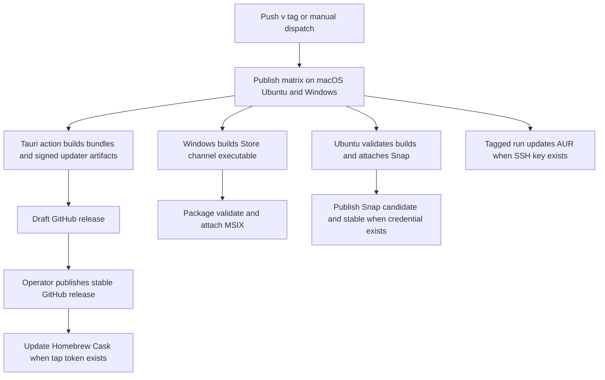

# Release and Distribution

Lymic delivers the desktop application through a signed GitHub/Tauri path and several downstream channels. A GitHub release begins as a **draft**; publishing it is an operator decision. That publication is also the handoff point for the Apple Silicon Homebrew Cask. The Store MSIX is an attached, separately built Windows channel, while Snap and AUR distribution are Linux-specific handoffs.

## Release inputs and version contract

The release workflow is triggered by pushing a `v*` tag or by manual dispatch. Its Tauri action names the release from the Tauri version, Windows MSIX packaging reads that same version, the Snap metadata has its own version, and the Snap attachment reads `package.json`. The AUR updater instead derives the version from the tag name. In practice, set the intended version consistently in `package.json`, `src-tauri/Cargo.toml`, `src-tauri/tauri.conf.json`, and `snap/snapcraft.yaml`, then create the matching `v<version>` tag. A mismatch can make attachments or downstream package metadata refer to a release asset that does not exist.

The standard Tauri configuration builds all bundle targets and updater artifacts. Clients validate updater material using the embedded public key and obtain `latest.json` from the GitHub Releases endpoint. The release workflow provides the corresponding private signing key and password only to `tauri-apps/tauri-action`; it also prefers NSIS when composing Windows updater metadata. Treat those signing secrets as release-only credentials.

## Tagged pipeline and publication boundary

The `publish` job is a three-platform matrix: `macos-latest`, `ubuntu-22.04`, and `windows-latest`. Each job checks out the tag, installs Node 22 and stable Rust with Clippy and rustfmt, runs `npm ci`, frontend checking, frontend tests and build, then Rust format, Clippy, and locked tests. Ubuntu additionally installs the GTK, WebKit, appindicator, SVG, and `patchelf` prerequisites. `fail-fast: false` lets the other platform jobs continue after a failure, but a release should not be published until all required outputs have passed.

After those checks, each matrix member invokes `tauri-apps/tauri-action` with `--locked`. The action creates or updates the draft `Lymic v__VERSION__` release, generates notes, and uploads normal platform bundles and signed updater material. The Windows and Ubuntu members then add their channel-specific artifacts. `gh release upload --clobber` replaces an existing MSIX or Snap asset on a rerun.

*The workflow creates a draft first; Store, Snap, and AUR steps are distinct handoffs, while Homebrew starts only after a stable release is published.*

Review the draft's notes, standard bundles, signed updater artifacts, MSIX, and Snap before publishing. In particular, do not equate a successful build with Store certification or a public release.

## Windows channels and MSIX validation

The Windows Store is deliberately isolated from the GitHub/NSIS channel. The normal Tauri matrix build is not given `LYMIC_RELEASE_CHANNEL=store`; a later Windows-only step sets it, rebuilds the frontend and creates the locked release executable with `custom-protocol`. The job packages `dist/msix/Lymic_<version>_x64.msix`, validates it, saves it as the `lymic-store-msix` workflow artifact, and attaches it to the GitHub release.

`package-msix.ps1` is the packaging entrypoint. It obtains a version from `tauri.conf.json` when none is given, removes an optional leading `v`, pads it to four MSIX components, finds x64 `makeappx.exe` through `PATH` or a Windows SDK, and requires the explicitly supplied or a recognized release executable. It recreates `target/msix-staging`, copies that executable as `Lymic.exe` and the four Store logos, fills the manifest template, and fails if `makeappx pack` fails.

The package defaults to identity `xXRoxXeRXx.Lymic` and publisher `CN=EB6D92C3-1B82-4D11-B562-6EA2D7C2FDEC`. The validator reads `AppxManifest.xml` from the archive and aggregates errors for missing or mismatched identity, publisher, x64 architecture, normalized version, and `runFullTrust`. It also rejects `broadFileSystemAccess`; any accumulated errors exit with code 1. The executable manifest/validator gate is therefore more authoritative than historical release documentation: the public Store record still describes `broadFileSystemAccess` as justified. Reconcile that discrepancy before using the record as certification evidence or changing package capabilities.

The Store channel is update-authority isolation, not just a packaging flag. Store builds report that in-app updates are unsupported, and startup, explicit checks, and installs return before contacting or relaunching the Tauri updater. Settings and update UI are hidden on that condition, leaving Microsoft Store as the update owner. The initial Store release does not migrate configuration or queued synchronization from an NSIS installation; see the [release-channel ADR](../../docs/adr/0004-microsoft-store-release-channel.md).

## Snap build and conditional publication

On Ubuntu, the release workflow runs the focused Snapcraft validator test and calls `snapcore/action-build`. It uploads the resulting file as `lymic-snap` and attaches the same artifact to the GitHub release. `snapcore/action-publish` runs only when `SNAPCRAFT_STORE_CREDENTIALS` is nonempty, publishing that file to both `candidate` and `stable`. Thus, missing credentials skip Snap Store publication but do not prevent building or attaching the Snap.

The Snap definition is `core22`, `strict`, and GNOME-extended. Its desktop app declares desktop/display plugs plus `network`, `home`, `removable-media`, and `password-manager-service`; it also binds the GNOME platform WebKitGTK 4.1 locations under confinement. The build reuses a discovered Debian bundle where available, otherwise performs the Tauri Debian build, extracts it, and fails if no recognized executable can be installed as `bin/lymic`. Keep these plugs and layout bindings aligned with actual runtime needs rather than treating them as optional metadata.

## AUR handoff

A tagged workflow run starts `update-aur` only after the complete `publish` matrix succeeds. With no `AUR_SSH_PRIVATE_KEY`, it explicitly logs a skip. With the key, it configures SSH for `aur.archlinux.org`, downloads `Lymic_<tag version>_amd64.deb` from the release, computes its SHA-256, copies the repository's `PKGBUILD` and `.SRCINFO` templates into the `lymic-bin` AUR checkout, substitutes the package version, source URL, and checksum, and commits only when there is a diff.

The repository also validates modifications to `packaging/arch/lymic-bin` on pushes and pull requests. The validation runs inside an Arch container, verifies sources, runs `namcap` on the PKGBUILD and built package, builds with `makepkg`, regenerates `.SRCINFO`, and requires it to match the checked-in file. This protects the template consumed by the handoff; it does not publish to AUR itself.

## Homebrew Cask handoff

`Update Homebrew Cask` runs from the GitHub `release: published` event only for non-prereleases. It checks out the released tag, and, only when `HOMEBREW_TAP_TOKEN` exists, downloads `Lymic_<version>_aarch64.dmg`, clones `xXRoxXeRXx/homebrew-tap`, regenerates `Casks/lymic.rb`, and pushes a commit if it changed. A missing token intentionally makes both the download and tap-update steps no-ops.

`scripts/update-homebrew-cask.mjs` accepts only stable three-part semantic versions. It uses a provided asset or downloads the release DMG, computes its SHA-256, and emits a Cask whose URL and checksum both describe that versioned artifact. The generated Cask is arm64-only and installs `Lymic.app`. For local validation and installation instructions, see the [Homebrew Cask guide](../../docs/homebrew-cask.md). The guide notes that the app is not notarized, so macOS may require Control-click **Open** on first launch.

## Store evidence and operator checklist

Attaching an MSIX to GitHub is traceability, not Microsoft Store publication. Submit it through Partner Center for Store signing and private Flight distribution. The [Flight validation runbook](../../docs/store/flight-validation.md) remains an open checklist for certification, clean-install and watched-folder behavior, synchronization, Store-only update behavior, and required-access denial. Record real outcomes before public rollout, then update the [Microsoft Store release record](../../docs/store/release-record.md) with the validated package, listing, rating, capability decision, and privacy/support endpoints.

Before releasing:

1. Align the four version inputs and push the corresponding `v<version>` tag.
2. Require all three matrix quality gates, the MSIX validation, and the Snap validation/build to pass; inspect platform-specific failures despite `fail-fast: false`.
3. Review the draft assets and release notes, then intentionally publish the stable GitHub release. This is what can trigger the Homebrew workflow.
4. Verify the Store executable was built with `LYMIC_RELEASE_CHANNEL=store`, retain the MSIX validation result, and do not add `broadFileSystemAccess` without changing the validator and reassessing certification.
5. Provide `SNAPCRAFT_STORE_CREDENTIALS`, `AUR_SSH_PRIVATE_KEY`, and `HOMEBREW_TAP_TOKEN` only for the respective Store publication, AUR update, and tap update you intend to authorize. Their absence has the documented skip behavior.
6. Complete the actual private Flight and the release-record sign-off before Microsoft Store public rollout.

For local prerequisites and routine checks, see [Development and Testing](development-and-testing.md). The desktop/webview boundary is covered in [Runtime Architecture](../architecture/runtime.md), and UI and IPC integration in [UI and IPC](../frontend/ui-and-ipc.md).
