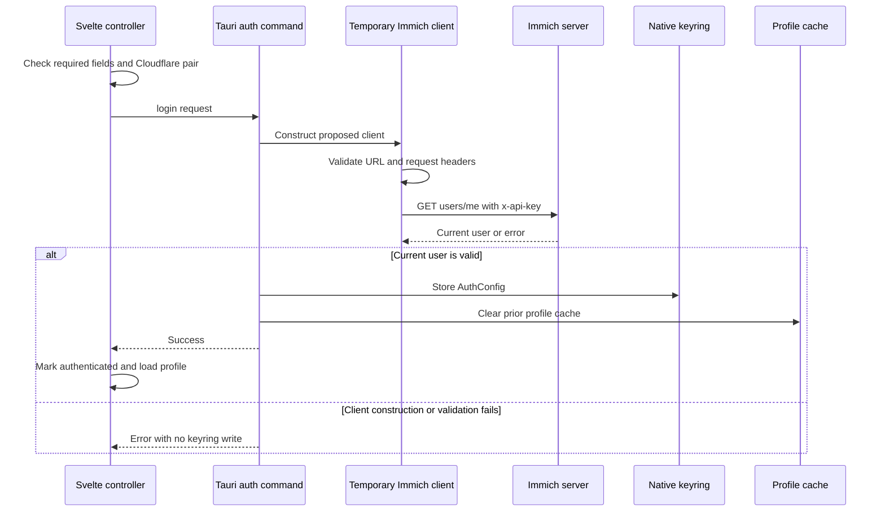

# Authentication and Credential Boundaries

Lymic authenticates to Immich with an API key. A connection may additionally use a Cloudflare Access service-token pair. The renderer submits those values only through Tauri commands; the Rust backend validates a proposed connection before persisting its `AuthConfig` in the operating system's native keyring. The profile cache and audit trail are deliberately separate from that secret store.

## Credential ownership and session boundary

`AuthConfig` holds the server URL, API key, local-HTTP opt-in, and optional Cloudflare client ID and secret. It is serialized as one password in the fixed `lymic-sync` / `api-credentials` keyring entry. A missing entry is the logged-out state, and deleting a missing entry succeeds. Serde defaults keep older stored JSON safe: local HTTP remains disabled and Cloudflare Access remains absent when those fields are missing.

Treat the complete configuration as secret-bearing. Its `Debug` implementation redacts the API key and Cloudflare secret, but not the server URL or Cloudflare client ID. Avoid emitting the complete configuration or any real credential component in diagnostics, screenshots, or support material.

The browser-side controller depends on the `AuthDesktopAdapter` contract (`login`, `logout`, `getAuthStatus`, `getServerUrl`, and `getCurrentUser`); `tauriDesktopAdapter` maps those calls to registered Rust commands. On startup, `hydrate()` first establishes authentication from keyring presence, then retrieves the stored URL and attempts profile loading. A profile failure is non-fatal: keyring presence remains the UI's authentication state.

## Login validation and persistence

The controller refuses an empty URL or API key and trims Cloudflare inputs. It rejects a partial Cloudflare pair before IPC. The backend repeats Cloudflare normalization, creates a temporary `ImmichClient`, and calls `validate_connection()`. Validation is a `GET users/me` request with `x-api-key`; it requires a successful JSON current-user response with either a nonblank name or email. Only then does the backend write credentials; it stores the local-HTTP setting derived from the validated client, then best-effort clears the prior profile cache. The temporary client is discarded.

*Login validates the proposed endpoint and current-user response before credentials cross into the native keyring.*

After a successful command, the controller clears its in-memory API key and Cloudflare secret, marks itself authenticated, invokes its login hook, and tries to load the profile. The latter failure is caught and logged as a warning rather than rolling back login. The backend also exposes `get_auth_status` and `get_server_url`; neither returns the API key.

## URL and HTTP transport policy

Every constructed `ImmichClient`, including the temporary validation client, applies the following policy before it can issue a request:

- HTTPS is mandatory by default. HTTP is permitted only with `allow_local_http` **and** an exact `localhost`, IPv4 loopback, or IPv6 loopback host. LAN addresses, `.local` names, public hosts, and non-HTTP(S) schemes are rejected.
- A server URL must have a host and cannot contain userinfo, a query, or a fragment. This prevents embedded credentials and ambiguous request targets.
- The accepted base path is normalized to an Immich API base: a trailing `/api` is retained and otherwise `/api/` is appended. Path-prefix deployments are therefore supported without allowing query or fragment data in configuration.
- The reqwest client has redirects disabled, so a credential-bearing request cannot be redirected to another destination or downgraded from HTTPS.

The backend prefixes rejected non-loopback HTTP with `LOCAL_HTTP_NOT_ALLOWED`; the controller maps that stable code to a localized message. Local HTTP remains an explicit risk acceptance because the API key travels over that loopback connection.

## Cloudflare Access boundary

Cloudflare Access is off when both optional values are absent; whitespace-only values normalize to absent. A supplied client ID requires a supplied secret and vice versa. `ImmichClient::new` validates both as HTTP header values, installs `cf-access-client-id` and `cf-access-client-secret` as default headers, and marks the secret header sensitive. These default headers apply to validation, profile, and synchronization requests made by that client, while `x-api-key` is applied to Immich requests individually.

A complete pair is persisted with the API key only after the validation request succeeds. Changes to either the UI validation or the Rust constructor must preserve both layers: the UI supplies early feedback, whereas the backend remains the enforcement point for untrusted IPC input.

## Logout and profile cache lifecycle

Logout obtains the audit actor from the existing credentials before attempting keyring deletion. On successful deletion it clears the profile-cache directory; if deletion fails, the cache and frontend authenticated state remain. After a successful logout command and user confirmation, the controller clears its API-key, local-HTTP, Cloudflare, display-name, and avatar state before running its logout hook.

Profile metadata and an optional avatar live under the application cache directory in `profile_cache`, not in the keyring. Metadata includes a derived account ID and user ID. Cache reads reject a different account and, when supplied, a different user. A refresh failure can return only the same account's cache; an avatar-fetch failure can reuse an image only for the same user. Before resolving a current-user refresh, the backend rereads credentials and compares the derived account ID. If the session changed during the request, it returns `Session changed during profile refresh` and does not persist the response into the new session.

The cache serializes profile metadata and raw image bytes separately, using temporary files followed by rename for writes. It converts only JPEG, PNG, WebP, and GIF signatures to data URLs; unrecognized payloads, including SVG, are not rendered as an avatar. Profile-image downloads are limited to 10 MiB both by declared content length and after reading.

## Audit redaction and operating guidance

Login writes a started audit event and then a success or failure event; logout writes its terminal success or failure event. Their actor identifier is a domain-separated SHA-256 value derived from the normalized server URL and API key, rather than either raw value. Failed-login audit reasons redact the submitted URL, API key, Cloudflare client ID, and secret. The shared sanitizer also replaces line breaks, collapses whitespace, and truncates retained text to 512 characters. Profile-refresh diagnostic errors use the same credential-aware redaction.

When changing authentication code, preserve these ordering and containment rules:

1. Construct and validate a client from the proposed values before calling `store_credentials`.
2. Keep URL validation and redirect refusal in the shared client constructor so login and subsequent requests cannot diverge.
3. Clear profile cache only after a successful credential store or credential deletion, and retain the account-change guard around profile persistence.
4. Redact the URL and every credential component before writing an error to an audit record or diagnostic output.

Focused tests cover loopback-only HTTP opt-in, URL and Cloudflare-header rejection, API-base normalization, legacy keyring configuration and debug redaction, controller error and session behavior, cache account/user isolation, rejected SVG avatars, and the profile-refresh session-change guard.

## Server-side permissions

The Immich API key's scopes are controlled by Immich, not by Tauri capabilities. The documented workflow uses `user.read` for login/current-user lookup, `asset.read` and `asset.upload` for synchronization, and album read/create/asset-create permissions for album features. Normal operation does not require asset deletion or album update; grant only the scopes required by enabled functionality.

## Related documentation

- [Local Persistence and Recovery](../data/local-state.md) distinguishes caches and database state from keyring credentials.
- [UI and IPC](../frontend/ui-and-ipc.md) describes the renderer-to-Tauri command boundary.
- [Immich API Integration](../integrations/immich-api.md) covers authenticated API operations.
- [Audit Logging](../operations/audit-logging.md) explains audit-event storage and review.
- [Synchronization](../workflows/synchronization.md) describes the authenticated transfer workflow.
