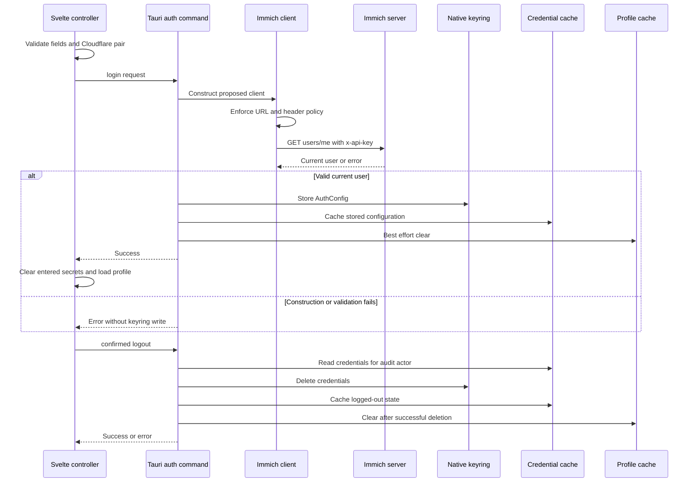

# Authentication and Credential Safety

Lymic authenticates to Immich with an API key and can additionally send a Cloudflare Access service-token pair. The renderer passes these values only to Tauri commands. Rust validates a proposed connection before persisting its `AuthConfig` in the operating system's native keyring; profile metadata and audit records are separate from that secret store.

## Credential ownership, storage, and short-lived caching

`AuthConfig` contains the server URL, API key, local-HTTP opt-in, and optional Cloudflare client ID and secret. It is JSON-serialized as the password of the fixed `lymic-sync` / `api-credentials` native-keyring entry. No entry represents logged-out state, and deleting a missing entry succeeds. Serde defaults mean legacy stored JSON leaves local HTTP disabled and Cloudflare Access absent.

The backend maintains a process-local credential cache for two seconds. It caches both a loaded configuration and the absent-entry result, avoids a keyring read while fresh, and is updated immediately after a successful store or deletion. This is an I/O optimization, not an additional persistence location or an authorization source independent of the keyring.

Treat the complete configuration as secret-bearing. `AuthConfig`'s `Debug` implementation redacts the API key and Cloudflare client secret, although it displays the server URL and client ID. Do not emit a complete configuration or any real credential component in diagnostics, screenshots, or support material.

## Login, persistence, and logout lifecycle

The browser-side controller uses the `AuthDesktopAdapter` contract (`login`, `logout`, `getAuthStatus`, `getServerUrl`, and `getCurrentUser`), which `tauriDesktopAdapter` maps to Tauri commands. On startup, `hydrate()` establishes UI authentication from keyring-backed status, loads the stored URL, and then attempts profile loading. A profile failure is non-fatal: stored credentials remain the authentication state.

Before IPC, the controller requires a URL and API key, trims Cloudflare inputs, and refuses a partial Cloudflare pair. The backend normalizes the Cloudflare values again because IPC input is untrusted. It constructs a temporary `ImmichClient`, calls `validate_connection()`, and only then calls `store_credentials`. Validation issues `GET users/me` with `x-api-key` and accepts a successful JSON response only when it has a nonblank name or email. The local-HTTP setting persisted is derived from the accepted client. After a successful store, profile-cache clearing is best effort and does not make login fail.

*Credential login and logout validate before persistence, update the short-lived credential cache, and clear profile data only after the relevant keyring mutation succeeds.*

Logout obtains the audit actor from the existing credentials before attempting keyring deletion. On successful deletion it clears the profile-cache directory and thumbnail cache; if deletion fails, those caches and the frontend authenticated state remain. After successful logout and user confirmation, the controller clears entered API-key, local-HTTP, Cloudflare, display-name, and avatar state before running its logout hook.

## Transport and Cloudflare Access policy

Every `ImmichClient`, including the temporary login client and clients made from stored credentials, enforces the following before a request can be sent:

- HTTPS is mandatory by default. HTTP is accepted only when `allow_local_http` is set and the host is exactly `localhost`, an IPv4 loopback address, or an IPv6 loopback address. LAN addresses, `.local` names, public hosts, and non-HTTP(S) schemes are rejected.
- The URL must include a host and cannot include userinfo, a query, or a fragment. Its path is normalized to an Immich API base: an existing trailing `/api` is retained; otherwise `/api/` is appended, including after a deployment path prefix.
- Reqwest redirects are disabled, preventing a credential-bearing request from being redirected to another target or downgraded from HTTPS.

Rejected non-loopback HTTP is prefixed with `LOCAL_HTTP_NOT_ALLOWED`; the controller recognizes that stable code and shows a localized error. Local HTTP is an explicit risk acceptance because the API key travels over that loopback connection.

Cloudflare Access is disabled when both optional values are absent; whitespace-only values normalize to absent. A client ID and secret are an all-or-nothing pair. The client constructor validates each supplied value as an HTTP header, installs `cf-access-client-id` and `cf-access-client-secret` as default headers, and marks the secret header sensitive. Thus the pair applies to validation, profile, and other requests made through that client, while the Immich API key is added as `x-api-key` on individual API requests.

## Reusing authenticated clients

Most authenticated backend operations call `ImmichClient::from_stored_credentials()` rather than independently reconstructing a client. It first retrieves the current `AuthConfig`, then reuses an `Arc<ImmichClient>` only when the complete configuration compares equal; otherwise it constructs and caches a new client and its derived account ID. This preserves one common constructor policy for stored sessions while retaining connection reuse for unchanged credentials.

The authenticated-client cache is not itself a session authority. A request after logout first fails to obtain stored credentials, even if an older client remains in the process cache. A changed configuration cannot match the cached configuration, so it creates a client using the new values. Constructor errors on stored credentials are passed through credential-aware redaction before being returned.

## Profile cache isolation and refresh race protection

Profile metadata and an optional raw avatar live under the application cache directory in `profile_cache`, not in the keyring. Metadata contains a derived account ID and user ID. Reads reject a different account and, when requested, a different user. Metadata and avatar writes use temporary files followed by rename.

For `get_current_user`, the backend derives the account ID from the credentials read before the request. It may return a cache entry for the same account on refresh failure; after an avatar-fetch failure it may reuse an image only for that same user. Before resolving or persisting a refresh result, it rereads credentials and compares the derived account ID. If the session changed during the request, it returns `Session changed during profile refresh` rather than persisting the old response into the new session.

Profile-image retrieval rejects declared or actual bodies larger than 10 MiB. The cache converts only JPEG, PNG, WebP, and GIF signatures to data URLs; unrecognized bytes, including SVG, are not rendered as an avatar.

## Audit redaction and change guidance

Login records started and terminal audit events, and logout records its terminal outcome. The actor identifier is a domain-separated SHA-256 value derived from normalized server URL and API key rather than either raw value. Failed-login audit reasons redact the submitted URL, API key, Cloudflare client ID, and secret. The sanitizer also removes line breaks, collapses whitespace, and limits retained text to 512 characters. Profile-refresh diagnostic errors use the same credential-aware redaction.

When changing authentication code, preserve these rules:

1. Construct and validate a client from proposed values before `store_credentials`.
2. Keep URL validation, header validation, and redirect refusal in `ImmichClient::new` so login and later authenticated requests cannot diverge.
3. Treat credential and authenticated-client caches as derived, process-local optimizations; keyring mutations must update the credential cache, and every authenticated operation must still load stored credentials.
4. Clear profile and thumbnail caches only after successful credential deletion, and retain the account-change check around profile persistence.
5. Redact the URL and every credential component before putting errors in audit records or diagnostics.

Focused tests cover legacy configuration defaults and debug redaction, loopback-only HTTP opt-in, URL and Cloudflare-header rejection, API-base normalization, frontend login/session behavior, cache account/user isolation, rejected SVG avatars, and the profile-refresh session-change guard.

## Server-side permissions

Immich controls API-key scopes; Tauri capabilities do not grant Immich permissions. The documented workflow uses `user.read` for login/current-user lookup, `asset.read` and `asset.upload` for synchronization, and album read/create/asset-create permissions for album features. Normal operation does not require asset deletion or album update, so grant only the scopes required by enabled functionality.

## Related documentation

- [Local Persistence and Recovery](../data/local-state.md) distinguishes caches and database state from keyring credentials.
- [UI and IPC](../frontend/ui-and-ipc.md) describes the renderer-to-Tauri command boundary.
- [Immich API Integration](../integrations/immich-api.md) covers authenticated API operations.
- [Audit Logging](../operations/audit-logging.md) explains audit-event storage and review.
- [Synchronization](../workflows/synchronization.md) describes the authenticated transfer workflow.
