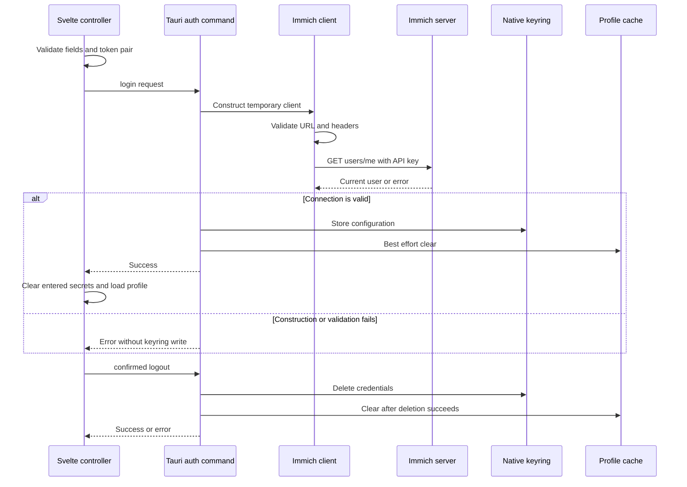

# Authentication and Credential Boundaries

Lymic authenticates to Immich with an API key and can attach an optional Cloudflare Access service-token pair. The renderer supplies these values to registered Tauri commands; the Rust backend is the boundary that validates a connection before writing the complete configuration to the operating system's native keyring. Profile data, thumbnails, the sync queue, and audit records are separate stores, not alternate credential stores.

## Credential ownership and retrieval

`AuthConfig` holds the server URL, API key, local-HTTP opt-in, and optional Cloudflare client ID and secret. The configuration is serialized into one fixed native-keyring entry. A missing entry means logged out, and deleting an already-missing entry succeeds. Defaults for deserializing older configurations leave local HTTP and Cloudflare Access disabled.

Credential reads have a process-local two-second cache. It can cache either a configuration or the logged-out result, and successful stores and deletions update it immediately. This reduces keyring reads; the keyring remains the persistent authentication authority. The authenticated-client cache is likewise derived process state rather than a session authority.

Treat the complete configuration as secret-bearing. `AuthConfig`'s `Debug` output redacts the API key and Cloudflare client secret, but callers must not put a configuration or credential component in diagnostics, screenshots, or support material.

## Login, persistence, and logout

The Svelte controller uses `AuthDesktopAdapter`; its Tauri implementation invokes `login`, `logout`, `get_auth_status`, `get_server_url`, and `get_current_user`. At startup, `hydrate()` obtains the keyring-backed authentication status, then the saved server URL and profile. A profile lookup failure is non-fatal to that frontend authentication state.

Before IPC, the controller requires a URL and API key, trims Cloudflare values, and refuses a partial Cloudflare pair. The command repeats Cloudflare normalization because IPC input is untrusted. It constructs a temporary `ImmichClient`, calls `validate_connection()`, and stores credentials only after that succeeds. Validation requests `GET users/me` with `x-api-key`; a successful response must provide a nonblank name or email. The saved local-HTTP setting is derived from the accepted client. Profile-cache clearing after a successful login is best effort.

*Login validates the proposed connection before persistence; logout clears profile data only after credential deletion succeeds.*

Logout derives its audit actor from existing credentials before attempting deletion. On success it clears the profile cache and thumbnail cache. If deletion fails, cache cleanup does not run and the controller retains its authenticated state; after a successful, confirmed logout it clears its API-key, local-HTTP, Cloudflare, display-name, and avatar state before its logout hook.

## Client construction and transport policy

Every `ImmichClient` constructor—whether for login, a command using stored credentials, or sync—centralizes the credential-bearing transport rules:

- HTTPS is required by default. HTTP is permitted only when `allow_local_http` is enabled and the host is exactly `localhost` or an IPv4 or IPv6 loopback address. LAN hosts, `.local` names, public hosts, and other schemes are rejected.
- A server URL needs a host and may not contain userinfo, a query, or a fragment. The client normalizes the path to an Immich `/api/` base while retaining an existing trailing `/api` and deployment path prefixes.
- Reqwest redirect handling is disabled, so a credential-bearing request cannot follow a redirect to a different target.

The `LOCAL_HTTP_NOT_ALLOWED` error is recognized by the controller and shown as a localized login error. Enabling local HTTP is an explicit acceptance that the API key is sent over that loopback connection.

Cloudflare Access is off when both optional values are absent, including whitespace-only values after normalization. If supplied, the client ID and secret must be a complete pair and valid HTTP header values. The constructor installs `cf-access-client-id` and a sensitive `cf-access-client-secret` as default headers, so they accompany validation and later requests from that client; API calls add the Immich API key as `x-api-key` per request.

Commands such as albums, timeline, map, people, asset, and thumbnail operations call `ImmichClient::from_stored_credentials()`. That helper reads the current credentials first, reuses an `Arc<ImmichClient>` only when the entire `AuthConfig` matches its cached configuration, and otherwise constructs and caches a client with the corresponding derived account ID. Consequently, a logout is observed before such a command can obtain an authenticated client, and a changed configuration cannot reuse the prior client's cache entry.

Synchronization deliberately takes a separate path: after it reads credentials for a run, it constructs an `ImmichClient` from that snapshot rather than using the shared command-client cache. This still applies the same constructor policy, including the persisted local-HTTP setting and Cloudflare pair.

## Authentication failure during sync and startup

Sync admission persists discovered work and claims the lifecycle before it obtains credentials. If credentials are absent or unreadable, or client construction rejects the stored server configuration, the service marks the run `FAILED`, updates the sync snapshot and tray action when possible, and writes a `sync.aborted` audit event. Durable queued work is retained, so it can be recovered rather than discarded. The same failure handling applies to manual and background sources; manual admission also emits a sync error to the UI.

Background startup starts a startup-sync task, waits two seconds, loads and scans watched folders, then submits the result with `SyncSource::Startup`. It therefore reaches the same credential gate after scan admission. A missing login or invalid persisted configuration can leave the startup run failed with queued work retained; it does not make the desktop login command fabricate a session.

## Profile isolation and audit boundaries

Profile metadata and an optional raw avatar are stored under the application cache directory, not in the keyring. Cache reads are account-bound and can additionally be user-bound. After a current-user refresh, the backend rereads credentials and compares the derived account ID before resolving or persisting the result; a session change returns `Session changed during profile refresh` rather than saving data from the old session into the new one.

Profile-image retrieval rejects declared or actual bodies over 10 MiB. Cached data becomes a data URL only when its signature is JPEG, PNG, WebP, or GIF; unrecognized bytes, including SVG, are not rendered as avatars.

Login and logout audit events use a domain-separated SHA-256 actor identifier derived from the normalized server URL and API key instead of storing those raw values. Failed-login and profile-refresh diagnostics redact submitted credential values; the audit sanitizer removes line breaks, collapses whitespace, and bounds retained error text.

## Capability and server-permission boundaries

The `default` Tauri capability applies to the `main` window. It declares `core:default`, narrowly listed dialog permissions, restart permission, and the updater and opener defaults. This desktop capability controls the application's Tauri/plugin surface; it does not grant access to Immich data or expand an API key's server-side scope.

Immich enforces API-key scopes. The documented workflow needs `user.read` for login/current-user lookup, `asset.read` and `asset.upload` for synchronization, and `album.read`, `album.create`, and `albumAsset.create` for album features. Normal operation does not require asset deletion or album update; grant only scopes needed for enabled features.

## Change and test guidance

When changing authentication code:

1. Validate a proposed client before storing credentials, and keep URL, header, and redirect policy in `ImmichClient::new`.
2. Treat credential and client caches as derived optimizations. Credential mutations must update the credential cache; command clients must read stored credentials before reuse.
3. Keep sync's credential gate and durable failure path aligned with all sync sources, including startup and recovery.
4. Clear profile and thumbnail caches only after successful credential deletion, and retain the account-change guard around profile persistence.
5. Redact the URL and every credential component before diagnostics or audit records.

Focused tests cover legacy defaults and debug redaction, loopback-only HTTP, URL and Cloudflare-header validation, API-base normalization, frontend login/session behavior, profile cache account/user isolation, rejected SVG avatars, the profile-refresh session-change guard, and durable sync failure behavior.

## Related documentation

- [Runtime architecture](../architecture/runtime.md) explains desktop startup and background services.
- [UI and IPC](../frontend/ui-and-ipc.md) describes the renderer-to-Tauri boundary.
- [Immich API integration](../integrations/immich-api.md) covers authenticated API operations.
- [Quickstart](../quickstart.md) covers initial connection setup.
- [Synchronization](../workflows/synchronization.md) describes queue and transfer behavior.
