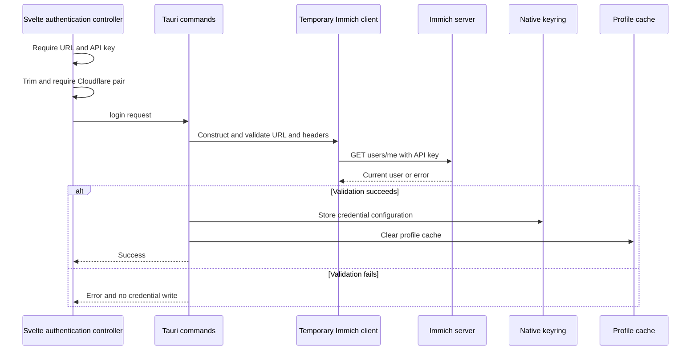

# Authentication and Credential Safety

Lymic is a desktop upload client for Immich. Authentication is based on an Immich API key, optionally augmented with a Cloudflare Access service-token pair. The application keeps those connection credentials out of SQLite: its Rust backend serializes the connection configuration and writes it to the platform keyring. The frontend only uses Tauri commands to submit, query, or delete the configuration.

## Trust boundaries and configuration

`AuthConfig` contains the configured server URL, API key, an `allow_local_http` flag, and optional Cloudflare client ID and client secret. It is serialized as one keyring password under the fixed `lymic-sync` / `api-credentials` service/account entry. A missing keyring entry means there is no authenticated configuration; deletion treats that already-absent state as success. Older serialized records default local HTTP to disabled and Cloudflare fields to absent.

The configuration must be treated as secret-bearing as a whole: although the server URL and Cloudflare client ID are not redacted by `Debug`, the API key and Cloudflare client secret are. Do not put real credential values, complete credential-bearing configuration, or Cloudflare service-token values in examples, bug reports, screenshots, or diagnostics.

The renderer's `DesktopAdapter` exposes `login`, `logout`, `getAuthStatus`, `getServerUrl`, and `getCurrentUser`; the desktop application registers the corresponding Rust commands. The default Tauri capability is restricted to the main window and declares core defaults plus the dialog, restart, updater, and opener plugin permissions. It does not itself define a separate permission model for Immich credentials; protection of the keyring entry relies on the operating-system account/keyring and the integrity of the desktop application.

## Login validation and persistence

The UI requires a nonempty server URL and API key before it invokes `login`. It trims optional Cloudflare fields and rejects an incomplete pair locally. The backend repeats normalization, then constructs a temporary `ImmichClient`. That construction is important: it applies the URL, HTTP, redirect, and Cloudflare-header validation that every later client uses. The temporary client calls `users/me`; only a successful current-user response permits the credentials to be stored. The temporary client is discarded after this probe.

*Login validates the endpoint before keyring persistence; a successful login also invalidates any cached profile from the preceding account.*

The client sends the API key in `x-api-key` on the current-user request and subsequent Immich API requests. A current-user response must be successful JSON and must provide a nonblank name or email; otherwise validation fails. Consequently, a stored credential is evidence of a successful validation at login time, not a promise that the server, key, or network will remain usable later.

After login, the UI marks itself authenticated, runs its application-level login hook, and attempts to load the profile. A profile-load failure is non-fatal to that successful authentication state. At startup, hydration first asks whether keyring credentials exist, then loads the stored server URL and tries to refresh the profile.

## Endpoint and transport policy

`ImmichClient::new` parses and trims the configured URL before any request:

- HTTPS is required by default. Plain HTTP is available only when `allow_local_http` is true **and** the host is exactly `localhost`, an IPv4 loopback address, or an IPv6 loopback address. LAN, `.local`, public, and non-HTTP(S) endpoints are not admitted by this exception.
- A URL must include a host and must not contain userinfo, a query string, or a fragment. This prevents configuration from carrying embedded secrets or ambiguous request targets.
- The configured path is normalized to an Immich API base: an existing trailing `/api` is retained, otherwise `/api/` is appended. This supports deployments behind a path prefix without accepting a query or fragment.
- The reqwest client refuses redirects. Operators must configure a reverse proxy to expose the final endpoint directly; redirects cannot forward a request carrying an API key to another target or from HTTPS to HTTP.

The local-HTTP rejection begins with the stable `LOCAL_HTTP_NOT_ALLOWED` code, which the UI maps to a localized error. Local HTTP remains a deliberate security tradeoff because the API key is transmitted over that loopback connection.

## Cloudflare Access

Cloudflare Access is disabled when both optional values are absent. Whitespace-only values are normalized to absent; if only one value remains, both the UI and backend reject the login. With a complete pair, the client validates each value as an HTTP header value and installs `cf-access-client-id` and `cf-access-client-secret` as default headers. The secret header is marked sensitive in reqwest.

Those headers accompany requests made by that `ImmichClient`, including login validation and profile fetches, while the API key continues to be set per request. They are stored alongside the API key in the native keyring after successful validation. Do not log either member of the pair or construct diagnostic examples containing them.

## Logout and profile-cache lifecycle

Logout derives its audit actor from the credentials before removal, deletes the keyring entry, and clears the profile cache only after a successful deletion. The UI first asks for confirmation; after a successful command it clears its API-key, local-HTTP, Cloudflare, displayed-name, and image state, then runs its logout hook. If deletion fails, the UI keeps its authenticated state and reports the error.

The backend stores profile metadata and an optional avatar under the application cache directory in `profile_cache`, rather than in the keyring. Metadata is keyed by a derived account identifier; cache reads refuse a different account and, when known, a different user ID. A successful login or logout clears those files. During a profile refresh, the backend rereads credentials before resolving or persisting the result; if the derived account changed during the request, it returns `Session changed during profile refresh` instead of writing a stale profile into a new session. On refresh or image-fetch failure, it may return a cache entry only for the same account.

## Diagnostics and operations

Login and logout emit started/completed/failed audit events. Their actor identifier is a domain-separated SHA-256 value derived from normalized server URL and API key, rather than either input value. For a failed login, the audit failure reason is sanitized against the submitted URL, API key, Cloudflare ID, and Cloudflare secret. The sanitizer also collapses line breaks and whitespace and limits the retained text to 512 characters. Login's UI progress message is generic and intentionally does not include connection values.

When changing this area, preserve the ordering invariant: validate with a client built from the proposed configuration before `store_credentials`, and clear profile cache only after a successful login store or logout deletion. Keep any newly introduced diagnostic path secret-safe—redact the URL and all credential components before persisting or displaying errors. The focused test coverage verifies URL rejection and local-loopback opt-in, Cloudflare pair validation, API-base normalization, native-config compatibility and debug redaction, frontend error handling, account-separated cache fallbacks, and the profile-refresh logout-race guard.

## Server-side permission assumptions

The Immich API key must be granted the capabilities used by the client. The project documentation identifies `user.read` for login/current-user lookup, `asset.read` for duplicate checks, `asset.upload` for transfers, and album read/create/asset-create permissions for album features. Normal operation does not require asset deletion or album update permissions. These are server-side API-key scopes, not permissions enforced by the Tauri capability file; deployments should grant the least set required by the enabled workflow.

## Related documentation

- [Local Persistence and Recovery](../data/local-state.md) describes database and cache state distinct from keyring credentials.
- [UI and IPC](../frontend/ui-and-ipc.md) covers the renderer-to-Tauri command boundary.
- [Immich API Integration](../integrations/immich-api.md) describes authenticated API operations.
- [Audit Logging](../operations/audit-logging.md) explains the audit-event store and operational review.
