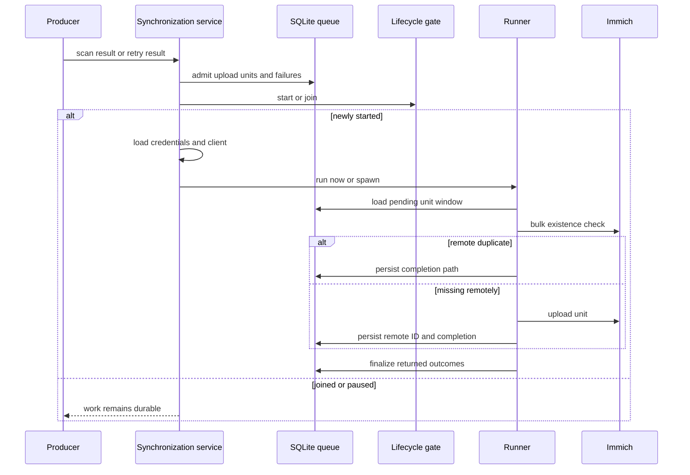
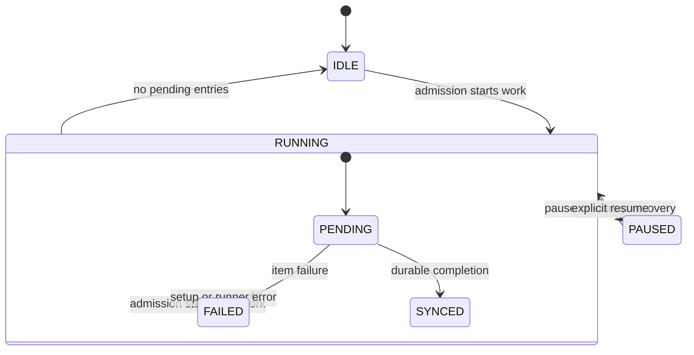

# Synchronization Pipeline

Synchronization is a one-way local-to-Immich workflow whose recovery authority is the SQLite queue, not a scan result or an in-memory transfer. Producers first turn discovered media into durable upload units; a serialized runner later reads pending units from that queue. This permits watcher and folder events to add work during a run and preserves uncompleted work across restart.

## Admission and execution

The Tauri commands `start_sync`, `pause_sync`, `resume_sync`, `get_sync_status`, `get_failed_syncs`, and `retry_failed_syncs` expose the service to the frontend. `start_sync` requires watched folders, scans them, then submits the result as the `Manual` source. Producers include manual scans, retry, watcher batches, startup/deferred-folder scans, folder changes, exclusion changes, removable-media reconnects, and recovery.

Admission copies the current watched-folder target album to each asset, combines related image and live-photo video assets into an upload unit, and writes units and scan failures transactionally. This freezes the target album for already-admitted work. A `SYNCED` queue row is retained on a conflicting re-enqueue; other conflicting rows become `PENDING` and have their failure reason cleared.

This sequence shows that durable admission precedes runner ownership and that duplicates use the completion path rather than being treated as an upload miss.

`start_or_join` uses an atomic `running` gate. It returns `Joined` if another lifecycle already owns the run and returns `Paused` without starting work when the durable job is paused. The coordinator mutex serializes runners. Automatic producers return after admission and runner startup; manual and retry sources await their claimed runner. Before either runner form starts, credentials and a valid authenticated Immich client are required. An execution or setup failure marks the job `FAILED`, clears the in-memory running gate, emits a snapshot, and records `sync.aborted`.

The runner itself takes work only from the queue. It waits for the coordinator lock when required, so a producer that overlaps a run does not lose its admitted work. To close the empty-queue race, it releases the lifecycle gate, rechecks for newly pending work, and reclaims it before conditionally completing the job.

## Durable states, pause, and recovery

There is one durable sync job (`id = 1`) with job statuses `IDLE`, `RUNNING`, `PAUSED`, and `FAILED`. Queue entries are independently `PENDING`, `SYNCED`, or `FAILED`; terminal entries contribute to completed bytes and counts. A job can become `IDLE` only while `RUNNING` and when no pending queue row exists.

This diagram separates the singleton durable job lifecycle from durable per-entry outcomes.

On startup, recovery changes an interrupted `RUNNING` job to `PAUSED`: the application cannot safely infer whether an in-flight HTTP upload succeeded. Pause sets both the coordinator flag and the durable status. A running runner waits on a notification, emits the paused lifecycle and transfer state, and does not load another queue window. Resume changes `PAUSED` to `RUNNING`, clears and notifies the coordinator flag, and wakes an existing runner. If no runner owns the coordinator lock, resume either conditionally completes an empty queue or authenticates and spawns a recovery runner for persisted pending rows.

The runner loads at most 50 pending **upload units** per window. A unit keeps a primary image and optional live-photo video together; the primary owns its target album and remote ID. Before processing a window, the runner reevaluates watched-folder exclusions and deletes matching still-pending rows. It registers the materialized unit as active work so matching folder removal can cancel it. Cancellation and a pause boundary leave unreturned work pending; only the terminal results returned by the processor are finalized.

## Processing and completion

For each window, hashing starts at most four units concurrently. A cached SHA-1 is reusable only when the live file validates against its expected size and modification time; otherwise stable checksums are calculated and pending local sync state is recorded. Hashed units are bulk-checked against Immich in chunks of at most 100.

A remote duplicate is resolved to a remote asset ID and sent through the same completion flow as an upload. Missing units upload concurrently up to the persisted upload-parallelism setting. Uploads can include a live-photo video and report byte chunks through the shared transfer tracker. Bulk existence checks retry only retryable errors: three attempts total, with one- and two-second delays before attempts two and three. A non-retryable response or exhausted attempts aborts the runner rather than treating the check as a miss.

Completion makes durable bookkeeping precede a `SYNCED` queue outcome:

1. The primary queue row receives the resolved remote ID.
2. A unit with a target album remains nonterminal until batched album assignment succeeds.
3. Local synchronized state and queue results are persisted for all members of the unit; the runner then finalizes those returned results.

Thus album-assignment or completion-persistence failures become visible failed outcomes instead of a false success. Individual hash or upload failures likewise mark local state failed and return failed queue results, while a pipeline-level fault puts the job in `FAILED` with its unresolved queue work retained.

## Retry, progress, and operations

Retry reads failed paths from persistence and revalidates each against current folder exclusions, supported-media rules, metadata, and readability. Missing or excluded paths are discarded from the failed queue; other validation failures remain failed. Valid retry results re-enter the same admission and execution path as normal work.

`SyncSnapshot` is the durable UI baseline: job status, totals, succeeded and failed counts, current path, total bytes, and terminal completed bytes. The runner emits `sync-progress-snapshot` after admission and durable changes, `sync-progress` for the current path, lifecycle events such as `sync-started`, `sync-paused`, `sync-resumed`, and `sync-idle`, and `sync-transfer-stats` for the tray and frontend.

Transfer statistics are runtime metrics distinct from durable completion. They use a rolling three-second rate window and are eligible for reporting every 250 milliseconds. When paused, the tracker freezes the displayed rate and suppresses ETA; cleanup marks it inactive and emits a final state. Audit events cover run start, pause/resume, completion, aborts, bulk-check retries and failures, hashing, uploads, and completion failures.

## Safe changes and related documentation

Preserve these invariants when changing the pipeline:

- Persist producer output before starting or joining a runner.
- Treat the queue and local sync state—not UI progress or an in-memory scan—as recovery authority.
- Keep a live-photo pair and its target-album completion decision coherent as one upload unit.
- Finalize only results that have reached a durable terminal outcome; do not turn pause or cancellation into silent success.

Focused tests in `sync/service.rs`, `db/queue.rs`, `sync/queue_runner.rs`, `sync/processor.rs`, `sync/retry.rs`, and `sync/progress.rs` cover lifecycle admission, crash recovery, bounded windows, partial pause finalization, deduplication retries, and progress calculations.

- [Watched Folders and Media Discovery](watched-folders.md) explains scan producers and folder policy.
- [Local Persistence and Recovery](../data/local-state.md) describes SQLite queue and sync state.
- [Immich Integration](../integrations/immich-api.md) describes the remote API boundary.
- [Frontend UI and IPC](../frontend/ui-and-ipc.md) describes commands and event consumers.
- [Audit Logging](../operations/audit-logging.md) describes operational audit records.
