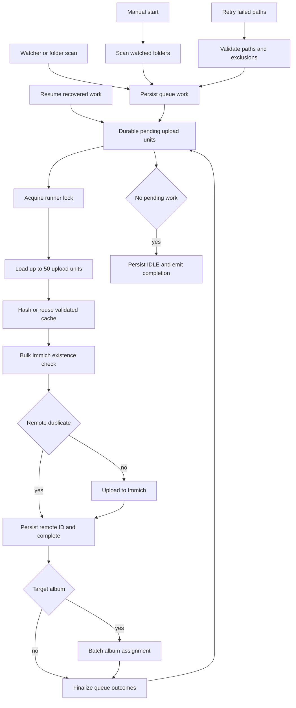
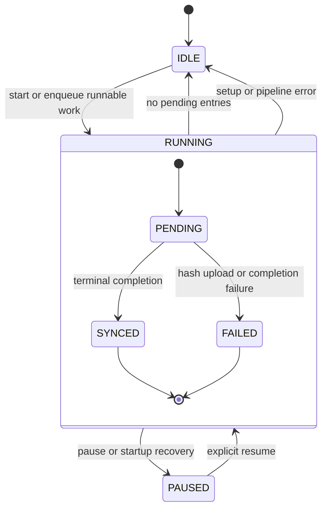

# Synchronization Pipeline

Synchronization is a one-way local-to-Immich workflow. Scans are **producers**, not the runner's source of truth: after an item has been persisted, the runner consumes the SQLite queue. This lets work survive a restart, lets watcher-driven scans add work during another run, and avoids rescanning completed items to recover a run.

## Entry points and admission

The Tauri commands `start_sync`, `pause_sync`, `resume_sync`, `get_sync_status`, `get_failed_syncs`, and `retry_failed_syncs` are thin adapters over `Synchronization`. The dashboard hydrates from the durable snapshot and subscribes to sync events; it uses the same action for pause and resume and separately offers retry for persisted failures.

| Entry point | What it does |
| --- | --- |
| Manual start | Requires at least one watched folder, atomically acquires the in-memory `running` gate, persists `RUNNING`, authenticates, scans watched folders, then invokes the queue pipeline. A second manual start is rejected as already in progress. |
| Automatic scan | Converts a scan result to durable queue rows **before** attempting to start a runner. If paused or another run owns the lifecycle gate, it leaves the work queued for that runner or a later resume. |
| Startup recovery | Startup changes a previously `RUNNING` durable job to `PAUSED`; it does not assume an interrupted HTTP upload failed or succeeded. The user must explicitly resume. |
| Resume | Changes a paused job to `RUNNING`, clears the coordinator pause flag, and wakes an in-memory runner. If no runner holds the coordinator lock, it checks the persisted queue: it completes an already-empty job or spawns a recovery pipeline with an empty scan result. |
| Retry failed | Starts a normal run from the persisted failed paths. It validates that each path is still supported, a regular readable file, and not currently excluded; missing or excluded paths are discarded, while invalid or unreadable paths remain failures. |

This shows how all producers converge on the durable queue and how the runner processes it.

The `running` atomic gate protects lifecycle admission, while the coordinator mutex serializes runners. A pipeline that loses the mutex does not discard its just-enqueued scan result: it waits for the active runner. The runner is therefore the only executor, even though queue producers may overlap.

## Queue model and lifecycle

There is one durable sync job and an ordered queue. A queue record retains path, size, modification time, status, target album, remote ID, sequence, and an upload-unit identity. An upload unit is a primary image with an optional live-photo video; it is recovered and finalized as a unit rather than accidentally splitting the pair. Enqueueing preserves an existing `SYNCED` entry, but makes a non-synced conflicting entry pending and clears its failure reason. Folder-to-album resolution occurs before enqueue, so later changes to a watched folder's target album do not rewrite already queued work.

The outer states are the singleton job's durable status; `PENDING`, `SYNCED`, and `FAILED` are durable queue-entry outcomes. On an unclean shutdown, recovery deliberately converts `RUNNING` to `PAUSED`, preserving pending work until confirmation. A run reaches `IDLE` only when no pending queue entries remain; failed entries remain recorded and make retry possible.

The runner loads bounded windows of 50 upload units. It rechecks current watched-folder exclusions at this queue boundary and discards still-pending matching entries. It registers loaded paths as active work, allowing folder removal to cancel matching uploads; cancellation deliberately produces no terminal outcome so that the still-pending work can be handled later. A pause is observed before another window and between new processor work. Terminal results for only the processed portion of a window are committed, leaving the pause remainder pending.

## Processing, deduplication, and durable completion

For each unit, the processor hashes up to four units concurrently. It reuses a cached SHA-1 only after the file still agrees with the cached size and modification time; otherwise it calculates stable checksums and records pending sync state. It bulk-checks up to 100 hashed units against Immich. A duplicate is not uploaded, but its remote asset ID is resolved so it can follow the same completion and target-album path as a new upload.

Missing units are uploaded concurrently up to the configured upload parallelism. The setting is persisted, defaults to 3, and accepts values from 1 through 8. Uploads include the optional live-photo video and use the shared transfer tracker. Sidecar lookup is held in a per-run directory cache.

Completion is deliberately ordered to avoid reporting a false success:

1. Once a remote ID is known—whether from upload, duplicate detection, or recovered queue state—it is persisted on the primary queue entry.
2. If the unit has a target album, it remains nonterminal until batched album assignment succeeds. Assignment failure produces a failed queue outcome rather than silently succeeding in the root library.
3. Terminal completion persists every member's synchronized local state with its checksum and remote ID, then returns `SYNCED` queue results. The runner atomically applies the returned terminal block results and updates counts and the current path.

If local completion persistence fails after a remote upload, the processor marks the unit failed when possible rather than claiming it synced. Its reconciliation helper can recheck all unit hashes remotely and retry persistence without another upload; if every asset cannot be confirmed or the retry fails, it aborts without a terminal success result. This makes remote success with uncertain local bookkeeping visible and recoverable instead of silently duplicating work.

## Progress, UI, and operational signals

`SyncSnapshot` is the durable UI baseline: job status, item totals, success and failure counts, current path, total bytes, and terminal completed bytes. The runner emits snapshots after enqueue, block finalization, exclusions, resume, and completion. It also emits the current path, an integer byte-progress percentage, lifecycle events, and `sync-transfer-stats` for the tray and frontend.

Transfer statistics are runtime-only: completed queue bytes are reconciled from snapshots, while transferred bytes, rate, and ETA measure the current runner's HTTP activity. Rate uses a rolling three-second sample window and reporting is eligible every 250 ms. During pause the tracker freezes the displayed rate and suppresses ETA; it is marked inactive at completion or on runner cleanup.

The pipeline records audit events for starts, pauses, resumes, completion, aborted manual/retry runs, bulk-check failures and retries, hashing failures, upload start/completion, and completion-persistence failures. Manual and retry setup failures reset the durable job to `IDLE`; asynchronous automatic/recovery runner errors emit a sync error and also reset it. Individual item failures remain in the queue and `sync_state` for inspection and retry.

Bulk duplicate checks retry only retryable Immich errors: at most three attempts with one- then two-second exponential delays. A non-retryable response, or exhaustion, aborts the pipeline rather than treating the check as an upload miss. Authentication and client construction are also required before a runner starts; a missing login or invalid server configuration leaves queued automatic work durable but does not run it.

## Tests and safe changes

Focused tests cover the invariants that are easiest to regress:

- `sync/service.rs` tests durable lifecycle transitions, folder admission, client configuration, and frozen target-album choices for already queued work.
- `db/queue.rs` and `sync/queue_runner.rs` test crash recovery, upload-unit recovery, bounded windows, exclusion removal, and that a partial paused window finalizes only its terminal subset.
- `sync/completion.rs` tests remote-ID persistence, coherent live-photo completion, album-gated completion, and refusal to report `SYNCED` when durable persistence fails.
- `sync/processor.rs`, `sync/retry.rs`, and `sync/progress.rs` test reconciliation without re-upload, duplicate-check retry limits, pause boundaries, cancellation behavior, and progress/statistics calculations.

When changing the pipeline, retain the central invariant: queue and local state must have a durable, retryable record before the UI is told that work is complete. Do not make a scan, an in-memory runner, or a transfer-statistics value the recovery authority.

## Related documentation

- [Watched Folders and Media Discovery](watched-folders.md) describes scan producers and folder policy.
- [Local Persistence and Recovery](../data/local-state.md) describes the SQLite state behind jobs, queues, and local sync state.
- [Immich Integration](../integrations/immich-api.md) describes the remote API boundary.
- [Frontend UI and IPC](../frontend/ui-and-ipc.md) describes command and event consumption.
- [Audit Logging](../operations/audit-logging.md) describes operational audit records.
