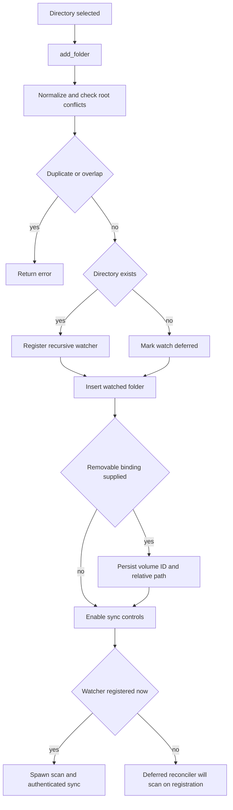
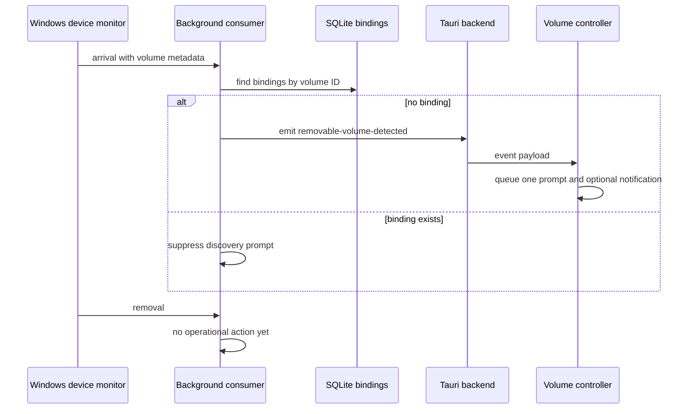

# Watched Folders and Removable Volumes

A **watched folder** is a persisted local root, optionally associated with an Immich target album. Persistence is deliberately independent of filesystem availability: an offline root remains configured and is retried later. The folder list is the durable source of truth; `WatcherState` is only the current recursive `notify` registration.

## User entrypoints and registration

The dashboard's add button opens the native directory picker. After the user selects an album or no album, the frontend invokes the Tauri `add_folder` command and refreshes the displayed list. An empty or whitespace-only album ID is stored as no target album. `FolderList.svelte` renders the configured path, final path component, optional resolved album name, and a remove control; it does not expose watcher health or removable bindings.

`register_watched_folder` follows a deliberately ordered registration path:

This is the registration and deferred-availability lifecycle. A failure to persist after registering a watcher attempts to unwatch it; a failure to persist an optional removable binding removes the just-created folder and un-registers its watcher. A path that exists but is not a directory, or that cannot be accessed for a reason other than not found, is rejected. A not-found path is instead accepted, persisted, and logged as deferred.

### Path and overlap invariants

Normalization makes relative roots absolute, lexically removes `.` and `..`, and canonicalizes paths when possible. This retains a usable absolute lexical path for an unavailable folder while resolving aliases for an available one. Windows verbatim prefixes are removed; component comparison is case-insensitive on Windows. Before persistence, a candidate cannot be equal to, below, or above any configured root. The component-based test means a similarly prefixed sibling such as `Photos-Vacation` does not conflict with `Photos`.

The scanner repeats overlap protection for multi-root scans: it normalizes and sorts roots by component depth, retains the first parent, reports suppressed child roots, and deduplicates discovered file paths. This protects startup and recovery scans even if older database contents predate the command-side guard.

## Scanning and watcher reconciliation

Folder scans run on a blocking worker through `WalkDir`. They recurse below the root, accept only supported media extensions, and collect path, size, and modification time into assets. Hidden names and the NAS metadata directories `@eaDir`, `@SynoResource`, and `#recycle` are excluded; Windows hidden attributes are also excluded. Per-entry traversal and metadata errors become file failures rather than aborting all discovery. The scan result is passed into the synchronization workflow only when authentication permits it.

At startup, Lymic attempts to register every persisted root. An unavailable one is retained and reported rather than removed. A background task then polls all configured roots every 30 seconds. For each root, reconciliation stops an existing watch when it is unavailable, registers an available but unregistered root recursively, and leaves an already-registered root alone. Newly registered roots are logged, scanned, and sent through authenticated synchronization.

The filesystem callback forwards only create and modify events to a bounded channel. The consumer coalesces events for two seconds and uses path scanning to build a deduplicated asset/failure batch. Remove and access events are ignored. An ambiguous event, a `notify` backend error, or channel saturation marks a rescan as required; after the debounce period, the consumer clears its incremental buffers and scans all persisted roots instead. This favors a complete reconciliation over trusting a lossy event stream.

## Removing a root and cancelling work

Removal is a two-step UI interaction when the root has active coordinator work or stored sync work. The first `remove_folder` call returns `requiresSyncCancellation`; the frontend shows a warning and repeats the command with `confirmCancellation: true` only after confirmation. Without work, removal proceeds immediately.

For a known root, the backend un-registers the watcher **before** cancelling in-memory work and deleting path-scoped queued and unsynchronized state, so the watcher cannot create fresh work while cleanup proceeds. The database cleanup uses path components, preserving sibling roots. If cleanup fails, the command tries to reconcile the watcher back to the root's current availability. If deleting the persisted folder fails, it likewise tries to restore watching and logs an error if restoration fails. Once removal completes, the tray sync affordance is enabled only if at least one persisted folder remains.

## Removable volumes: implemented boundary and current gap

The schema has a one-to-one `removable_watched_folders` binding keyed by watched-folder ID. It stores a stable `volume_id` and a volume-relative path and cascades away when the watched folder is deleted. The reusable registration function can create this binding after persisting a folder and compensates by removing the folder if binding persistence fails, but the current public `add_folder` command and dashboard add flow never provide a binding. Consequently, the stored binding is an implementation foundation rather than a user-reachable “watch this card” feature.

On Windows, a dedicated device-message thread reacts to removable-drive arrival and removal notifications. It ignores fixed drives; for a removable drive it derives a volume GUID, mount path, and display name, then sends a `VolumeEvent`. At application startup the monitor feeds a volume-event consumer:

This shows the currently implemented detection behavior, not automatic remapping. A known volume suppresses the discovery event, but arrival does not reconstruct its absolute root, re-register its watcher, or scan it. Removal is explicitly a no-op pending watcher unregistration and queue-state handling. macOS and Linux currently select default monitors whose `start` method does nothing, so this runtime detection path is Windows-specific.

The frontend listens for `removable-volume-detected`, suppresses duplicates and volume IDs dismissed during its lifetime, queues remaining prompts, and sends a desktop notification only while the app is in the background and notification permission is already granted. It unsubscribes when destroyed.

## Change and test guide

Keep command-side root validation and scanner-side overlap handling aligned: the former prevents new conflicting configuration while the latter makes bulk scans safe for existing data. Changes to watcher event classification must retain the overflow-to-full-rescan fallback. Changes to removal ordering must keep unwatching ahead of cancellation/cleanup and preserve best-effort watcher restoration on failure.

Focused Rust tests cover duplicate, parent, child, and prefix-sibling conflict cases; watcher registration/deferred/re-registration behavior; hidden and NAS metadata exclusion; scan overlap deduplication; watcher queue overflow; and unknown-versus-known removable-volume arrivals. Frontend controller tests cover the `add_folder` payload and the remove-confirmation retry. For synchronization of scanned results and upload semantics, see [Synchronization Workflow](synchronization.md). Related persistence and IPC details are in [Local Persistence and Recovery](../data/local-state.md) and [Frontend State and Tauri IPC](../frontend/ui-and-ipc.md).
