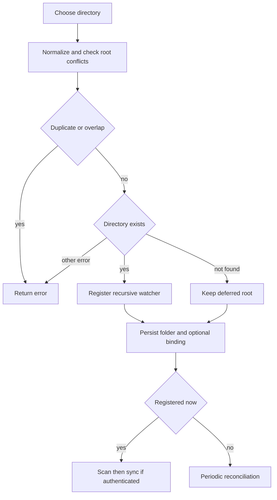
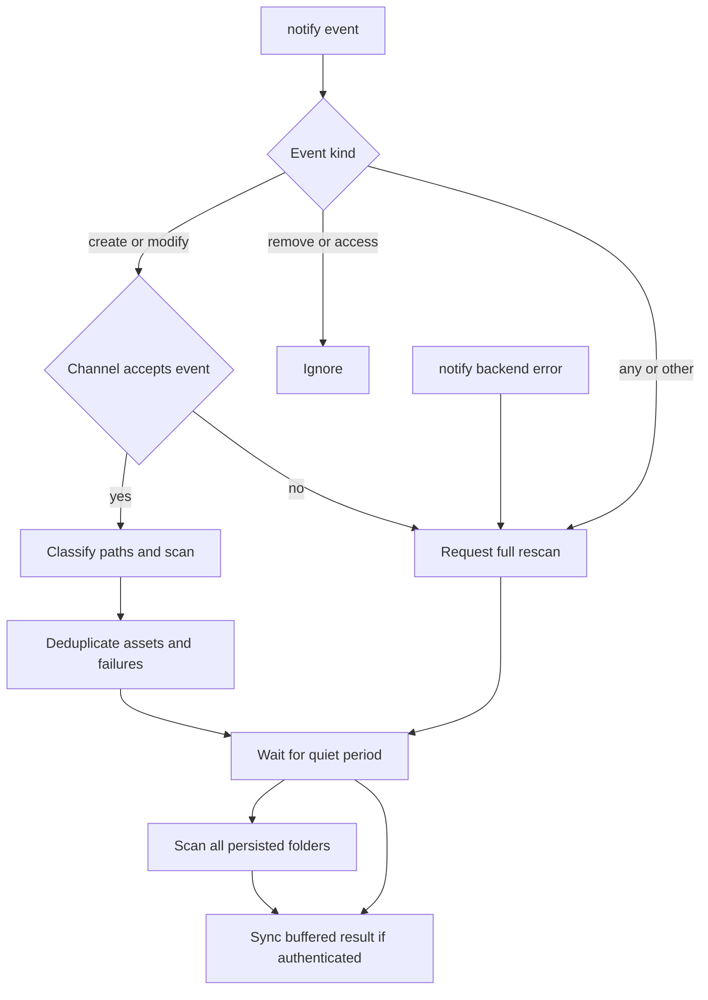
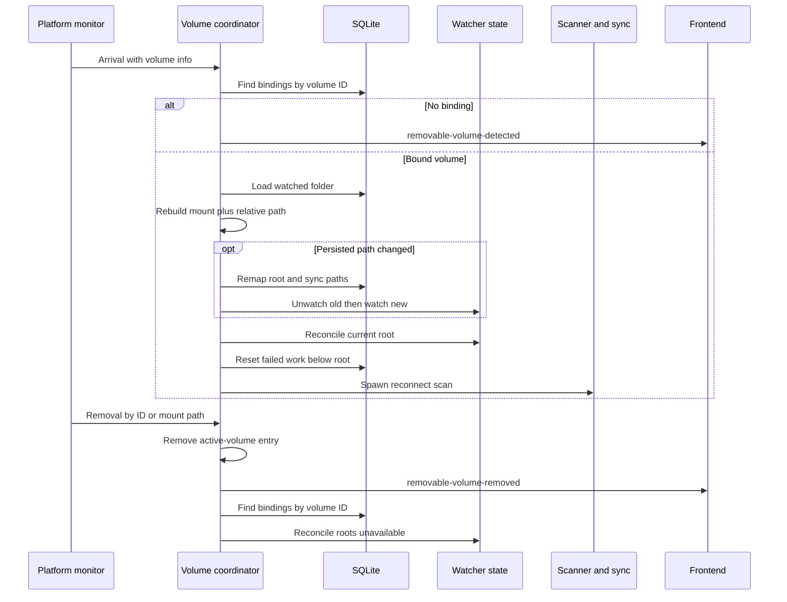

# Watched Folders and Media Discovery

A watched folder is a durable local root, optionally associated with an Immich target album and exclusion patterns. The database is the source of truth for configured roots; `WatcherState` only represents active recursive `notify` registrations. Consequently, an offline path can remain configured even when it cannot be watched or scanned.

## Adding and configuring a root

The dashboard selects a directory, optionally selects an album, and calls `add_folder`. For removable-media prompts, the same album dialog ultimately calls `accept_removable_media_folder`. Blank album identifiers are treated as no target album.

`register_watched_folder` normalizes the candidate and compares paths by components (case-insensitively on Windows). It rejects an equal root and either parent/child overlap, while allowing prefix siblings such as `Photos` and `Photos-Vacation`. A path that exists but is not a directory, or cannot be accessed, is rejected. `NotFound` is different: the folder row is persisted as a deferred root.

This is the registration and deferred-recovery decision flow. Watcher registration happens before database insertion for an available root; if insertion fails, the command attempts to unwatch it. If a removable binding cannot be written after the folder row is created, it removes that row and unregisters the new watch. A persisted root enables the tray sync action even when it is unavailable.

### Exclusions

Each folder persists a JSON list of relative patterns. The update command trims entries, drops blanks and case-insensitive duplicates, and rejects absolute paths, backslashes, `..`, `?`, character or brace classes, and negation. The supported matching language is case-insensitive relative path matching with `*` within a segment and `**` across segments. Updating patterns immediately rescans that folder and submits the result to authenticated synchronization.

Exclusion is applied consistently to full scans, event-driven scans, and failed-item retry preparation. It applies to an entire live-photo upload unit: excluding either a still or its sibling video suppresses both, rather than allowing a partial upload.

## Discovery by scan

Full scans run in a blocking worker. They recursively traverse the non-overlapping watched roots, identify supported media, and produce assets with path, size, and modification time; metadata and traversal failures are retained as individual failures rather than aborting the whole result. The scanner skips hidden path components, Synology directories `@eaDir`, `@SynoResource`, and `#recycle`, and Windows hidden files or directories. It deduplicates file paths across roots and reports overlap so callers can log stale or otherwise invalid configurations.

A scan first applies the selected root's patterns during traversal, then removes any asset whose most-specific watched root excludes it or a live-photo sibling. This second pass makes nested-root and upload-unit policy consistent even when old overlapping rows exist.

## Watcher events and synchronization

A callback receives `notify` events. Create and modify events enter a bounded channel; remove and access events are intentionally ignored. `Any`, `Other`, backend errors, and a failed `try_send` mark the event stream dirty and notify the consumer. The notification retains a permit, so an overflow while the consumer is idle is not lost.

This flow shows the loss-tolerant path from filesystem events to synchronization. The consumer debounces for two seconds, resetting the timer as events arrive. Directory events scan their most-specific watched folders once; media-file events include existing live-photo siblings. Assets and failures are keyed by path in buffers. When the dirty flag is set after the quiet period, the consumer clears incremental buffers, scans every persisted folder, and replaces them with that authoritative result before calling `sync_scan_result_if_authenticated`. Thus an ambiguous or lossy event stream cannot be treated as a complete incremental update.

At startup, a delayed startup scan processes all persisted roots. Separately, a 30-second task checks every configured path and reconciles it with `WatcherState`: unavailable paths are unwatched without deleting their rows, and newly available paths are recursively registered. Only roots newly registered by this deferred task are scanned and passed to synchronization.

## Removing a watched folder

Removal is deliberately two-step. An unconfirmed `remove_folder` call only reports whether the root has active coordinator work or stored sync work. The frontend presents a sync-cancellation-specific warning when appropriate, then retries with `confirmCancellation: true` only after confirmation.

The confirmed operation unregisters the root before it cancels active work and discards queue and sync-state data scoped to that component-aware path. It then deletes the folder. If cleanup fails, it reconciles the watcher with the path's current availability; if deleting the folder fails, it similarly attempts to restore watching. A removable binding is removed through the database foreign-key cascade. After removal, the tray action is enabled only if another persisted folder remains.

## Removable volumes

A removable binding associates a watched-folder ID with a stable `volume_id` and a volume-relative path. A standard `add_folder` automatically creates such a binding if the selected path lies under an active removable mount, choosing the deepest matching mount. Explicit acceptance additionally requires that the volume is currently connected, that no binding already exists for its ID, and that the selected path is inside its mount.

This sequence shows coordinator decisions for recognized and unrecognized removable volumes.

On a known arrival, the coordinator suppresses the discovery prompt, reconstructs each path from the current mount and stored relative path, and remaps changed paths transactionally. The remap updates the watched folder plus matching `sync_state.local_path`, `sync_queue.local_path`, `sync_queue.upload_unit_id`, and `sync_jobs.current_path`. It then reconciles the watcher, resets failed queue and state entries under that folder to pending, and asynchronously scans with source `removable_media_reconnect`.

On removal, the coordinator resolves an ID from the active registry when possible, clears the active entry, emits `removable-volume-removed`, and unwatches each bound root by reconciling it as unavailable. Folder and binding rows are retained for a future arrival.

Windows supplies the implemented monitor: a device-message loop recognizes removable drives, derives stable volume information on arrival, and sends removals by drive mount path. The macOS and Linux monitors currently have no-op `start` implementations, so they do not independently generate volume events.

## Change and test guidance

Preserve the distinction between persisted configuration and live watcher state. Changes to watcher dispatch must retain the dirty-flag full-rescan fallback; changes to scanner policy must apply equally to bulk, event, and retry paths, including live-photo units. Changes to removal must retain unwatch-before-cleanup and restoration attempts.

Focused tests cover root duplicate, parent, child, and prefix-sibling validation; watcher forwarding, ambiguous-event and queue-overflow recovery; recursive exclusions and event exclusions; live-photo exclusion; removable acceptance bounds and active-volume tracking; changed and unchanged remounts, remapping, failed-work reset, and removal preservation. See [Synchronization Workflow](synchronization.md) for the result-to-queue pipeline, [Local Persistence and Recovery](../data/local-state.md) for durable state, and [Frontend State and Tauri IPC](../frontend/ui-and-ipc.md) for command wiring.
