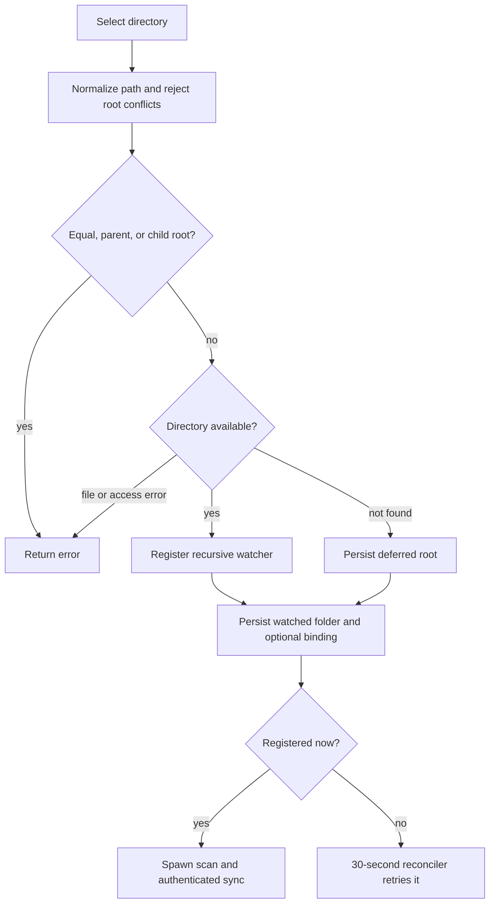

# Watched Folders and Removable Volumes

A **watched folder** is a persisted local root with an optional Immich target album. The database configuration is the durable source of truth; `WatcherState` is only the current set of recursive `notify` registrations. Thus an unavailable root remains configured and can resume watching later.

## Registration and root invariants

The usual dashboard flow opens a native directory picker, then an album-selection modal, and invokes `add_folder`. Empty or whitespace-only album IDs become no target album. `register_watched_folder` normalizes and validates the proposed root before it persists anything:

This is the registration path for both ordinary folders and accepted removable folders.

Normalization makes a root absolute, removes lexical `.` and `..` components, and canonicalizes when possible. That preserves a usable absolute path for an offline folder while resolving available-path aliases. Comparisons are component based (and case-insensitive on Windows), so duplicate roots and parent/child pairs are rejected, but `Photos` and `Photos-Vacation` are siblings rather than conflicts. Scanner-side multi-root handling repeats the overlap protection, so old or otherwise invalid configuration cannot cause duplicate discovery during bulk scans.

An existing non-directory and an access error are rejected; a `NotFound` error is retained as a deferred watch. For an available root, watcher registration precedes persistence. If persistence fails, the command attempts to undo that registration. Once a folder is persisted, the tray sync action is enabled even if the path is currently offline. An immediately registered root is scanned asynchronously and handed to synchronization only when authentication permits it.

## Watching, scanning, and event recovery

`WatcherState` keeps a set of registered paths and makes reconciliation idempotent: availability registers a missing path recursively, an already registered path is unchanged, and unavailability stops watching it. Unwatch treats `WatchNotFound` as success and removes the path from its state.

At startup, persisted roots are reconciled without deleting unavailable entries. A background task checks all roots every 30 seconds; it unregisters paths that disappeared and registers paths that appeared. Only newly registered paths are logged, scanned, and passed into authenticated synchronization.

Scans run on a blocking worker using recursive traversal. They collect supported media with path, size, and modification time; exclude hidden paths and the `@eaDir`, `@SynoResource`, and `#recycle` metadata directories (plus Windows hidden attributes); record per-entry errors as failures; and deduplicate assets across scan roots.

The watcher callback forwards only create and modify events to a bounded channel. The consumer debounces events for two seconds, path-scans them, and builds a deduplicated batch. Remove and access events are ignored. An ambiguous event, a watcher/backend error, or channel saturation instead requests a full scan of every persisted root after the debounce interval; incremental buffers are discarded. This is deliberately a correctness fallback for a lossy event stream.

## Removing a folder

`remove_folder` is a two-step protocol. A request without `confirmCancellation: true` performs no deletion: it reports whether the root has active coordinator work or stored sync work. The frontend then shows either the sync-cancellation warning or the ordinary removal warning and retries with `confirmCancellation: true` only after the user confirms.

For a known folder, the confirmed operation first unregisters its watcher, then cancels in-memory work and discards queued and sync-state data scoped to that root, and finally deletes the folder row. Component-aware path predicates prevent cleanup from reaching sibling roots. If data cleanup fails, it attempts to reconcile the watcher to the path's current availability; if folder deletion fails, it likewise tries to restore watching and logs a restoration failure. Removing the row also removes any removable binding by cascade. The tray sync action is disabled only when no persisted folders remain.

## Removable-volume lifecycle

A removable binding stores a watched-folder ID, stable `volume_id`, and a path relative to that volume's mount point. The binding is one per watched folder and cascades on folder deletion. The standard `add_folder` command also checks the in-memory active-volume registry: when its selected path lies within a tracked removable mount, it selects the deepest matching mount and persists the corresponding volume-relative binding.

For the discovery prompt, the frontend first asks the user to choose a directory rooted at the volume mount, then uses the same album modal. Confirmation calls `accept_removable_media_folder(volumeId, path, targetAlbumId)`. The command rejects a disconnected volume, a volume already bound to a folder, or a selected path outside its mount; otherwise it calculates the relative path and delegates to ordinary watched-folder registration. If writing that binding fails after folder persistence, registration compensates by deleting the folder and unregistering its watcher.

```mermaid
sequenceDiagram
    participant Monitor as Platform Monitor
    participant Coordinator as Volume Coordinator
    participant Database as SQLite
    participant Watcher as Watcher State
    participant Scanner as Scan and Sync
    participant Frontend as Frontend

    Monitor->>Coordinator: Arrival volume
    Coordinator->>Database: Find bindings
    alt No binding
        Coordinator->>Frontend: Emit detected event
    else Bound volume
        Coordinator->>Coordinator: Rebuild bound path
        opt Path changed
            Coordinator->>Database: Remap persisted paths
            Coordinator->>Watcher: Unwatch old root
        end
        Coordinator->>Watcher: Reconcile current root
        Coordinator->>Database: Reset failed items
        Coordinator->>Scanner: Spawn reconnect scan
    end
    Monitor->>Coordinator: Removal volume ID or mount path
    Coordinator->>Coordinator: Clear active volume
    Coordinator->>Frontend: Emit removed event
    Coordinator->>Database: Find bindings
    Coordinator->>Watcher: Reconcile bound roots unavailable
```

This shows arrival and removal handling after a platform monitor has emitted a volume event.

For a known arrival, the coordinator suppresses the discovery prompt. It reconstructs each bound path from the current mount path and stored relative path. If this differs from the persisted root, it atomically remaps the watched folder and path-scoped `sync_state`, `sync_queue` (including upload-unit IDs), and current job path before watcher reconciliation and the reconnect scan. For an unchanged mount it still reconciles the watcher.

Before triggering that scan, reconnect resets only failed queue and sync-state entries whose local paths are the bound folder or its descendants to `PENDING` and clears their failure reasons. If one or more queue rows changed while the singleton job was idle, it changes that job to `RUNNING`. The scan is asynchronous and uses the `removable_media_reconnect` source.

On removal, the coordinator resolves the volume ID from the active registry when possible, removes it from that registry, emits `removable-volume-removed`, and reconciles each bound root as unavailable. It retains the folder and binding records so a later arrival can recover them. If watcher reconciliation fails, handling returns an error to the background consumer, which logs it.

### Platform and UI boundaries

Windows has the implemented device-message monitor: it ignores fixed drives and produces arrivals/removals for removable drives with volume metadata. macOS and Linux select platform monitor implementations whose `start` methods are currently no-ops, so they do not independently generate this runtime event stream.

The frontend queues at most one prompt for an undismissed volume ID, removes a prompt when a removal event matches either its ID or mount path, and remembers dismissals for the controller lifetime. It optionally sends a desktop notification only while the application is in the background and permission is already granted. Destroying the controller unregisters both Tauri listeners. The prompt's Sync action enters the selection-and-acceptance flow; after successful acceptance, the dashboard removes the prompt and refreshes its folder list.

## Operational and test guide

Keep command-side root validation aligned with scanner-side overlap filtering. Changes to watcher event handling must retain the overflow/error-to-full-rescan path, and changes to removal must preserve unwatch-before-cancellation cleanup and best-effort watcher restoration.

Focused Rust tests cover duplicate, parent, child, and prefix-sibling roots; unavailable/re-registered watches; event-channel overflow and ambiguous events; removable acceptance bounds and existing bindings; active-volume tracking; changed and unchanged remounts; path remapping; failed-work reset; and removal preserving database rows while unwatching. Frontend controller behavior covers volume prompt deduplication, notification conditions, cleanup, removable acceptance invocation, and remove-confirmation retry. For scan result synchronization, see [Synchronization Workflow](synchronization.md). Related persistence and IPC details are in [Local Persistence and Recovery](../data/local-state.md) and [Frontend State and Tauri IPC](../frontend/ui-and-ipc.md).
