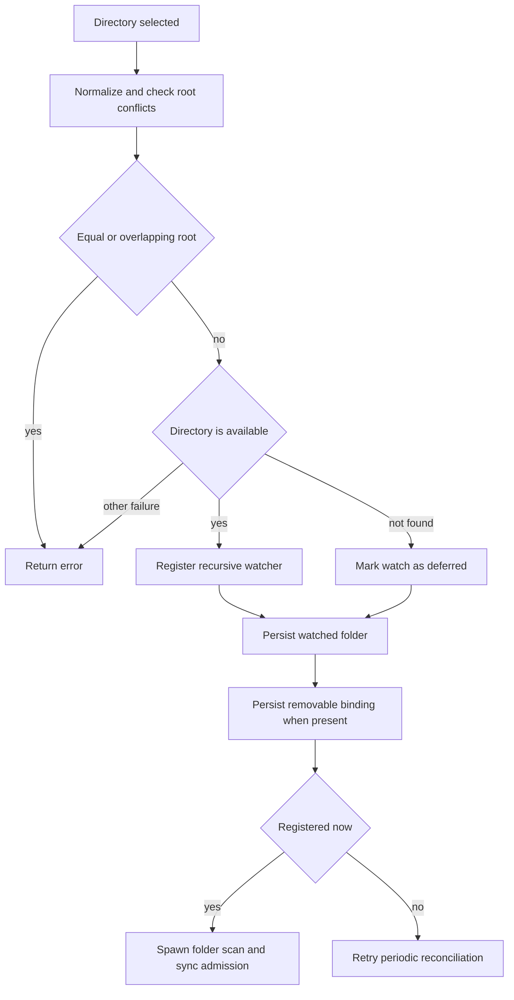
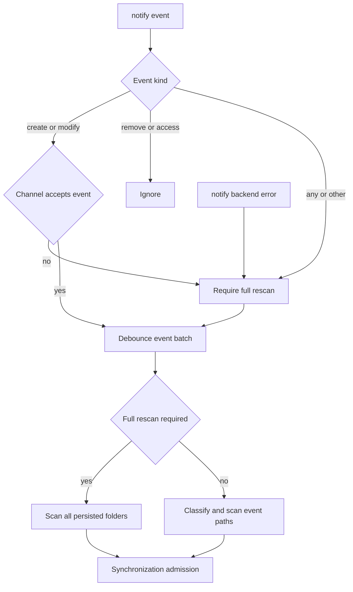
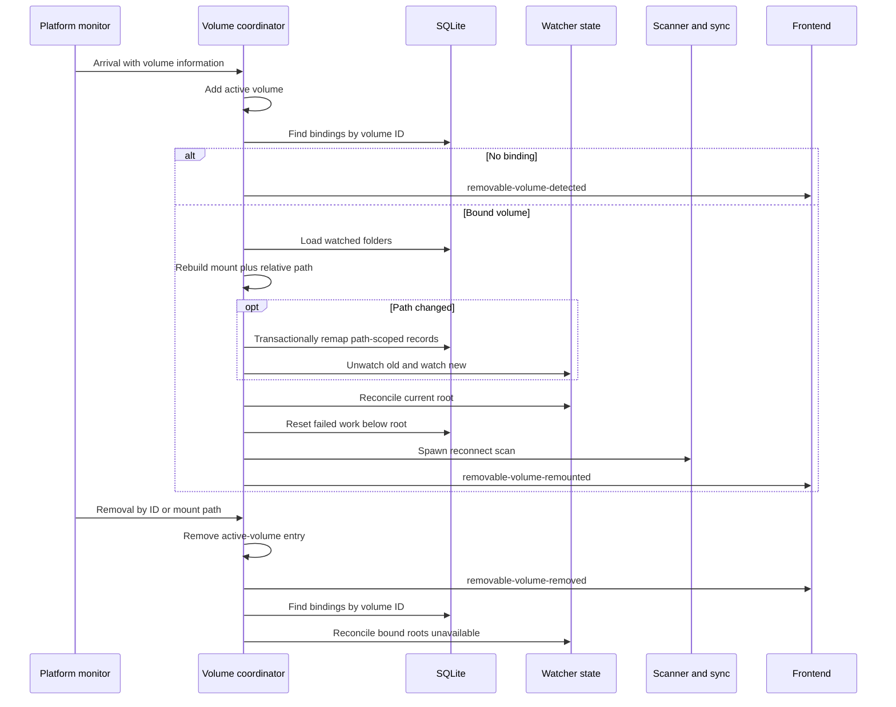

# Watched Folders, File Events, and Removable Media

A watched folder is durable configuration in SQLite: a root path, optional target album, and exclusion patterns. The native `WatcherState` is deliberately separate and represents only currently active recursive registrations. An unavailable folder therefore remains configured but is neither watched nor scanned until reconciliation can register it.

## Registration, validation, and compensation

The Tauri commands `add_folder` and `accept_removable_media_folder` both delegate registration to `WatchedFolderRegistration`. It sanitizes a blank album ID to no album, lexically normalizes the candidate, and compares path components rather than string prefixes. Equal paths and parent/child roots are rejected, whereas prefix siblings such as `Photos` and `Photos-Vacation` are valid. Comparison is case-insensitive on Windows through the path-normalization helpers.

This is the folder-registration path, including the deliberate deferred-watch branch.

The path must be a directory when it exists; inaccessible paths fail, but `NotFound` is accepted as a deferred root. For an available root, watcher registration precedes persistence. If persistence fails, registration is undone; if writing a removable binding fails, the newly created folder is removed and its new watch is undone. Once the folder is durable, sync is enabled even for a deferred root. An immediately registered root is scanned asynchronously with `SyncSource::FolderAdded`; a deferred root waits for successful reconciliation.

### Exclusions and scan admission

Exclusion patterns are stored as JSON per folder. The update command normalizes patterns, rejects invalid syntax, returns an error for an unknown folder, then scans the updated root and sends the result to synchronization admission with `SyncSource::ExclusionPatternsChanged`. The supported relative pattern language admits names plus `*` and `**`; normalization trims values, removes blanks, and deduplicates case-insensitively.

Full scans run in a blocking worker. They traverse non-overlapping roots, collect supported media with size and modification time, retain per-entry metadata or traversal failures, and deduplicate assets by path. Traversal itself skips dot-hidden components, `@eaDir`, `@SynoResource`, and `#recycle`, as well as Windows hidden filesystem entries; configured exclusion patterns are applied afterwards, not while walking. That admission pass uses the most-specific containing root and evaluates complete upload units, so excluding either component of a live photo suppresses the whole unit. Event-driven scans apply the same admission step after scanning event files or directories, and failed-item retry preparation rechecks admission before probing live-photo siblings.

## Watcher ingestion and unavailable roots

The `notify` callback forwards create and modify events into a bounded channel and ignores remove and access events. Ambiguous `Any` or `Other` events, backend errors, and inability to enqueue a message request a full rescan. The request is an atomic dirty flag plus `Notify`; the notification retains a permit, so an idle consumer cannot miss the reconciliation trigger.

This is the loss-tolerant path from filesystem events to synchronization admission.

`WatcherIngestion` waits for a two-second quiet period, resetting its timer as new inputs arrive. For incremental work, directories resolve to their most-specific watched folders and media files include existing live-photo siblings; files and failures are keyed by path while the batch is assembled. A full-rescan request clears those partial buffers and scans every persisted folder instead. If folder resolution, scanning, or the handoff fails, the consumed batch is retained and retried after a debounce delay rather than silently discarded.

Startup independently performs a delayed scan of persisted roots. A separate 30-second deferred-watch task tests every configured path and reconciles it with `WatcherState`: unavailable paths are unwatched without deleting their rows, and newly available paths are registered. Only paths newly registered by that task are scanned and admitted with `SyncSource::DeferredFolder`.

## Removal and queue cleanup

Folder removal has an explicit confirmation protocol. An unconfirmed `remove_folder` request only reports whether active coordinator work or persisted sync work exists under the component-aware root. The frontend can show a cancellation warning and repeat the call with `confirmCancellation: true`.

On confirmed removal, the backend unwatches first so no new work can be produced for the root, cancels active work, discards queue and sync-state data within the root, then deletes the folder. If data cleanup fails it reconciles the watcher using the path's current availability; if database deletion fails it likewise attempts to restore watching and logs a restoration failure. Deleting a watched folder cascades to its removable binding. The tray sync action is then enabled only if another persisted folder remains, and the successful removal is audit-recorded.

## Removable media binding and reconciliation

A removable binding stores a watched-folder ID, stable `volume_id`, and path relative to the volume mount. Standard `add_folder` detects an active matching mount and selects the deepest match for an automatic binding. The explicit removable prompt path requires that the volume is active, the chosen directory is within its mount, and no folder is already bound to that volume ID before registration proceeds.

This sequence shows arrival, remount recovery, and removal without deleting durable folder configuration.

For a known arrival, the coordinator reconstructs each root from the current mount plus its stored relative path. A changed mount path is remapped transactionally across `watched_folders.path`, `sync_state.local_path`, `sync_queue.local_path`, `sync_queue.upload_unit_id`, and `sync_jobs.current_path`; watcher reconciliation follows the commit. Whether changed or not, the coordinator reconciles the root, resets failed queue and sync-state records below it to pending and clears failure reasons, then asynchronously scans with `SyncSource::RemovableMediaReconnect`. Resetting failed queue entries also moves the singleton job from `IDLE` or `FAILED` to `RUNNING`.

On removal, the coordinator resolves the volume ID from the active registry when possible, clears that active entry, emits `removable-volume-removed`, and reconciles every bound root as unavailable. It preserves both watched-folder and binding rows so a later arrival can recover them.

Windows is the implemented platform monitor. It seeds existing removable drives, consumes device-change messages, uses the Windows volume GUID as the stable ID on arrival, and reports removals by drive mount path. The macOS and Linux monitors currently have no-op `start` implementations, so they do not independently originate volume events. In the frontend, the removable-volume controller deduplicates prompts by volume ID, removes queued prompts on removal, optionally notifies only while the app is backgrounded and permission is granted, and releases all event listeners on destruction.

## Change and test guidance

Preserve the distinction between durable folder configuration and live watcher state. Changes to native event handling must retain the full-rescan fallback and retained-batch retry semantics. Scanner or exclusion changes must apply consistently to full scans, event paths, and retries, including whole live-photo units. Changes to removable recovery must preserve transactional path remapping before watcher reconciliation; removal must preserve bindings and unwatch before queue cleanup.

Focused tests cover duplicate, parent, child, and prefix-sibling roots; registration rollback; watcher forwarding, debounce, overflow, and retry; recursive exclusions and live-photo admission; remount path changes, queue recovery, and binding preservation; and Windows device-event translation. See [Synchronization Workflow](synchronization.md), [Local Persistence and Recovery](../data/local-state.md), [Frontend State and Tauri IPC](../frontend/ui-and-ipc.md), and [Audit Logging](../operations/audit-logging.md) for adjacent responsibilities.
